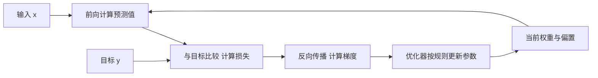

# 模型参数是怎样训练出来的

[← AI Infra 学习路线](README.md)

下载一个模型，拿到的是配置、分词器和权重文件。再给它一批数据继续训练，代码看起来只是反复执行几个步骤。模型到底改了什么，为什么训练还要保存梯度和优化器状态，可以从两个参数的一次更新看起。

这里先讨论通过梯度更新参数的训练过程。人工智能 AI 包含多种方法，大语言模型 LLM 是其中一类。LLM 使用大规模神经网络处理语言，参数则是网络里参与计算、能够通过训练调整的数值。

## 权重和偏置都是参数

先用一个只有单个输入的线性模型做教学示例。

$$
\hat y = wx+b.
$$

$x$ 是输入，$\hat y$ 是预测值，$w$ 是权重，决定输入变化怎样影响预测，$b$ 是偏置，调整预测的偏移。模型只有 $w$ 和 $b$ 两个参数。输入换了一条，参数通常继续沿用，训练才按约定的规则修改它们。

实际网络把许多这样的运算组织成层。一个接收 100 个数、输出 100 个数的全连接层，如果每个输出都有独立偏置，就有 $100\times100+100=10100$ 个参数。[PyTorch 的线性层定义](https://docs.pytorch.org/docs/stable/generated/torch.nn.Linear.html)给出了权重与可选偏置的形状。矩阵里每个可训练数值分别计数，整个矩阵不能只算一个参数。

模型中还有嵌入表、归一化参数等，并非每层都设置偏置。公开权重文件通常把这些数值按张量保存，张量可以先理解成具有形状的多维数值数组。公开权重也不意味着训练代码、数据与全部处理流程都已公开。

## 一次预测怎样变成一次更新

设定一条样本，输入 $x=2$，目标 $y=10$。初始化 $w=3$、$b=1$，预测得到 7。为了衡量误差，定义平方损失

$$
L=(\hat y-y)^2=(7-10)^2=9.
$$

损失函数把当前预测与训练目标的差异变成一个数。怎样修改两个参数才能降低这个数，需要继续计算梯度，也就是损失对各参数的局部变化率。

对这个例子，利用求导的链式法则，可以得到

$$
\frac{\partial L}{\partial w}=2(\hat y-y)x=-12,
\qquad
\frac{\partial L}{\partial b}=2(\hat y-y)=-6.
$$

偏导数分别观察一个参数变化对损失的局部影响。以 $w$ 的梯度为例，保持其他条件不变，把 $w$ 增加一个很小的量 $\Delta w$，损失变化近似为 $-12\Delta w$。当前两个梯度都是负数，意味着在足够小的范围内，增加相应参数有助于降低损失。梯度没有直接给出最终正确的参数值，也无法保证任意幅度的调整都会有效。

采用最简单的梯度下降，学习率 $\eta$ 设为 0.01，参数按下面的规则更新。

$$
w_{\mathrm{new}}=w-\eta\frac{\partial L}{\partial w}=3.12,
\qquad
b_{\mathrm{new}}=b-\eta\frac{\partial L}{\partial b}=1.06.
$$

更新后的预测为 $3.12\times2+1.06=7.30$，损失为 $7.29$。这一步降低了当前样本的损失，模型仍有两个参数。

学习率决定每次更新的尺度，属于训练配置中的超参数。它通常由训练方案设定或调度，和模型通过梯度学习的权重、偏置需要分开记录。



图中的循环表示多次训练步骤。前向计算产生预测，反向传播沿运算关系计算梯度，优化器负责参数更新。推理通常执行前向计算，不走这个参数更新循环。

## 程序员写计算过程，框架计算梯度

把上面的更新写成普通 Python，可以直接核对每个数。

```python
x, target = 2.0, 10.0
w, bias = 3.0, 1.0
learning_rate = 0.01

prediction = w * x + bias
error = prediction - target
loss_before = error ** 2
grad_w = 2 * error * x
grad_bias = 2 * error

w -= learning_rate * grad_w
bias -= learning_rate * grad_bias
loss_after = (w * x + bias - target) ** 2

print(f"w={w:.2f}, bias={bias:.2f}")
print(f"loss={loss_before:.2f} -> {loss_after:.2f}")
```

输出为 `w=3.12, bias=1.06` 和 `loss=9.00 -> 7.29`。这里手写了两个梯度公式，大网络通常交给自动求导系统处理。[PyTorch 的自动求导教程](https://docs.pytorch.org/tutorials/beginner/basics/autogradqs_tutorial.html)说明了框架怎样记录计算关系，并沿这些关系求出梯度。

程序员仍要定义模型和损失，准备训练数据，组织执行与保存流程。框架减少了手工求导工作，数据是否正确、训练目标是否合适，仍需另行验证。

只有一个线性层时，模型能表达的关系有限。神经网络通常在层间加入激活函数这样的非线性变换。若只把若干线性或仿射变换连续叠加，整体仍可合并成一次相应变换。激活函数让多层网络有能力表示更复杂的关系，具体能学到什么还受数据和训练方法影响。

## 预训练和微调都在更新参数

预训练通常让模型从大规模数据中学习通用模式。常见因果语言模型把文本转换成 token，在多个位置预测后续 token，并根据目标 token 的预测概率计算损失。这里的 token 是词元这种处理单位，和算力单位不同。

微调从已经训练过的模型继续出发，使它适应某种领域、任务或回答要求。全参数微调会更新全部或几乎全部参数；部分参数微调则只更新选定部分。微调并不要求只训练少量参数。

结构固定时，普通训练主要改变参数数值，数量保持不变。7B 约表示 70 亿个参数，训练更多轮不会自动长成 14B。增加层数、调整宽度或改变专家数量，才会改变相应的结构规模。新版本也可以保持原有参数量，通过数据与训练方法改进能力。

## SFT 与 RL 用什么信号学习

监督微调 SFT 使用给定的输入与目标输出继续训练。对常见文本 SFT，模型学习提高目标回答中各 token 的预测概率，通常使用交叉熵损失。交叉熵在这里衡量模型为目标 token 分配的概率是否足够高。[TRL 的 SFT 文档](https://huggingface.co/docs/trl/sft_trainer)解释了这种训练目标及损失计算范围。

强化学习 RL 利用奖励反馈改进模型的生成策略，也就是给定上下文时选择后续 token 的概率分布。奖励可以来自答案检查、代码测试或评分模型。某些方法先生成多份回答，再利用奖励及其他约束构造损失，通过梯度更新参数。[TRL 的 GRPO 实现说明](https://huggingface.co/docs/trl/grpo_trainer)展示了生成、评分和更新之间的关系。

| 训练方式 | 提供的主要学习信号 | 一项需要检查的风险 |
|---|---|---|
| SFT | 输入及示范输出 | 错误示范被学进去，或只记住训练样本 |
| RL | 对生成结果或行为的奖励 | 模型取得高奖励，却没有满足真实目标 |

数学题的正确性奖励仍可能依赖标准答案，SFT 示范也可以由模型生成。区分两者时要看训练目标怎样使用这些信息。给回答打分只完成了反馈环节，真正训练还要把反馈用于参数更新。

## LoRA 决定怎样表示参数改变量

SFT 和 RL 讨论学习信号，LoRA 讨论参数更新的实现方式。它们可以组合使用。

[LoRA](https://arxiv.org/abs/2106.09685)通常冻结原有权重矩阵 $W$，增加两个较小的可训练矩阵 $A$ 和 $B$，用它们的乘积表示改变量。以列向量记法，计算可写成

$$
h=Wx+sBAx,
\qquad W\in\mathbb{R}^{d\times k},\quad
A\in\mathbb{R}^{r\times k},\quad B\in\mathbb{R}^{d\times r}.
$$

$s$ 是缩放系数，$r$ 是较小的秩，也就是中间维度。原矩阵有 $dk$ 个参数，这组适配器有 $r(k+d)$ 个参数。当 $r$ 远小于原矩阵维度时，需要训练和保存梯度的参数数量明显减少。原模型仍参与前向计算，也仍需存放。

[QLoRA](https://arxiv.org/abs/2305.14314)进一步结合基础权重的低比特量化与 LoRA。量化用较少位数表示数值，降低存储开销，通常不改变原矩阵包含多少个参数。LoRA 减少可训练参数，量化减少每个数的表示成本，二者作用不同。

蒸馏还要再分开看。教师模型提供输出分布或经过整理的回答，学生模型利用这些信号学习。DeepSeek 公开的 [R1 蒸馏模型](https://github.com/deepseek-ai/DeepSeek-R1)使用已有 Qwen、Llama 模型继续训练。学生的参数规模通常事先选定，训练调整其数值，效果仍需在独立任务上检验。

## 训练误差下降以后，还要检查什么

前面的两个参数在一个样本上取得更低损失，只能证明这一步对这个样本有效。训练集用于参数更新，验证集用于比较训练配置与选择检查点，独立测试集则用来检查最终效果。反复依据测试结果改方案，也会削弱测试集的独立性。

进入 Infra 预算时，要分别统计模型总参数、可训练参数和运行中间结果。优化器还可能保存动量等跨步骤状态。LoRA 冻结了大部分权重，反向计算仍可能经过冻结的网络部分，激活值与计算开销不能一并忽略。

继续阅读[模型架构怎样决定计算与显存开销](model-architecture-resource-budget.md)，可以把这里的权重矩阵对应到 Embedding、注意力和 FFN；[推理与训练的资源预算](inference-and-training-workloads.md)再把梯度、激活与优化器状态放进实际负载中计算。
