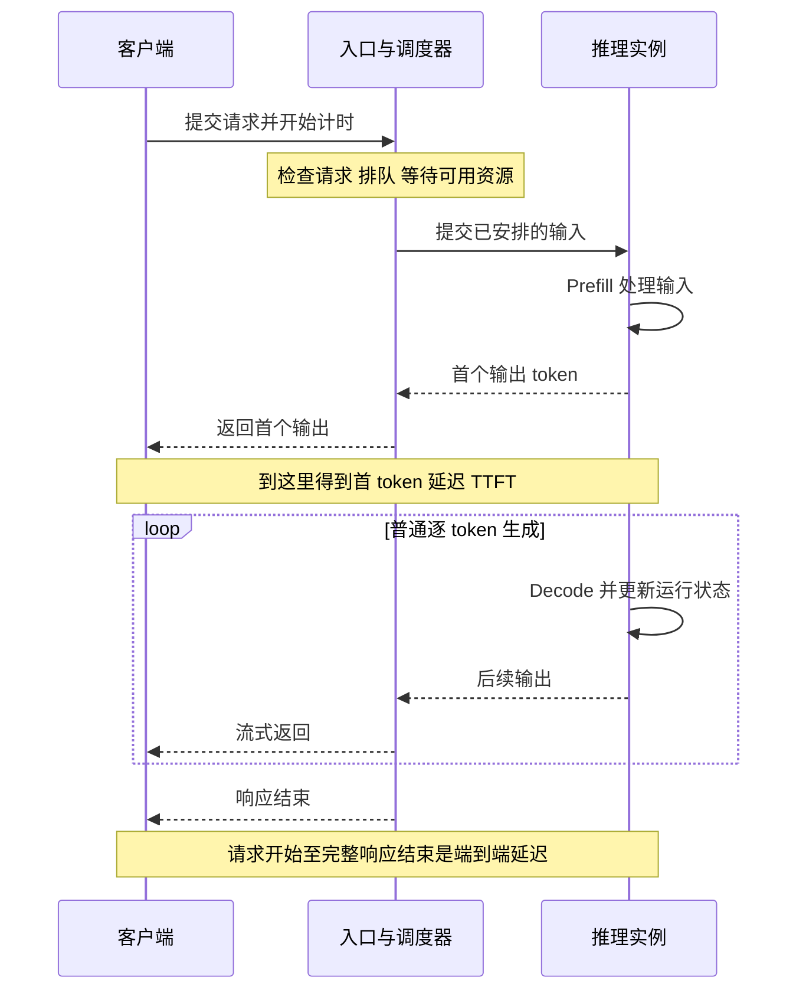
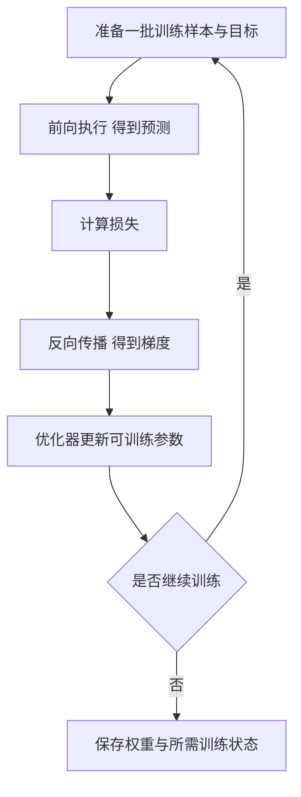

# 推理与训练为什么需要不同的资源预算

[← AI Infra 学习路线](README.md)

同一个模型可以接收一份长文档，返回几句话，也可以接收一句问题，连续生成很长的回答。两次调用即使处理了相近的 token 总数，用户等待的过程和设备承担的工作也可能明显不同。

[上一篇](model-architecture-resource-budget.md)沿模型结构计算权重与上下文状态。这次把时间和请求的到达方式加进来。负载是系统在一段时间内需要处理的工作集合，除了工作总量，还包括哪些工作可以同时执行、哪些必须等待，以及结果需要在什么时候交付。

## 输入 token 和输出 token 要分开统计

Prefill 是模型处理已有输入的阶段。对常见因果 Transformer，同一层可以并行处理多个已知位置，再用掩码限制信息来源。Decode 则在普通逐 token 生成中，利用已有状态处理新位置，继续预测后续输出。

第一轮输出可以来自 prefill 的计算结果。假设一次普通生成返回 101 个 token，首个输出之后还需要推进 100 次 decode。具体系统可能使用推测解码等方法一次验证多个候选，统计执行次数时要以实际路径为准。

两个阶段使用同一组权重，却形成不同的计算形状。长输入让同一权重参与更多输入位置的计算；低并发 decode 每步只为少量新位置计算，仍要读取相关权重与上下文。前者常有较高的计算需求，后者容易受到数据读取速度限制，实际瓶颈还取决于模型、并发和上下文长度。

| 请求变化 | 主要增加的工作 | 需要观察的现象 |
|---|---|---|
| 输入变长 | 输入处理、上下文状态与注意力交互 | 首个输出变慢，KV 占用增长 |
| 输出变长 | 更多生成步骤，状态继续保留或增长 | 完整回答耗时增加，资源更晚释放 |
| 独立请求增多 | 更多并发状态与调度工作 | 排队、缓存容量和吞吐发生变化 |

只报告总 token/s，容易把这几类工作混在一起。至少要分别记录输入处理量和输出生成量，再保留它们在同一条请求中的对应关系。

## 用户等待的几段时间要分别计量

一次请求先到达入口，再等待资源，随后执行输入处理和生成。用户看到第一个输出之前，可能已经经历了多段等待。

首 token 延迟 TTFT 衡量从约定起点到首个输出的时间。起点可以设在客户端发出请求时，也可以设在服务端收到请求时，两种口径会覆盖不同范围，比较时要保持一致。

假设用客户端记录一组教学数据。请求发出后 0.5 秒收到首个 token，2.5 秒收到最后一个，总共生成 101 个 token。那么 TTFT 为 0.5 秒，端到端延迟为 2.5 秒。首末输出之间有 100 个间隔，平均每个输出 token 的时间 TPOT 为

$$
\mathrm{TPOT}=\frac{2.5-0.5}{101-1}=0.02\ \mathrm{s}=20\ \mathrm{ms}.
$$

20 ms 是平均值，过程中仍可能出现明显停顿。流式接口一次事件也可能携带多个 token，事件间隔和 token 间隔需要区分。[vLLM 的指标文档](https://docs.vllm.ai/en/latest/design/metrics/)分别定义了首响应、请求耗时与输出间隔，排查时还可以单独记录排队时间。

只有一个输出 token 时，上面的 TPOT 公式没有可用分母，应单独处理。聚合多条请求时，还要观察较慢请求的表现。例如将 100 条请求的耗时从小到大排列，按最近秩法取第 95 条，就是这组样本的 p95。

## 平均请求量相同，到达方式也会改变结果

均匀到达的请求和集中涌入的请求，可能具有相同的分钟平均量。集中到达时，可用资源却要同时处理更多工作，未完成的部分进入队列。此前空闲的设备时间无法直接留给后面的突发请求。

请求长度也要看分布。平均输入长度相同，一组请求可能全部接近平均值，另一组可能由很多短问题和少量超长文档组成。长请求的处理时间与状态保留，会影响其他请求何时能够开始。

批处理能够复用权重，但会同时增加各请求的计算和状态。推理系统需要在接纳新请求、推进已有生成和控制内存占用之间安排工作。吞吐增加以后，TTFT 和生成过程中的停顿仍需分别检查。

一种具体做法是把长输入分块，让输入处理与其他请求的解码交错执行，称为分块预填充。它能减少一次长输入连续占用执行机会的时间，同时引入调度上的取舍。[vLLM 的调优说明](https://docs.vllm.ai/en/latest/configuration/optimization/)展示了批次预算怎样影响首响应与后续输出间隔。某组参数是否适合业务，需要用对应的请求分布验证。

## Agent 的一次任务可能包含多次模型调用

Agent 先读资料，再调用工具，随后带着工具结果继续请求模型。任务时间因此包含模型计算、工具执行和交接等待。每次调用都很快，也可能因往返次数多而迟迟无法完成任务。

多轮输入还会增长。第二轮请求可能带上第一轮的问题与回答，第三轮再加入工具日志。只统计用户新输入的文字，会低估送入模型的上下文。保留公共前缀并命中可复用缓存，可以省去部分输入重算，但后续查询仍要利用相应的上下文状态。

工具等待期间要分清两种保存。应用可以在普通存储中保留对话文本；推理服务则根据策略决定是否继续保留可复用的 KV。会话还存在，并不保证它的 KV 一直占用 GPU 显存。

若服务选择把某任务的 1 GiB 缓存保留在 GPU 上等待 10 秒，这段时间对应 10 GiB·s 的容量占用。GiB·s 是容量乘以时间，用来描述一份状态占用了资源多久。20 个这样的任务同时等待，需要的即时容量是 20 GiB；它们分别等待 10 秒，累计占用是 200 GiB·s。这里的数字都是设定条件。

释放缓存能腾出容量，下一次调用可能需要重新计算输入。将缓存转移到其他存储，则要付出传输与恢复成本。选择取决于状态大小、预期复用时间和当前资源压力，不能只按会话是否结束决定。

## 训练还要计算误差，再更新参数

推理通常使用固定权重求输出。训练在此基础上增加损失计算、反向传播和参数更新。[PyTorch 的训练教程](https://docs.pytorch.org/tutorials/beginner/basics/optimization_tutorial.html)把这些操作组织成明确的训练循环。

损失是衡量预测与训练目标差异的数值。反向传播计算损失对相关参数的梯度，梯度描述参数变化会怎样影响损失。优化器再利用梯度和自己的更新规则修改参数。

前向产生的一些中间结果，还要在反向时使用，需要保留或届时重新计算。这些中间结果通常称为激活。参数梯度和优化器状态也占用内存，有些状态还要跨多次更新保存。

| 需要预算的数据 | 文本生成推理 | 常规梯度训练 |
|---|---|---|
| 模型权重 | 参与前向计算 | 参与计算，可训练部分会更新 |
| 中间结果 | 按当前执行需要保存 | 部分结果需留给反向，或通过重计算获得 |
| 上下文状态 | 自回归生成常使用 KV 缓存 | 常规训练通常采用不同的状态组织方式 |
| 参数梯度与优化器状态 | 通常不需要 | 按可训练参数和优化器配置保存 |

因此，某张卡能运行一个模型的推理，无法直接证明它能完成同规模的全参数训练。冻结部分参数、改变精度、使用重计算或把状态分摊到多张卡，都会改变训练的容量和执行预算。

## 训练中的文本已知，执行方式也与生成不同

语言模型训练时，可以给出一整段已知文本，让多个位置分别预测它们后面的 token。因果掩码限制信息来源，各位置的计算仍能按层并行推进。它无需像在线回答那样，每选出一个新 token 才知道后面的输入。

监督微调 SFT 使用给定的输入与目标回答继续训练模型。一些训练配置只对回答部分计算损失，输入中的问题和参考材料仍需经过相关计算，为回答提供上下文。参与监督的 token 数，与实际进入模型的 token 数，要分别统计。

SFT 描述学习信号，LoRA 描述参数改变量的表示方式，二者可以组合使用。全参数 SFT 与 LoRA SFT 即使使用相同样本，也会保存不同规模的梯度与优化器状态。冻结权重仍参与计算，激活和数据传输也要继续预算。[参数与训练基础](how-model-parameters-learn.md)用一次数值更新解释了这些区别。

显存不足以一次处理目标训练批次时，还可以分成多个小批次，累计梯度后再更新参数。梯度累积能改变同时保留激活的规模，仍需执行各小批次的前向与反向。它不会让同样多的训练数据凭空少算几遍。

## 强化学习把生成、反馈和更新连接起来

语言模型的某些强化学习方法会先生成回答，再通过规则、测试或评分模型取得奖励，用这些反馈构造训练信号，更新参数。生成样本的过程常称为 rollout。一个训练周期由此包含推理工作，也包含梯度更新。[TRL 的 GRPO 文档](https://huggingface.co/docs/trl/grpo_trainer)给出了回答生成与奖励计算的实例。

所有已经生成和检查的样本都消耗资源，最终进入更新的样本数则取决于训练方法与筛选规则。增加候选数量，会增加生成与评分开销，更新批次未必等比例增长。代码验证还需要 CPU、测试环境和执行时间。

生成端使用独立模型副本时，还需要让它取得相应版本的权重。评分、更新与权重同步之间存在依赖，某个阶段变慢会让其他阶段等待。训练容量应按这些角色实际同时保存的权重、状态和工作区计算。

## 压测要复现业务怎样使用模型

准备负载时，保留请求到达时间、输入长度和实际输出长度，区分短问答、长文档与长生成。多轮任务还要记录模型调用次数、缓存复用情况和工具等待。模型版本、精度、硬件及计时范围保持可追查，比较结果才有共同条件。

吞吐与质量要一起检查。假设一组测试消耗 100 个成本单位，完成 50 个合格任务，每个成功任务分摊 2 单位；另一组消耗 200 单位，完成 80 个，则分摊 2.5 单位。成功率提高了，成功任务成本也可能增加，失败尝试和验证消耗都应进入预算。

评测还要区分对象。模型能力评测检查回答与推理是否正确；RAG 检查检索材料与回答依据；Agent 评测继续检查工具执行及完整任务是否完成。Infra 压测重点观察延迟、吞吐、资源和恢复能力，同时确认系统优化没有破坏业务质量。[Agent 评测文章](../agent-learning-path/agent-evaluation.md)讨论了完整任务与运行过程怎样一起验收。

出现响应变慢时，先把入口等待、输入处理和后续生成分开定位。若计算已经空闲，却仍无法接纳请求，再检查缓存容量与状态驻留。训练任务还要查看数据准备、反向、参数更新和通信，让每项调整对应到实际耗时与占用。
