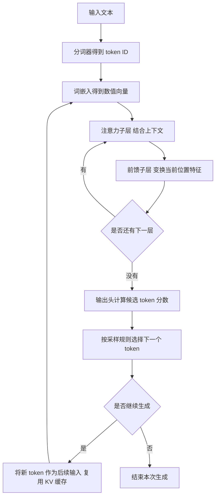
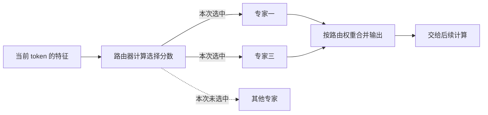

# 模型架构怎样决定计算与显存开销

[← AI Infra 学习路线](README.md)

选模型时，参数量通常最先进入视线。8B 表示大约 80 亿个参数，却没有告诉我们每次生成会用到哪些参数，也没有说明一段对话要保存多少运行状态。参数量相近的两个模型，在长文档和高并发场景下，可能需要不同的部署方案。

[上一篇](what-is-ai-infra.md)用容量、算力和带宽估算模型能否运行。这次继续往里看，追踪一个 token 经过哪些运算，再把这些运算与资源需求对应起来。下面先讨论常见的仅解码器 Transformer，也就是用已有内容预测后续 token 的一类模型结构。

如果还不熟悉参数与训练的关系，可以先读[模型参数是怎样训练出来的](how-model-parameters-learn.md)。大语言模型 LLM 是模型类别，Transformer 是常用结构，下面讨论的注意力和前馈网络则是结构中的计算模块。

## 从文字到下一个 token，中间发生了什么

输入文本经过分词器转换成 token ID。ID 是词元在词表中的编号，本身没有表达完整语义。模型先从词嵌入表中取出对应的向量，也就是一组数，用它作为这个位置的初始表示。

分词结果可能是词、子词或其他文本片段，不一定对应一个完整汉语词语。token ID 为模型提供统一的离散索引，编号大小没有语义远近之分。token 用来统计输入输出长度，也会影响资源消耗，但本身并非算力单位。

这里的词嵌入层与检索中使用的文本 Embedding 模型处于不同层级。前者把 token ID 映射为初始向量；后者通常接收文本，内部经过分词、嵌入和上下文计算，再汇总出用于比较文本的向量。向量数据库主要负责保存和检索这些表示，向量生成需要相应模型或编码服务。[PyTorch 的嵌入层说明](https://docs.pytorch.org/docs/stable/generated/torch.nn.Embedding.html)与 [Sentence Transformers 的编码接口](https://www.sbert.net/docs/package_reference/sentence_transformer/model.html)分别对应这两个使用层级。

这组数随后经过多层计算。注意力子层结合上下文信息，前馈子层继续变换每个位置的特征。末层表示经过输出头，得到词表中各候选 token 的分数，称为 logits。生成程序再根据分数和采样规则选择下一个 token。

图中省略了归一化和残差连接，突出主要数据流。每层通常有自己的权重，同一个位置经过下一层时，会执行新的变换。图里的层间循环也与生成循环不同，前者在一次前向执行中推进网络深度，后者把已经选出的 token 送回模型，继续生成。

前向执行指使用当前权重从输入计算到输出。它产生下一步的候选分数，分数如何转换成输出，还受采样设置和停止条件影响。

## 注意力怎样利用上下文

每个位置的表示会通过不同的权重变换，得到查询 Q、键 K 和值 V。它们都是数值向量，承担不同用途。

在一层的一组投影中，可以把这些变换写成 $Q=XW_Q$、$K=XW_K$、$V=XW_V$，$X$ 表示各位置进入该子层的特征。三个权重矩阵通过训练学习，同一组矩阵用于该层的不同位置。独立投影让匹配关系与传递内容可以学习不同的变换，三组向量并非三份原输入的直接复制。

Q 用来与允许访问位置的 K 计算匹配分数。分数经过缩放与归一化，形成一组加权系数，再用这些系数汇总 V。当前位置由此取得上下文信息，继续交给后续运算。

这些加权系数随输入变化，和训练后保存在模型中的权重参数有区别。注意力也可能同时利用多个位置，不能把它理解成一定找到一句话再原样取回。

因果注意力限制当前位置只能使用自身和此前位置的信息。模型可以通过位置编码区分顺序，例如旋转位置编码 RoPE 会把位置信息引入查询与键的计算。具体变换方法会随模型结构变化。

注意力头是在不同数值子空间中执行这类计算的分组。多个头各自产生查询和输出，再将结果合并。头数、每个头的宽度，以及它们怎样共享 K 和 V，都会改变矩阵形状与状态大小。

多头与可见范围是两项不同设置。多个头可以都使用因果掩码，也可以在其他模型里访问双向上下文。不能把它们固定分成只看前文和只看后文的两组，语法、指代等分工也通常没有人工指定。注意力系数用于汇总特征，词表候选的预测概率则来自后续输出计算。

## 前馈网络也要读取权重、执行计算

注意力完成位置之间的信息交互后，前馈网络 FFN 对每个位置分别执行特征变换。FFN 是 Feed-Forward Network 的缩写；FNN 也常用来指前馈神经网络这一类网络，本文用 FFN 表示 Transformer 的前馈子层。常见实现先把向量变宽，经过非线性变换或门控，再映射回主干宽度。门控用计算得到的系数调节中间特征。

这些变换通常包含较大的权重矩阵。模型有多少层、向量有多宽、中间维度有多大，会直接影响参数量和计算量。注意力之外的工作同样要计入资源预算。

以一次普通矩阵乘法为例，输入有 $m$ 行、$k$ 列，权重有 $k$ 行、$n$ 列。权重包含 $kn$ 个数，主要计算量约为 $2mkn$ 次浮点运算，其中一次乘法和一次加法分别计数。

同一个模型处理更多输入时，$m$ 增大，计算量增加，权重矩阵的大小保持不变。改变模型宽度则会改变 $k$ 或 $n$，连同权重占用一起变化。这能解释批处理为何有机会复用权重，也说明矩阵形状会影响实际执行效率。

子层周围还有归一化与残差连接。归一化调整数值尺度，残差连接把子层输入加到变换结果上。用于相加的输入需要保留到结果产生，临时数据何时创建、何时释放，也因此受到计算关系约束。

## KV 缓存省掉了什么，又要保存多少

模型继续生成时，过去位置不能看到后来出现的 token。在权重、位置和计算条件一致时，过去位置已经算出的 K、V 可以继续使用。新一步计算当前查询，再读取这些缓存，便能省去旧位置的大量重复计算。[Hugging Face 的缓存说明](https://huggingface.co/docs/transformers/main/en/cache_explanation)展示了这种逐步追加和复用过程。

旧位置的 Q 通常无需为后续生成长期保存。后续位置会产生新的 Q，用它重新查询已有 K、V。缓存也没有消除全部注意力工作，新查询仍然需要取得上下文信息。

对于每层都保存完整 K、V 的常规实现，可以先用下面的式子估算单条请求的 KV 数据大小。

$$
M_{\mathrm{KV}} = 2 \times L \times S \times H_{\mathrm{KV}} \times D \times b.
$$

$L$ 是层数，$S$ 是已缓存的 token 数，$H_{\mathrm{KV}}$ 是每层 KV 头数，$D$ 是每头维度，$b$ 是每个数占用的字节数。开头的 2 对应 K 和 V 两份数据。

可以对照 [Qwen3-8B 的公开配置](https://huggingface.co/Qwen/Qwen3-8B/raw/main/config.json)做一笔计算。该配置有 36 层、8 个 KV 头，每头 128 维。假设 KV 全部用 BF16 这种 16 位浮点格式保存，每个数占 2 字节，每增加一个缓存 token，需要

$$
2 \times 36 \times 8 \times 128 \times 2 = 147456\ \mathrm{bytes} = 144\ \mathrm{KiB}.
$$

KiB 等于 1024 字节，GiB 等于 $2^{30}$ 字节。8192 个缓存 token 对应 1.125 GiB 的 KV 数据。八条同样长、彼此独立且不共享缓存的请求，合计就是 9 GiB。模型权重和运行工作区还要另算。

这些数字是按配置推导的数据量，没有包含缓存分块的空余空间、管理开销或框架预留。改变 KV 精度、共享前缀或转移缓存位置后，GPU 显存中的实际占用也会改变。

## 输入处理能并行，生成仍有先后依赖

Prefill 处理的是已经给定的输入。对因果 Transformer，同一层可以并行处理多个已知位置，再用因果掩码屏蔽未来位置的信息。各层仍要等待所需的上一层结果，但已有输入无需逐字串行计算。

普通自回归生成的下一个输入尚未确定，必须等前一个输出选出来，再继续执行。所以输入处理与逐 token 解码即使使用同一组权重，也会形成不同的计算形状和等待。

输入长度还会改变注意力的工作量。对于完整因果注意力，处理长度为 $S$ 的已知输入时，有效位置配对数为 $S(S+1)/2$。输入长度翻倍，这部分配对工作大约变成四倍；前馈网络逐位置执行，主要工作则约增至两倍。整次请求的耗时需要把各部分放在一起测。

使用 KV 缓存的普通解码步骤，只为新位置执行投影和前馈变换，随后访问已有上下文。上下文变长，会增加完整注意力的查询范围。长输入、长输出和大量并发，分别增加不同项目，压测时需要单独记录。

## GQA 改变的是 KV 的共享方式

多头注意力可以为每个查询头分别保存一组 K、V。分组查询注意力 GQA 则把查询头分组，让一组查询共享 KV。多查询注意力 MQA 进一步让所有查询头共用一组 KV。[Transformers 的配置说明](https://huggingface.co/docs/transformers/model_doc/qwen3)区分了这几种关系。

固定四个查询头，可以用一个小例子比较。

| 结构 | 查询头数 | KV 头数 | 共享关系 |
|---|---|---|---|
| 多头注意力 MHA | 4 | 4 | 每个查询头对应自己的 KV |
| 分组查询注意力 GQA | 4 | 2 | 每两个查询头共用一组 KV |
| 多查询注意力 MQA | 4 | 1 | 四个查询头共用一组 KV |

上下文长度、层数、头维度与精度相同时，这个例子的 KV 数据量比例为 4 比 2 比 1。查询头仍各自计算分数，共享 KV 并不意味着所有注意力计算都按同样比例减少。

这是一项模型结构选择，涉及训练得到的权重和表达方式。已有模型使用哪种结构，需要查配置与实现。部署时直接删掉几个 KV 头，会改变计算，不能用来等价替换原模型。

其他结构还可能使用局部窗口、压缩表示或递推状态，改变历史信息的保存与访问方式。前面的完整 KV 公式需要按相应层的结构改写，不能只看模型名称里的参数量就套用。

## MoE 把总参数与每次参与的参数分开

稠密前馈网络让各 token 经过同一组变换。混合专家 MoE 为部分层准备多个前馈子网络，由路由器为每个 token 选择其中一部分，再合并结果。这里的专家是数值计算模块，不一定对应数学、语文等人为划分的学科，也不等同于多个独立 Agent。

图中实线表示本次执行的分支，虚线标出未选中的候选。模型需要保存的专家总量，与一个 token 实际参与的专家量，要分别统计。作为公开实例，Mistral 的 [Mixtral 8x7B 技术报告](https://arxiv.org/abs/2401.04088)说明了每层从八个专家中选择两个执行的结构。未选中的专家本轮不承担对应计算，但后续 token 仍可能选中它们。

DeepSeekMoE 在这种思路上采用更细粒度的专家与共享专家设计，试图减少通用模式的重复学习，并增加专家组合的灵活性。[DeepSeekMoE 论文](https://arxiv.org/abs/2401.06066)介绍了这两项选择。作为明确的版本实例，[DeepSeek-V3](https://arxiv.org/abs/2412.19437)有 671B 总参数，每个 token 激活约 37B 参数。模型总量保持不变，每个 token 使用的计算路径有所选择。

普通稀疏 MoE 训练同样可以按 token 选择专家，相关专家获得对应训练信号；它并非只在推理时才使用路由。这里的稀疏描述参与计算的路径，检索中的稀疏向量则描述向量里非零分量的分布。两者需要分开理解，未选中的专家权重也没有因此变成零。

部署因此仍需安排完整专家权重的存放。全部驻留 GPU、分散到多张卡，或按需从其他存储搬入，会带来不同的容量与传输开销。不能只按激活参数量计算整套模型需要多少显存。

一批 token 还可能选中不同专家。如果选择集中，同一专家权重可以服务更多 token；选择分散时，本批需要访问的专家集合会扩大。专家分布在不同设备上，还要传输输入和汇总结果。激活参数量相近，实际延迟也可能不同。

## 部署前先把结构换成一份资源预算

拿到模型后，可以先核对配置里的层数、隐藏维度、注意力头、KV 头、前馈宽度和专家设置。隐藏维度表示主干特征向量包含多少个数。配置描述计算结构，权重文件说明实际保存的数据；量化或特殊结构还需要结合实现确认。

预算至少分开记录完整权重、请求状态和临时工作区。再针对业务的输入长度、输出长度与并发，判断每步会执行哪些计算、访问哪些数据。层数会影响逐层依赖，KV 结构会影响长上下文占用，专家布局则可能增加跨设备交接。

比较两个模型时，用同一批业务任务检查回答质量，再固定请求条件测容量与速度。若只换上下文长度就发生显存不足，先核算请求状态；若 MoE 计算量较小却执行偏慢，再检查专家访问、数据搬移和路由后的负载分布。结构分析提供排查方向，实际部署结果由测量确认。
