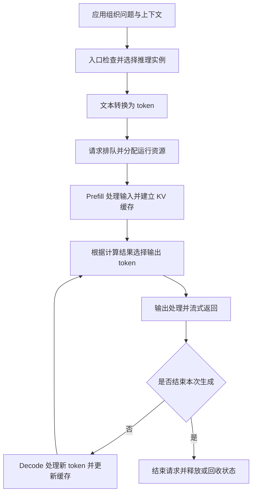

# 初识 AI Infra，从一次模型请求看起

[← AI Infra 学习路线](README.md)

同一个模型，本地只有一个人使用时回答很顺，接入业务以后却可能迟迟不出第一个字。把输入换成一份长文档，显存占用也会上升。模型参数没有变化，服务表现已经不同。

这些差异需要沿执行过程去找原因。请求可能在排队，输入处理可能耗时，生成过程也可能在等待显存里的数据。一次接口调用会经过模型服务、计算设备和数据传输，任何一段都可能延长用户的等待。

AI Infra 是支撑 AI 训练与推理的基础设施，包括处理器、存储、设备互联，以及管理这些资源的软件。训练用数据计算误差并调整模型参数；推理使用已有参数处理新输入，通常不会更新权重。两者需要的资源有交集，执行方式和优化目标各有侧重。这篇先沿文本生成请求认识这套系统。

## 应用发出请求以后，谁来执行

应用通常把用户问题、历史对话和检索材料组织成上下文，再交给模型。上下文就是本次调用提供给模型的信息。同一模型可以根据这些信息完成不同任务，底层承担的工作量也会随输入和输出长度变化。

从应用向下看，可以先按六层理解。这个划分用于定位问题，各层之间仍有交叉。

| 层次 | 负责的事情 | 需要关注的问题 |
|---|---|---|
| 应用与任务 | 定义要完成什么，组织输入与工具调用 | 用户能等多久，一项任务要调用几次模型 |
| 模型与负载 | 确定计算结构，以及请求的长度和到达方式 | 参数有多少，输入多长，同时有多少请求 |
| 训练与推理系统 | 安排任务执行，组织批处理，保存运行状态 | 谁先执行，资源怎样分配 |
| 算子与编译运行时 | 把模型运算落实为设备程序 | 运算怎样分块，何时读取和写回数据 |
| 处理器与存储 | 执行计算，保存权重和中间结果 | 数据能否放下，计算与读取各有多快 |
| 互联与数据中心 | 连接设备和服务器，提供供电与散热条件 | 数据经过哪里，设备之间要等多久 |

算子是矩阵乘法等基本运算。编译器把程序转换为设备能够执行的形式，运行时负责提交工作、管理执行资源。CPU 是中央处理器，擅长运行通用程序。GPU 是图形处理器，也广泛用于并行执行大量模型计算。模型服务常由 CPU 组织请求，再把适合并行的计算交给 GPU。

开发者即使只调用外部模型接口，也会影响底层负载。多放一段历史对话，会增加输入处理和状态保存的工作；Agent 多执行一轮工具调用，随后又可能带着更长的上下文请求模型。

## 一次文本生成要经过哪些步骤

模型服务先检查请求，再选择推理实例。实例是一组能够执行模型的资源，可以使用一张 GPU，也可以让多张 GPU 协作。实例内部的调度器根据可用资源安排请求。

文本要转换成 token，也就是模型处理的词元。一个 token 可能对应一个字、词的一部分或其他片段，不能直接用汉字数量代替 token 数量。下面展示一种常见的自回归生成路径，后一个输出依赖前面的内容。

Prefill 称为预填充，主要处理已有输入，并建立后续生成需要的状态。Decode 称为解码，在普通逐 token 生成方式下，反复处理新 token，继续预测后面的输出。第一轮输出可以来自 prefill 的计算结果，之后进入 decode 循环。

两段工作的特点不同。长输入通常会增加 prefill 的工作，长回答会增加 decode 的步数。请求等待第一个输出的时间还包括排队和入口处理，不能全部算到 prefill 上。

生成时，模型会复用前面 token 的部分计算结果。常见 Transformer 模型把注意力计算中的键和值保存为 KV 缓存，后续步骤读取这些数据，避免重复生成过去位置的键和值。[Hugging Face 的缓存说明](https://huggingface.co/docs/transformers/main/en/cache_explanation)给出了这个过程。KV 缓存保存的是计算状态，和直接保存一份聊天文本有区别。

## 显存先要容纳哪些数据

模型权重是训练得到的数值参数。服务启动时，权重通常从文件加载到 GPU 显存，随后供多个请求反复使用。显存是 GPU 保存运行数据的内存，除了权重，还要容纳请求状态和执行工作区。

| 数据 | 用途 | 主要随什么变化 |
|---|---|---|
| 模型权重 | 参与模型计算 | 参数量与存储精度 |
| KV 缓存 | 保存可以复用的上下文计算状态 | 模型结构、上下文长度、缓存方式和并发请求 |
| 临时数据与工作区 | 保存中间结果，支持算子执行 | 批次规模、输入长度和具体实现 |

先做一笔简化预算。假设一个模型恰好有 70 亿个参数，全部以 BF16 保存。BF16 是一种 16 位浮点格式，每个数占 2 字节，权重数据约需 140 亿字节，也就是 14 GB。这里使用十进制单位，1 GB 等于十亿字节。这个估算方法也见于 [Hugging Face 的模型内存指南](https://huggingface.co/docs/transformers/main/en/llm_tutorial_optimization)。

14 GB 只计权重。部署还要预留 KV 缓存、工作区和框架自身占用。权重刚好装满显存，服务很可能无法继续接入目标长度的请求。

量化可以用更少的位数近似表示权重，减少存储需求。但量化还会带来缩放参数等附加数据，部分权重可能保留较高精度。实际占用、回答质量和执行速度，都要用具体模型与推理实现验证。

## 装得下以后，还要算数据送得有多快

显存容量决定能保存多少数据，显存带宽决定每秒能够传输多少数据，算力描述设备每秒能完成多少运算。这三个数回答的问题不同。

权重加载到显存以后，GPU 计算单元仍要反复读取参与当前步骤的权重。模型文件无需每生成一个 token 就从磁盘重新加载，显存内部的数据读取却会持续发生。

继续用刚才的模型做教学估算。假设一次生成步骤需要从显存读取 14 GB 权重，该路径的带宽上限为 1 TB/s。1 TB 等于 1000 GB，仅这次读取就至少需要

$$
T_{\mathrm{read}} \ge \frac{14\ \mathrm{GB}}{1000\ \mathrm{GB/s}} = 14\ \mathrm{ms}.
$$

这些数是明确设定的算例条件，没有对应某款设备的实测。估算还没有计入 KV 访问和其他读写，真实实现的读取量也要根据模型与缓存情况核对。

如果相关计算只需 1 ms，单纯把计算能力翻倍，主要等待仍然留在读取一侧。此时可以研究减少读取量、提高数据复用或增加有效带宽，随后再测完整执行是否变快。

对于确定的运算量和读写量，可以分别除以对应算力与带宽，估算各自的时间下界。计算与读取能够充分重叠时，较慢的一项会限制处理速度。[NVIDIA 的性能指南](https://docs.nvidia.com/deeplearning/performance/dl-performance-gpu-background/index.html)采用了这种分析方法。实际程序还存在启动、同步和执行依赖，几项估算之间的关系要沿具体过程判断。

这个下界只对当前假设成立。改变数据表示、减少运算或利用缓存，都会改变需要计算和传输的数量。它适合筛选优化方向，不能直接当作完整请求能够达到的延迟。

## 批处理怎样提高吞吐，又为何可能增加等待

同一模型的多个请求可以组成一个批次，共同执行部分计算，称为批处理。一个批次参与执行的请求或 token 数量，由系统的调度方式决定。

在前面的简化条件下，如果四个请求能够共享一次权重读取，读入的数据就能服务更多计算。系统有机会在相近时间内产生更多输出。吞吐量衡量单位时间完成多少工作，例如整个实例每秒生成多少 token。

每个请求仍然要经历整批执行。它还可能为了等待资源而排队，各自的 KV 缓存和计算也会增加开销。每个输出分摊的成本下降，和一个用户更快看到结果，需要分别测量。

观察服务时，至少要分清几种指标。

| 指标 | 回答的问题 |
|---|---|
| 首 token 延迟 TTFT | 从约定的请求起点到第一个输出 token，等了多久 |
| 后续输出速度 | 第一个输出以后，生成是否顺畅，期间有没有长停顿 |
| 端到端延迟 | 从请求开始到完整响应结束，总共用了多久 |
| 实例吞吐量 | 整个实例单位时间处理了多少输入或生成了多少输出 |

后续输出可以观察相邻输出事件的间隔，也可以计算每请求的平均输出 token 时间 TPOT。一次事件可能包含多个 token，两种口径会有差异。[vLLM 的指标文档](https://docs.vllm.ai/en/latest/design/metrics/)分别说明了这些定义。比较性能时要固定测量起止点，并记录输入长度、输出长度和并发条件。

## 多加几张卡以后，会多出通信与同步

一张卡放不下模型时，可以让不同 GPU 保存并计算模型的不同部分。每张卡除了检查自己的权重、状态和工作区，还要交换后续计算需要的结果。

多卡的总显存够用，只能说明容量有了可能。切分是否均匀、通信能否及时完成，以及设备是否经常等待其他卡，都会影响速度。显存带宽、GPU 间互联带宽与服务器网络带宽属于不同路径，估算传输时必须选对接口。

另一个选择是增加独立实例，让不同实例分别处理请求。它可以扩大整体接待能力，每个实例通常也要保存自己需要的权重。一个请求拆到多卡执行，与多份模型各接一部分请求，对容量和通信的要求不同。

## 优化要回到完整请求里验证

假设一次请求原来需要 100 ms，其中某段计算占 20 ms，其他等待与处理占 80 ms。只把这段计算提速一倍，总时间变成 90 ms。局部快了一倍，完整请求减少了 10 ms。这是阿姆达尔定律描述的基本关系，收益取决于被优化环节原先占多少时间。

工程上可以先保存一组可重复的请求，固定模型、精度、输入输出长度和并发条件，再记录排队、输入处理、生成与通信耗时。根据容量和时间估算提出一个判断，每次改变一个条件，用测量检查判断是否成立。

如果首个输出变慢，先区分排队与输入处理。如果生成途中停顿，再查看读取、计算、调度和通信。只有定位到当前任务花时间的地方，才能决定下一步该调整模型表示、修改推理配置，还是增加资源。
