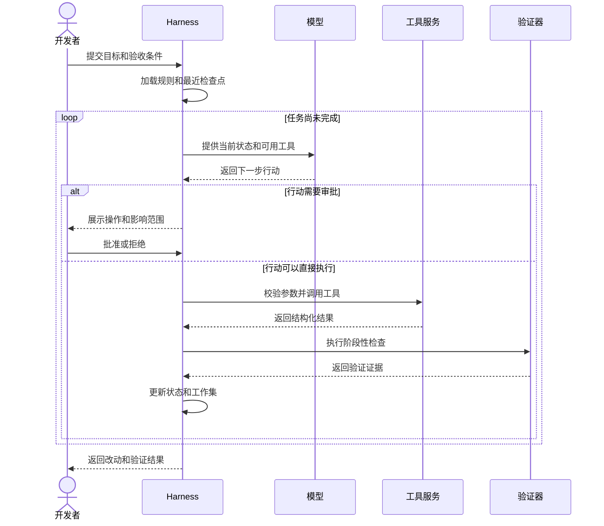

# Agent Harness 怎样让长任务跑到结束

[← AI Native](README.md)

构建任务失败以后，日志里只有一句依赖解析错误。修复它可能要查看构建文件，确认内部依赖的版本，再修改配置并重新运行测试。第一次修改若引出新的错误，还得继续追踪。模型能够提出下一步，整个任务却很难靠一次调用完成。

Agent Harness 处理的正是这段过程。它接收任务目标，准备模型当前需要的材料，把工具开放给模型，再根据工具返回的结果组织下一轮。模型负责理解现状和选择行动，Harness 负责让每次行动能够执行、留下状态并接受检查。

## 一次模型调用装不下一项工程任务

普通的大模型应用通常接收一组消息，生成一次回复。修复构建失败时，回复只是一个建议。完整的工程任务还会读取文件、执行命令、等待结果、修改方案和再次验证。中间任何一步都可能改变后面的路径。

Harness 因此维护一个持续运行的任务。它在每一轮把目标、当前状态、相关上下文和可用工具交给模型。模型返回下一步行动，Harness 检查这项行动能否执行，再调用工具并记录结果。验收条件满足以后，循环才结束。

这里的验证器可以是构建命令、单元测试、静态检查或代码差异检查。它不负责理解需求，只回答一个更窄的问题，例如项目能否构建、测试是否通过、改动是否超出允许范围。

## 上下文是一份不断变化的工作集

长任务会产生大量内容。构建日志可能有几千行，代码搜索会返回几十个文件，对话中还会积累已经失效的猜测。把全部历史原样放回模型，很快会挤占上下文，也会让旧错误继续干扰判断。

Harness 需要维护一份当前工作集。任务目标、验收条件和仓库规则长期保留。最近一次失败、当前改动和下一步所需文件优先进入模型。早期日志可以提取错误摘要，已经排除的假设只保留结论，需要追溯时再读取原始记录。

这种处理不能只按字符数量截断。假如日志末尾只剩一句构建失败，依赖冲突的线索却在前面，简单裁剪会丢掉决定性信息。更可靠的做法是按材料类型分别处理。代码保留路径和相关片段，工具结果保留退出状态与关键输出，任务历史保留已经完成的步骤和未解决的问题。

## 状态让任务能够暂停和恢复

长任务随时可能中断。模型服务超时，运行环境被回收，某项操作等待审批，都会让当前进程停下来。只保存聊天记录，恢复时仍然不知道哪些文件已经修改、哪条命令已经执行、哪些结论通过了验证。

任务状态至少要记录下面这些内容。

| 状态 | 需要保存的信息 |
|---|---|
| 任务 | 目标、约束、验收条件和当前阶段 |
| 工作区 | 基线版本、已改文件和未提交差异 |
| 行动 | 工具名称、参数、开始时间和执行结果 |
| 判断 | 当前计划、已排除的假设和待确认问题 |
| 验证 | 已运行的检查、证据位置和失败原因 |

检查点应当出现在能够重复进入的位置。修改文件以后可以保存工作区差异，测试完成以后可以保存报告，等待审批以前可以保存将要执行的操作。恢复任务时，Harness 先确认工作区和外部资源仍与检查点一致，再决定继续执行还是重新准备环境。

检查点不能把所有副作用都变成可重放操作。创建临时分支可以重复确认，向外部系统发布内容却可能执行两次。工具需要返回稳定的操作标识，Harness 也要记录请求是否已经完成。无法安全重试的写操作，应在状态不明时停止并要求确认。

## 工具结果必须能够推动下一轮判断

终端把一大段混合文本扔回来，模型只能猜命令是否成功。工具若返回退出码、标准输出、错误输出、持续时间和产物位置，Harness 就能先用确定规则处理，再把影响判断的部分交给模型。

文件修改也一样。工具需要说明改了哪些文件，写入是否完整，内容与读取时的版本是否冲突。测试工具应返回用例数量、失败名称和报告位置。Harness 由此可以区分工具调用失败、代码验证失败和任务目标仍未满足，随后选择重试、调整计划或结束任务。

| 决策 | 更适合的执行者 |
|---|---|
| 根据错误判断下一步查看哪个模块 | 模型 |
| 检查路径是否位于允许目录 | Harness 或工具服务 |
| 判断命令是否超时 | Harness |
| 根据测试失败调整修复方案 | 模型 |
| 确认全部必需检查已经通过 | 确定性验证器 |
| 批准高风险外部写操作 | 有权限的人 |

模型的判断可以随着上下文变化，权限和验收规则则要保持稳定。两者混在提示词里，任务一长就很难知道某条限制是否仍然有效。

## 完成状态也要由系统定义

模型说已经修好，不能直接结束任务。Harness 应当检查约定的验证项是否都有结果，工作区是否存在意外改动，外部操作是否留下可查询的状态。缺少证据时，任务只能标记为未完成或受阻。

修复构建失败的最终交付可以很朴素。改了哪些文件，构建和测试运行了什么，失败怎样被定位，还有哪些风险没有验证。Harness 把这些证据连同任务状态交还给开发者，这项长任务便有了明确的结束状态。
