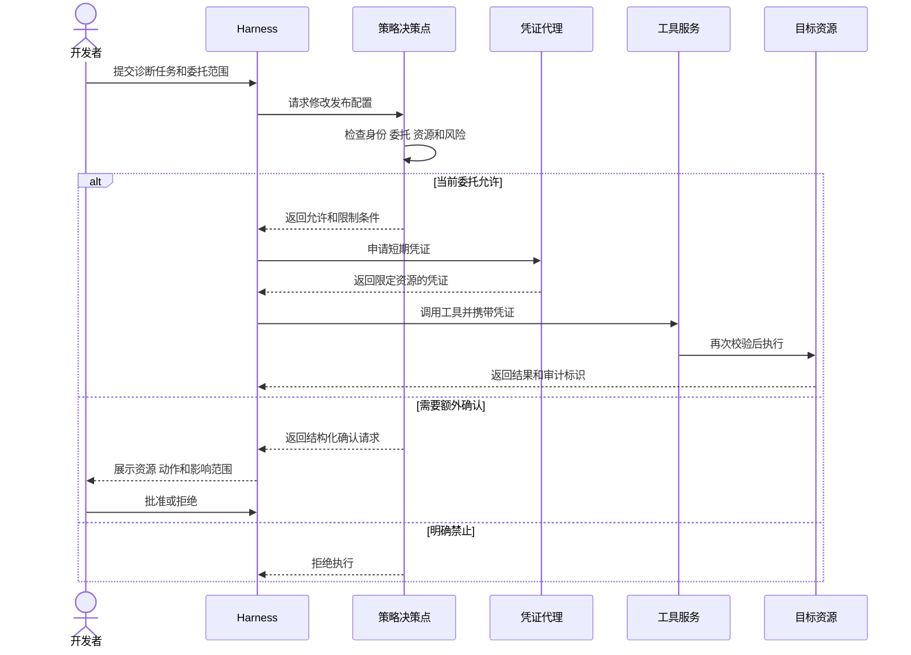

# 身份、权限和 Guardrail 怎样约束 Agent

[← AI Native](README.md)

Agent 准备修改一项发布配置。发起任务的开发者拥有项目权限，当前任务却只允许查看状态，任何写操作都要再次确认。模型若沿用用户的全部权限，原本用于诊断的任务就可能直接改变生产环境。

系统需要同时回答几件事。谁发起任务，哪一个 Agent 正在运行，它代表谁行动，本次委托允许做什么，目标资源当前又接受哪些操作。身份、委托、策略和 Guardrail 分别处理这些问题。

## 用户有权限，不等于 Agent 可以直接使用

传统应用的调用路径通常固定。用户点击按钮，后端调用已知接口，权限模型只需判断这个用户能否执行这项操作。Agent 会在运行时选择工具、参数和资源，路径到执行前一刻才确定。

如果直接复用用户账号，审计记录无法区分用户亲手操作和 Agent 代为操作。复用一个公共服务账号同样麻烦，系统又失去了委托人和任务范围。更稳妥的做法是保留一条复合身份链。

| 身份信息 | 说明 |
|---|---|
| 用户身份 | 谁发起任务，拥有哪些原始权限 |
| Agent 身份 | 哪个 Agent、版本和运行实例正在行动 |
| 委托上下文 | 用户允许 Agent 在本任务中做什么 |
| 运行身份 | 当前 Sandbox、设备或工作负载是谁 |
| 资源身份 | 最终被访问的项目、服务和环境 |

一次有效权限由这些条件共同收敛。用户可以修改测试环境，不代表任何 Agent 都能代替他修改。Agent 支持发布，也不代表这次诊断任务包含发布委托。平台还可以按时间、网络位置和风险级别继续收紧范围。

## 模型提出行动，策略系统作出决定

模型适合根据目标提出下一步，例如读取发布记录或修改某个配置项。是否允许执行，应交给确定性的策略系统。常见设计把它拆成策略决策点和策略执行点。

策略决策点根据身份、委托、资源、动作和环境作出允许、拒绝或需要补充确认的判断。策略执行点分布在 Harness、工具网关、MCP 服务和资源服务前面，负责拦住未经许可的调用。离目标资源越近，越要重新校验真实参数，不能只相信模型提交的资源名称。

资源服务的最终校验不能省略。工具描述、网页内容和模型上下文都有可能被篡改，授权结论必须以可信身份和真实资源为准。

## 凭证应该短、窄，并且可以撤销

长期 API Key 一旦进入模型上下文、日志或任务快照，很难保证以后不会泄露。凭证代理可以根据已经通过的策略决定，换取只对目标资源有效的短期凭证。任务结束、委托撤销或风险状态变化时，停止签发并清理缓存。

短期凭证的权限范围要小于用户原始权限。它只允许访问指定项目和环境，只包含当前工具需要的动作，并设置很短的有效期。多 Agent 协作时，子 Agent 接受的委托还要继续收窄，不能继承上游全部权限。

凭证原文也没有必要交给模型。Harness 或工具网关可以在调用下游服务时注入凭证，返回给模型的只是资源结果和审计标识。Cookies、刷新令牌和数据库密码同样应隔离处理。

## 缺少权限时需要第三种结果

只返回允许或拒绝，会让一些正常任务卡死。修改测试配置可能需要用户确认，重启生产实例可能要求值班负责人审批。策略系统可以返回结构化的补充授权请求，说明目标资源、具体动作、有效期和风险。

Harness 收到这类结果后暂停任务，把信息交给有权的人。批准后重新计算策略并签发新凭证，不能让模型凭一段自然语言承诺继续执行。资源状态在等待期间可能变化，恢复时也要再次检查。

## Guardrail 检查一次行动能否进入下一阶段

权限回答当前主体能否操作资源，Guardrail 继续检查行动是否满足发布或变更规则。发布配置以前，系统可能要求变更范围明确、测试通过、监控正常并保留回滚方案。Agent 可以收集证据，Guardrail 按固定规则判断证据是否齐全。

检查结果适合使用三种状态。

| 状态 | 含义 | 后续动作 |
|---|---|---|
| 通过 | 证据充分并满足当前规则 | 进入下一阶段 |
| 阻断 | 已确认违反规则 | 结束或重新修改 |
| 未知 | 查询失败、证据不足或事实无法解释 | 补充证据或请求人工判断 |

未知不能当作通过。Agent 没查到异常，可能是系统正常，也可能是它查错了范围。证据要记录来源、查询时间、资源范围和结果摘要，Guardrail 只执行约定好的判定，不替模型补业务事实。

输入内容中的恶意指令也需要 Guardrail。Issue、网页、代码注释和工具返回值都属于不可信内容。Harness 可以在它们进入模型前做来源标记与内容过滤，高风险行动仍然要依靠权限和资源端校验。过滤提示注入无法代替授权系统。

## 审计需要串起整条委托链

一条有用的审计记录要关联用户、Agent、任务、委托范围、策略版本、工具调用、目标资源、凭证签发和最终结果。只记录接口地址和返回码，无法解释模型为何选择这个动作，也无法确认操作是否超出任务范围。

开发者撤销任务以后，相关凭证和后续操作应立即失效。策略规则更新时，新请求使用新版本，已经批准的高风险操作是否继续，则按明确的变更规则处理。身份和权限只有能够收回、查询和追溯，才适合支撑持续运行的 Agent。
