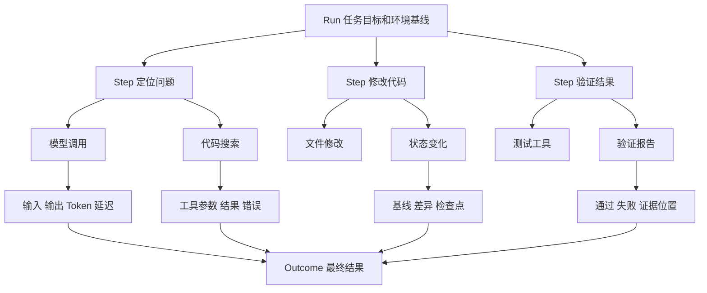

# 怎样看清一次 Agent 执行

[← AI Native](README.md)

一个后台 Agent 运行了三分钟，最后只留下任务失败。平台知道它消耗了多少 Token，也知道某次命令返回非零状态，却不知道它为什么选择这条命令，更不知道失败发生在模型、工具、环境还是验收规则。

普通服务的监控主要回答系统是否健康。Agent 还需要一份完整的行动轨迹，回答它怎样从任务目标走到结果。可观测负责留下这份轨迹，评测再利用轨迹与最终结果判断哪一步需要改。

## 先把一次执行拆成可以查询的记录

一次 Agent 执行可以从大到小分成 Run、Step 和 Span。Run 代表一项完整任务，保存目标、环境基线和最终结果。Step 代表一次有明确目的的行动，例如定位模块或运行测试。Span 记录模型调用、工具调用、Skill 执行和状态变化等原子事件。

这些对象要共享稳定的关联标识。开发者从失败结果打开详情时，应当能够找到对应任务、模型输入、工具参数、环境日志和验证报告。单独查看聊天记录或终端日志，都无法还原完整因果关系。

轨迹记录执行事实，不能只保存模型的自我解释。模型可能说已经检查配置，系统仍要看到它实际调用了什么工具、读取了哪个版本、返回结果是什么。最终结果也要由验收器写入，不能直接采用模型给自己的完成评价。

## 系统可观测和行为可观测回答不同问题

系统可观测沿用成熟的指标、日志和 Trace。它关心模型服务是否可用，Sandbox 创建是否超时，工具接口的错误率与延迟多高，一项任务消耗多少 Token 和计算资源。这些数据帮助平台定位容量、性能和成本问题。

行为可观测关心 Agent 怎样行动。它是否选对工具，是否在同一个错误上循环，修改以后有没有运行规定的测试，遇到受限操作时有没有等待审批。最终任务失败时，行为轨迹可以说明它走到哪一步，又从哪里偏离了预期。

| 失败位置 | 轨迹中常见的证据 | 处理方向 |
|---|---|---|
| 模型判断 | 选择了无关文件或重复同一行动 | 调整上下文、任务说明或模型 |
| 工具契约 | 参数错误、返回值无法解析 | 修改接口定义和错误分类 |
| 运行环境 | 依赖缺失、资源超限或网络被拦截 | 修正环境定义和资源策略 |
| 权限策略 | 委托不足、凭证过期或资源不匹配 | 修正授权流程或任务范围 |
| 验证规则 | 漏掉关键测试或把未知当成通过 | 补充验收项和证据要求 |

分类要落在能够处理问题的团队和组件上。把所有异常都记成模型失败，会让平台问题长期藏在提示词修改后面。

## 指标帮助定位问题，不能替代验收

会话数量、代码生成行数和 Token 消耗可以说明工具被使用了多少。这些数字无法单独证明研发工作更快或更稳。排障时应先把运行数据与具体行为关联起来。

| 观察方向 | 可以采集的信号 | 需要追查的证据 |
|---|---|---|
| 运行性能 | 耗时、Token、工具延迟、资源消耗 | 时间花在模型等待、工具执行还是环境准备 |
| 重复行动 | 相同错误、相似调用、重复修改次数 | 重试是否带来新信息，是否超出配置上限 |
| 验证行为 | 测试调用、报告位置、检查完成状态 | 规定的检查是否实际执行，结果是否被采用 |
| 权限与接管 | 审批等待、拒绝事件、人工接管原因 | 哪个动作被拦截，任务能否安全暂停或恢复 |

这些信号还不能直接给任务判分。工具返回正常，可能只是请求受理；测试没有报错，也可能是没有发现任何可运行的测试。最终状态仍要由任务验收检查。

平均值容易掩盖问题。平台可以按任务类型、仓库、Agent 版本和风险级别分组，再观察长尾延迟与接管原因。团队交付周期、审查投入和返工成本怎样比较，放在[团队怎样把 Agent 放进真实研发流程](agent-team-adoption.md)中讨论，这里不把使用量解释成生产率。

## 把轨迹交给评测与反馈系统

一条线上轨迹可以成为调查入口，不能直接当作标准答案。导出时保留不可变的记录引用、代码基线、模型与工具版本、环境标识，以及外部操作的返回证据。文件和报告需要持久化，临时下载地址过期以后仍应能按产物标识找回。

输入、工具参数和日志可能带有凭证、个人信息或业务数据。共享视图与评测导出应脱敏，只保留复现需要的内容。确需保存的原始证据单独限制访问并设置保留期限。采集端应优先避免记录秘密，不能把先完整收集再脱敏当作唯一保护。

平台可以从重复失败、人工接管或越界事件建立问题单，关联原始 Run 与证据位置。后续处理人确认原因、补齐复现条件，再交给独立的[数据反馈与评测流程](../enterprise-ai-platform/data-foundation/data-feedback-evaluation.md)。问题单、候选样本和评测结论分别保存，避免一次用户投诉直接改变发布标准。

记录里没有采集到的信息，应明确标成未知。工具超时后无法确认外部操作是否完成，需要查询业务状态；不能靠重新生成一份总结补足证据。新的调查结论可以关联原记录，原轨迹不随事后解释覆盖。

具体怎样固定环境、检查关键动作、重复运行和比较新旧版本，统一放在[Agent 评测怎样判断一次修改有没有真的变好](../agent-learning-path/agent-evaluation.md)。可观测负责把证据留下，让这些检查有据可查。
