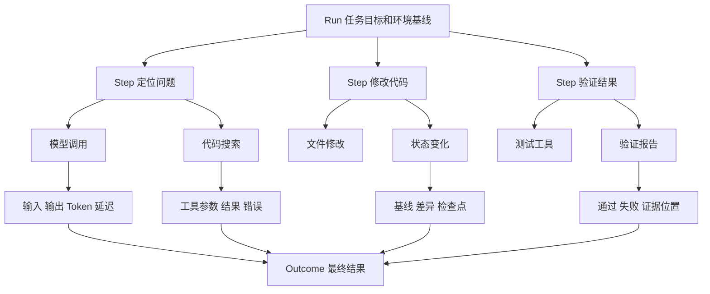

# 怎样看清一次 Agent 执行

[← AI Native](README.md)

一个后台 Agent 运行了三分钟，最后只留下任务失败。平台知道它消耗了多少 Token，也知道某次命令返回非零状态，却不知道它为什么选择这条命令，更不知道失败发生在模型、工具、环境还是验收规则。

普通服务的监控主要回答系统是否健康。Agent 还需要一份完整的行动轨迹，回答它怎样从任务目标走到结果。可观测负责留下这份轨迹，评测再利用轨迹与最终结果判断哪一步需要改。

## 先把一次执行拆成可以查询的记录

一次 Agent 执行可以从大到小分成 Run、Step 和 Span。Run 代表一项完整任务，保存目标、环境基线和最终结果。Step 代表一次有明确目的的行动，例如定位模块或运行测试。Span 记录模型调用、工具调用、Skill 执行和状态变化等原子事件。

这些对象要共享稳定的关联标识。开发者从失败结果打开详情时，应当能够找到对应任务、模型输入、工具参数、环境日志和验证报告。单独查看聊天记录或终端日志，都无法还原完整因果关系。

轨迹记录执行事实，不能只保存模型的自我解释。模型可能说已经检查配置，系统仍要看到它实际调用了什么工具、读取了哪个版本、返回结果是什么。最终结果也要由验收器写入，不能直接采用模型给自己的完成评价。

## 系统可观测和行为可观测回答不同问题

系统可观测沿用成熟的指标、日志和 Trace。它关心模型服务是否可用，Sandbox 创建是否超时，工具接口的错误率与延迟多高，一项任务消耗多少 Token 和计算资源。这些数据帮助平台定位容量、性能和成本问题。

行为可观测关心 Agent 怎样行动。它是否选对工具，是否在同一个错误上循环，修改以后有没有运行规定的测试，遇到受限操作时有没有等待审批。最终任务失败时，行为轨迹可以说明它走到哪一步，又从哪里偏离了预期。

| 失败位置 | 轨迹中常见的证据 | 处理方向 |
|---|---|---|
| 模型判断 | 选择了无关文件或重复同一行动 | 调整上下文、任务说明或模型 |
| 工具契约 | 参数错误、返回值无法解析 | 修改接口定义和错误分类 |
| 运行环境 | 依赖缺失、资源超限或网络被拦截 | 修正环境定义和资源策略 |
| 权限策略 | 委托不足、凭证过期或资源不匹配 | 修正授权流程或任务范围 |
| 验证规则 | 漏掉关键测试或把未知当成通过 | 补充验收项和证据要求 |

分类要落在能够处理问题的团队和组件上。把所有异常都记成模型失败，会让平台问题长期藏在提示词修改后面。

## 指标要从使用走到交付

会话数量、代码生成行数和 Token 消耗可以说明工具被使用了多少。这些数字无法单独证明研发工作更快或更稳。一次生成很多代码，也可能带来更长的审查和返工。

指标可以分为三组。

| 层级 | 可以观察的指标 | 主要用途 |
|---|---|---|
| 执行效率 | 任务耗时、模型调用次数、工具成功率、重试次数、成本 | 定位运行性能和资源浪费 |
| 工程质量 | 首次验证通过率、返工次数、人工接管率、越界改动、缺陷逃逸 | 判断交付过程是否可靠 |
| 交付结果 | 需求前置时间、评审等待、发布频率、恢复时间 | 判断团队流程是否改善 |

三个层级需要关联到同一项工作。只看 Agent 会话，无法知道生成内容有没有进入代码提交。只看提交，也无法知道改动是否通过发布并产生返工。任务、代码变更、发布记录和故障记录之间要有稳定关联，但采集时应去掉与分析无关的个人内容和敏感数据。

平均值也容易掩盖问题。简单任务大量成功，会盖住少数高风险任务的长时间循环。平台可以按任务类型、仓库、Agent 版本和风险级别分组，再观察成功率、长尾延迟和人工接管原因。

## 离线评测需要固定任务和环境

离线评测要保存任务说明、代码基线、环境定义、允许工具和验收脚本。只保留一句问题和标准答案，无法复现 Agent 实际面对的工程条件。同一个任务换了依赖版本或网络权限，结果已经不再可比。

评测至少检查四件事。任务结果是否通过，工具和步骤是否符合约束，改动有没有越界，运行成本是否处在接受范围。对于存在多种正确路径的任务，重点检查最终状态与关键约束，不要求 Agent 复刻固定步骤。

轨迹还能支持局部评测。工具选择正确以后，调用参数是否正确。参数正确以后，返回结果有没有被合理使用。把失败拆到这些位置，比只给整个任务一个分数更容易找到改动对象。

模型和工具具有非确定性，同一任务应重复运行几次。评测报告要记录模型版本、参数、Harness 版本和环境基线，随后比较成功率与失败分布。一次通过可以证明这次执行完成，不能直接证明方案长期稳定。

## 线上反馈要回到可复现样本

线上出现人工接管、重复失败、越界修改或发布后回滚时，平台可以把相关任务和轨迹送入问题池。进入评测集以前要去掉敏感信息，固定代码基线与外部依赖，并确认验收脚本能够重现问题。

同类失败积累到一定数量后，再决定修改模型、Prompt、Skill、工具或运行环境。没有轨迹时，团队常常先改最显眼的 Prompt。轨迹若显示多数失败来自凭证过期，继续调整 Prompt 只会让模型更会解释同一个错误。

可观测的价值落在日常排障里。开发者能够从一个失败结果追到具体步骤，平台能够把问题分给对应组件，评测也能用同一套记录比较新旧版本。Agent 的行动因此变得可检查，后续优化才有可靠起点。
