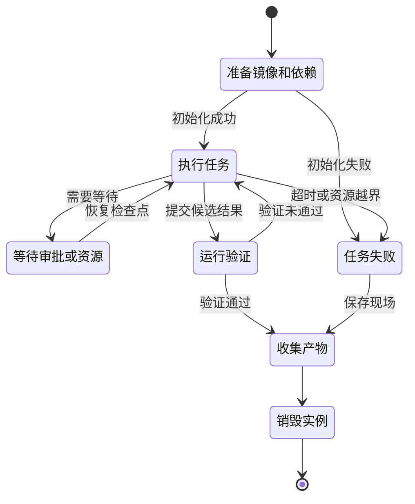

# Agent 在哪里运行

[← AI Native](README.md)

一份改动在开发者电脑上通过了测试，换到新的机器却启动失败。代码没有变，缺的是本地配置、数据库初始数据和一个没有写进文档的构建工具。Agent 也会遇到同样的问题，而且它比人更依赖明确的运行条件。

当 Agent 需要拉取代码、安装依赖和执行测试时，平台要为它准备一块能够工作的空间。Sandbox 负责隔离和资源边界，Coding Environment 负责把项目运行所需的仓库、工具、配置与依赖放进这块空间。两者合起来，才能让任务从代码修改走到可重复验证。

## 只交付仓库还不够

仓库保存源码、构建文件和一部分测试，许多运行条件仍然散落在其他地方。特定版本的 JDK 或 Node.js、私有依赖的获取方式、数据库结构、测试数据、外部服务替身和网络访问规则，都可能影响结果。

开发者电脑能够运行项目，常常是因为这些条件已经准备多年。新建的 Agent 工作区没有这段历史。它看到缺少配置时可以猜字段含义，却无法猜出一套真实数据库。它发现请求被拦截，也无法仅凭错误信息判断应该访问线上服务、测试替身，还是根本不允许出网。

项目需要一份可执行的环境定义。它记录运行时版本、初始化步骤、依赖服务、网络边界、验证命令和需要收集的产物。平台根据定义创建任务实例，Agent 只在实例内工作。

## Sandbox 和 Coding Environment 各管一部分

Sandbox 解决隔离问题。它限制 Agent 能使用多少 CPU 和内存，可以访问哪些文件与网络，任务最多运行多久。进程失控、依赖带有恶意脚本或命令写错路径时，影响会留在明确边界内。

Coding Environment 解决项目可运行的问题。它准备代码工作区、编译器、包管理器、语言服务、测试工具和项目依赖，也可以启动数据库或服务替身。Agent 从这里获得与任务匹配的开发环境，不需要每次从空容器猜测项目怎样启动。

| 能力 | Sandbox | Coding Environment |
|---|---|---|
| 文件系统隔离 | 负责 | 使用被分配的工作区 |
| CPU、内存与时限 | 负责 | 按项目需求声明 |
| 网络出入站策略 | 负责执行 | 声明所需地址与协议 |
| 编译器和开发工具 | 提供可安装空间 | 负责版本与配置 |
| 数据库和服务替身 | 隔离运行 | 负责准备与初始化 |
| 测试与构建命令 | 限制资源和权限 | 负责定义与调用 |

容器只是常见实现。虚拟机、微虚拟机或受控的远程主机也能提供隔离。选择哪种技术取决于启动速度、隔离强度、操作系统要求和任务持续时间。

## 一次任务环境有完整的生命周期

平台先读取环境定义和任务基线，再创建实例并装入代码。初始化完成后，Agent 才能修改文件和运行命令。任务通过验证，平台收集差异、日志和测试报告，随后销毁实例。失败和中断同样要留下证据。

环境定义适合长期维护，任务实例应当按次创建。同一个项目可以反复使用确认过的镜像、依赖声明和测试基线，每次任务的临时文件、进程与凭证则彼此隔离。这样既能复用准备工作，也不会让上一次运行留下的状态悄悄影响下一次。

## 网络和凭证要从默认收紧开始

允许任意联网很省事，也会把依赖投毒、数据外传和误调用线上接口的风险一起放大。任务环境可以默认拒绝出站访问，再根据依赖下载、代码托管和测试服务逐项开放。请求线上业务服务时，还要由工具层和业务系统继续鉴权。

凭证不能长期写进镜像、环境定义或任务快照。平台在任务启动后注入短期凭证，限制用途和有效期，任务结束时立即撤销。Agent 可以使用一个受控工具完成操作，不需要读取凭证原文。暂停或恢复实例时，旧凭证也不能跟着快照长期保存。

入站访问同样要受控。Agent 启动临时 Web 服务或调试端口时，平台可以分配带身份校验的临时地址。直接暴露容器端口，会让原本隔离的任务重新进入公共网络。

## 环境反馈要能被程序读取

命令只返回成功或失败，Agent 很难选择下一步。执行服务还应返回退出码、标准输出、错误输出、资源使用情况和超时原因。数据库初始化、服务启动和网络请求也要提供状态与日志。

任务结束时，平台收集代码差异、测试报告、构建产物和必要的诊断信息。临时环境随后销毁。需要复现失败时，可以从环境定义、代码基线和经过筛选的检查点创建新实例，避免把整个失控现场无限期保留。

现场保存也有边界。内存、环境变量和日志可能包含敏感数据，不能无条件进入快照。保留什么、保存多久、谁能查看，都应当由平台规则决定。

## 三种运行方式共用同一份环境定义

| 方式 | 谁发起 | 人怎样参与 | 适合的任务 |
|---|---|---|---|
| 本地交互 | 开发者从 IDE 或 CLI 发起 | 随时查看和确认 | 探索、调试和小范围修改 |
| 后台执行 | CI 或任务系统发起 | 在审批和异常时介入 | 批量修复、升级和代码检查 |
| 平台托管 | 业务系统通过 API 发起 | 通过工作台查看状态 | 多租户、长任务和统一治理 |

运行入口可以不同，环境定义、权限检查和验证证据应保持一致。开发者本地验证通过的任务，进入后台以后不应换一套隐含规则。平台也不应因为任务由 API 发起，就放宽网络和资源限制。

Agent 能修改代码，只解决了工作的一部分。项目能否在一套明确、干净并可重建的环境里启动和验证，决定了这份改动能不能被其他人接住。
