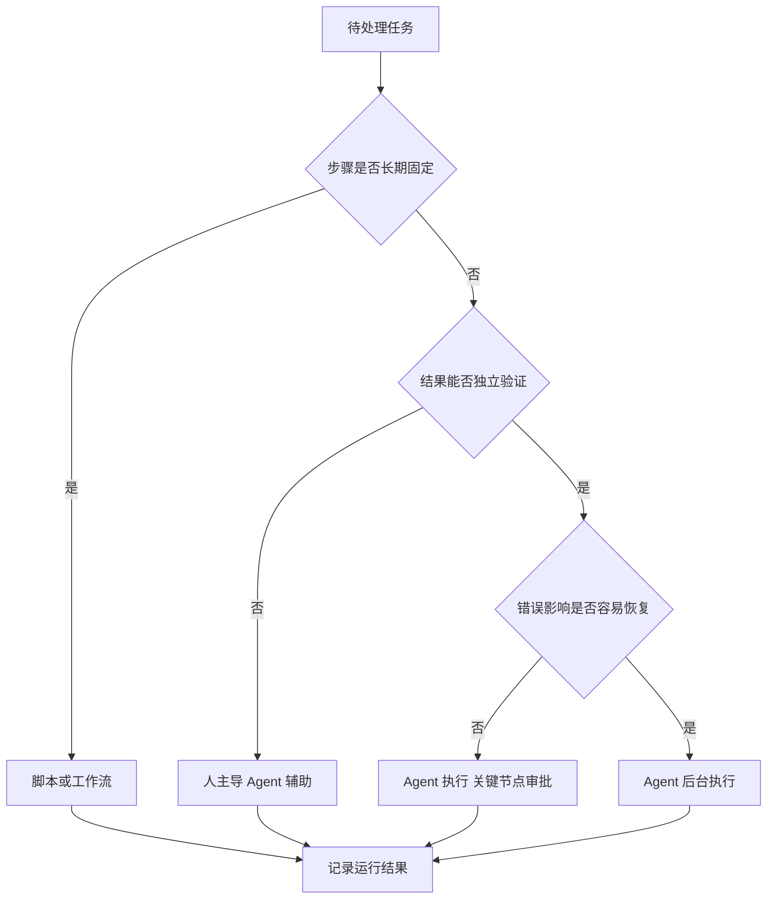

# 团队怎样把 Agent 放进真实研发流程

[← AI Native](README.md)

团队接入编码 Agent 以后，最先增长的通常是会话数量和生成代码量。评审者很快会碰到另一面。有些改动确实省了时间，有些改动把时间从编码挪到了检查，还有一些任务反复重试，最后仍要开发者重新完成。

把 Agent 放进研发流程，先要决定哪些任务适合交给它，再说明谁给目标、谁检查结果、出错以后谁负责。工具装好只代表它可以被使用，团队还需要一套任务分配和验收办法。

## 先按任务特点决定执行方式

输入、步骤和结果都很稳定的任务，继续使用脚本更省事。格式化代码、生成固定报表和执行确定的发布步骤，都可以写成普通程序。Agent 适合路径会随项目状态变化的任务，例如跨文件修复、依赖升级和根据测试结果继续定位。

能否自动验证同样重要。任务即使复杂，只要有可靠测试和清楚的改动范围，也可以让 Agent 独立执行到候选结果。缺少验证方式或涉及高风险资源时，人在行动前后都要参与。

这套分流不需要一次定死。某类任务刚接入时可以由人确认每个写操作，等环境、评测和回滚机制稳定以后，再把审批移到少数高风险节点。发生新的失败类型时，也可以临时收紧权限。

## 自主程度跟着验证能力走

Agent 的自主程度可以从本地辅助逐步扩大。第一阶段由开发者发起任务并持续观察，Agent 负责搜索、修改和运行检查。第二阶段允许后台执行，开发者只处理审批、异常和最终评审。更复杂的多 Agent 协作需要清楚的任务边界、交接协议和统一状态，不能仅靠几个 Agent 互相发送自然语言消息。

| 执行方式 | 人负责什么 | 平台需要补什么 |
|---|---|---|
| 本地辅助 | 给出目标，确认操作，检查结果 | 工具权限、操作日志和本地规则 |
| 后台执行 | 定义验收，处理审批，完成评审 | 隔离环境、检查点、短期凭证和异常恢复 |
| 多 Agent 协作 | 拆分目标，确定责任，处理冲突 | 独立身份、任务状态、交接协议和全程追踪 |

增加自主程度以前，应先确认任务能否暂停、撤销和恢复。一个无法停止的后台任务，即使成功率很高，也不适合触碰生产配置。多个 Agent 同时工作时，还要隔离工作区，避免它们修改同一批文件并互相覆盖。

## 目标、执行和责任要分开

人负责定义任务目标、业务边界和最终责任。Agent 在约束内选择步骤并执行。平台负责身份、权限、环境、记录和验收。三类职责混在一起以后，失败很容易变成一句模型没做好，具体该改哪一层却无人知道。

每类 Agent 任务都需要明确的负责人。他决定任务能否进入流程，维护验收标准，并处理无法自动恢复的异常。Agent 生成的改动仍要进入现有代码评审和发布制度，不能因为执行者换了就绕开质量要求。

评审方式也会变化。评审者除了看代码，还要看任务说明、改动范围和验证证据。对于大批量机械修改，可以先用自动检查过滤，再抽样查看具体差异。高风险改动则要保留逐项审查。

## 提效要沿着一项工作完整计算

采用率和代码生成量适合观察工具有没有被使用，无法说明团队是否更快交付。Agent 省下两小时编码，却增加三小时评审，整体时间仍然变长。改动很快合并，随后出现更多回滚，也不能算作稳定收益。

一项工作从进入开发到发布完成，可以观察这些变化。

| 观察对象 | 需要回答的问题 |
|---|---|
| 前置时间 | 任务从开始到交付用了多久 |
| 人工投入 | 开发、审批和评审分别用了多少时间 |
| 返工 | Agent 和开发者重复修改了几次 |
| 质量 | 测试失败、越界改动、回滚和缺陷是否增加 |
| 可复用资产 | 新增规则、Skill、测试和环境定义有没有被后续任务使用 |

比较时要按任务类型和风险分组。批量更新依赖与设计新架构的难度不同，把它们混在一起算平均时间没有意义。最好先找一组历史数据相对稳定、验收明确的任务，比较接入前后的耗时、返工与质量，再决定是否扩大范围。

Agent 参与以后，人投入的时间可能转移。编码时间下降，任务描述和评审时间上升。统计只看某一个岗位，会把转移当成节省。完整计算需要覆盖提出需求、执行、评审、发布和故障处理。

## 团队经验要从个人习惯变成公共规则

很多项目依赖少数开发者记住构建顺序、测试入口和发布禁区。Agent 加入以后，这些隐含经验会直接影响任务成功率。仓库规则、运行手册、Skill、环境定义和验收脚本，可以把反复出现的做法变成团队都能使用的材料。

这项整理也会暴露原有流程的问题。测试难以运行，说明环境没有被完整描述。同一任务每个人做法都不同，说明验收标准仍然含糊。Agent 只是更频繁地撞上这些缺口，修补以后，人完成任务也会更顺。

规则需要负责人和版本。过期的 Skill 会让错误稳定复现，互相冲突的仓库说明会让 Agent 每次选择不同路径。任务失败以后，团队要判断该补规则、工具、测试还是环境，不能把经验全部继续追加到一个总提示词里。

## 从一条窄流程开始扩展

落地时可以先挑边界清楚、容易验证并且失败可恢复的任务，例如补测试、更新文档或完成小范围依赖升级。给它准备环境、权限和验收脚本，记录几轮执行里的人工接管与返工原因。稳定以后，再增加任务长度和操作范围。

团队最终得到的不会只是一个会写代码的工具。任务怎样描述，项目怎样运行，权限如何授予，结果依据什么验收，这些原本分散的约定会逐步变成可以执行和检查的工程规则。Agent 能承担多少工作，取决于这些规则已经清楚到什么程度。
