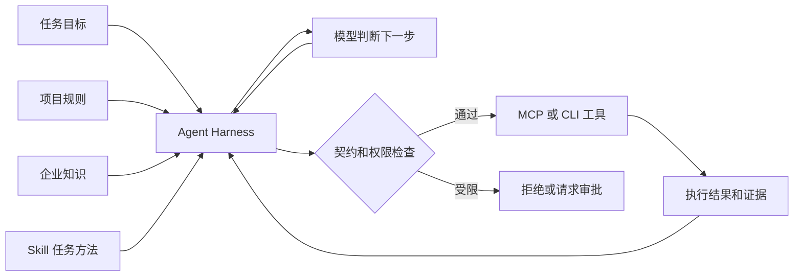

# 企业知识和工具怎样交给 Agent

[← AI Native](README.md)

把一个基础依赖升级到新版本，看起来只是改动版本号。Agent 打开项目以后，还要知道哪些模块共用这项依赖，升级前是否需要生成兼容报告，内部制品库怎样访问，改完以后要运行哪些测试。缺少其中一块，它可能写出语法正确的改动，却交不出项目能够接受的结果。

这些材料进入 Agent 的方式并不相同。仓库规则约束它必须怎样做，企业知识帮助它理解眼前的项目，Skill 提供一类任务的做法，MCP 与 CLI 则把查询和操作接到真实系统。Harness 负责在任务运行时把它们组织起来。

## 先把信息和行动分开

研发平台经常把规则、知识库、工具和 Skill 都叫成 Agent 能力。名称放在一起以后，很容易把一篇操作说明当成工具，也可能让模型根据文档猜测某项外部操作已经完成。

| 能力 | 回答的问题 | 常见载体 |
|---|---|---|
| 项目规则 | 哪些要求必须遵守 | `AGENTS.md`、编码规范、仓库策略 |
| 企业知识 | 当前项目有哪些事实和关系 | 架构文档、服务目录、接口说明、配置查询 |
| Skill | 这类任务通常怎样完成 | 步骤、前置条件、检查项、辅助脚本 |
| MCP 与 CLI | 怎样查询或改变外部系统 | 工具接口、命令、结构化返回结果 |

规则应当在行动以前生效。依赖升级禁止修改哪些目录，必须运行哪些检查，可以由 Harness 固定加载并由程序校验。企业知识按任务取用。Agent 查到某个内部依赖以后，再读取它的负责人、兼容范围和迁移说明，没有必要在开场时载入整套服务目录。

Skill 位于两者之间。它不会替 Agent 完成升级，却能说明先查依赖树，再确认破坏性变化，随后修改和验证。查询、修改和执行仍由工具完成。

这张图里只有模型节点负责开放式判断。规则加载、参数校验、权限判断和工具执行都应有稳定接口。模型可以选择调用哪个工具，不能自行宣布权限检查已经通过。

## 企业知识不等于把所有文档做成向量

依赖升级需要的材料可能来自仓库文件、服务目录、制品库接口和变更记录。文档检索适合找迁移说明，依赖的当前版本更适合直接读构建文件，制品是否存在则应查询制品库。来源不同，更新频率和可信范围也不同。

企业知识进入上下文以前，至少要保留来源、版本、适用范围和更新时间。两份文档发生冲突时，Agent 需要知道哪一份仍然生效。只返回一段相似文本，模型无法判断它来自当前规范、历史方案还是其他项目。

检索方式也要跟着材料走。文件路径明确时先搜索仓库，结构化事实优先查 API 或数据库，只有长文档和自然语言问题才需要语义召回。向量检索可以补充入口，不能替代资源标识、权限过滤和版本判断。

知识的返回结果应当支持追溯。Agent 在交付中引用了兼容规则，开发者需要回到原文确认。Harness 可以把来源标识放进执行轨迹，模型上下文只保留当前需要的片段。

## Skill 保存方法，工具承担动作

一个依赖升级 Skill 可以写清适用的项目类型、触发条件、步骤顺序、常见失败和完成标准。它还可以引用检查脚本或工具名称。Skill 适合版本管理，因为任务方法会随着项目约定变化。

Skill 不应藏入长期凭证，也不应绕过工具权限。文档里写着可以发布制品，不代表当前 Agent 获得了发布权。Harness 读取 Skill 后仍要按照当前身份暴露工具，并在每次写操作前检查资源与权限。

过长的 Skill 也会变成负担。把所有语言、框架和异常处理塞进一份说明，模型很难找到眼前任务需要的部分。可以用一个入口 Skill 判断项目类型，再加载对应的升级方法。固定检查项交给脚本，只有需要结合现状取舍的步骤留给模型。

## 工具契约决定 Agent 能不能稳定调用

给 Agent 一个命令名称远远不够。工具契约要说明输入字段、返回结构、副作用、超时、权限和重试方式。写操作还要说明幂等性。幂等指同一个请求重复执行时，系统不会重复产生资源或扩大影响。

| 契约内容 | 依赖升级任务里的例子 |
|---|---|
| 输入 | 仓库、模块、目标版本和基线提交 |
| 输出 | 依赖树、退出状态、报告位置和错误类型 |
| 副作用 | 是否改文件、创建分支或写入外部系统 |
| 权限 | 允许读取哪些制品，能否发布候选版本 |
| 重试 | 超时能否重跑，重复请求怎样识别 |
| 证据 | 命令日志、差异文件和测试报告 |

工具错误也要让程序能够分类。参数不合法、权限不足、资源不存在和服务超时需要不同处理。只返回一句调用失败，模型通常只能换一种说法再试，既浪费调用，也可能重复触发副作用。

## MCP 和 CLI 解决的接入问题不同

CLI 适合本地开发工具。参数明确，输出可以被后续命令继续处理，也容易在开发者电脑和隔离环境中复现。它的权限、凭证和输出格式需要平台另行约束，很多历史命令默认是给人看的，错误信息并不结构化。

MCP 为 Agent 客户端提供统一的能力发现与调用方式。服务可以公开工具、资源和提示模板，客户端读取描述后决定怎样使用。企业接入时仍要处理身份传递、资源授权、审计和版本兼容。协议统一了接入方式，没有替业务系统完成这些判断。

同一项能力不必同时包装成多种接口。已有稳定 CLI 的构建和测试任务，可以先补上结构化输出与权限边界。跨多个 Agent 客户端共享的业务查询，更适合通过 MCP 服务统一暴露。选择标准落在调用场景和治理要求上，不在接口名称的新旧。

依赖升级完成以后，Agent 应当能说明它依据了哪些规则，读取了哪些知识，调用了什么工具，最后拿到哪些验证证据。企业知识和工具只有进入这条可追查的执行路径，才会成为 Agent 可以长期使用的工程能力。
