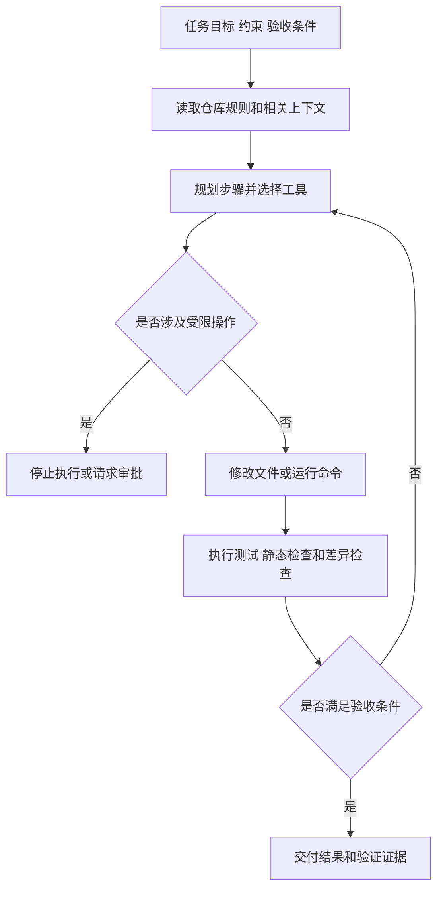

# AI Native 到底改变了什么

[← AI Native](README.md)

需求单上只有一句话，给登录接口加上限流。

模型可以很快写出一段限流代码，研发任务却还没有结束。项目可能已经有统一的中间件，限流阈值需要进入配置中心，失败响应要符合现有接口规范，测试还得覆盖正常登录与超限请求。代码能够生成，只说明其中一步有人做了。

本文所说的 AI Native，是让 Agent 作为一个可执行的工程角色进入这段过程。它读取项目状态，调用经过授权的工具，修改文件并运行检查，最后交付结果和验证证据。模型仍然负责理解与判断，工程系统负责约束它能看什么、能做什么，以及怎样证明任务已经完成。

## 从补一段代码变成完成一项任务

传统自动化适合规则稳定的任务。输入格式、执行步骤和结果都能提前写进程序，脚本每次沿着同一条路径运行。AI 编程助手放宽了输入形式，开发者可以用自然语言描述需求，再由模型补全代码或解释问题。上下文怎样准备、代码怎样验证，主要责任仍在开发者手里。

Agent 接手的是另一类工作。它拿到目标以后，需要根据仓库状态选择步骤。刚才的限流需求可能先查找登录入口，再阅读已有中间件和配置规则，完成修改以后运行相关测试。测试失败，它还要根据错误继续定位。执行路径会随当前项目状态变化，系统无法把每一步提前写死。

| 方式 | 输入 | 执行过程 | 完成依据 |
|---|---|---|---|
| 传统自动化 | 固定参数和结构化事件 | 程序按预设步骤运行 | 返回值、状态和规则检查 |
| AI 辅助编码 | 自然语言与开发者提供的上下文 | 模型生成建议，开发者选择并执行 | 开发者检查代码与运行结果 |
| AI Native 研发 | 任务目标、约束和验收条件 | Agent 读取状态、调用工具并根据结果调整步骤 | 测试、代码差异、最终状态和执行记录 |

这种变化先落到任务写法上。模糊的一句需求可以开启讨论，却不足以驱动长时间执行。Agent 需要知道修改范围、允许使用的工具、不能触碰的区域和验收方式。开发者过去藏在脑子里的项目常识，也要逐步变成仓库规则、测试或可以查询的文档。

## 任务描述开始承担执行契约

给登录接口加限流时，一份可执行的任务至少要回答几个实际问题。

| 要说明的内容 | 这个任务里的含义 |
|---|---|
| 目标 | 登录接口在超过阈值时返回统一的限流响应 |
| 修改范围 | 认证模块、相关配置和测试 |
| 现有约束 | 复用项目已有中间件，不改变数据库结构 |
| 验收条件 | 正常请求通过，超限请求被拦截，现有测试保持通过 |
| 异常处理 | 缺少配置或测试环境不可用时停止写操作并报告原因 |

这些信息并不要求都塞进一次对话。稳定规则可以写进 `AGENTS.md` 或项目文档，接口约束由代码与测试表达，当前任务只补充这次修改特有的条件。Agent 运行时把它们装配成当前上下文。

这里的上下文装配，是按任务挑选模型此刻需要的材料。代码仓库很大，把全部文件一次交给模型会增加成本，也会让过期实现和无关模块干扰判断。系统通常先提供仓库规则和任务信息，再根据 Agent 的查询加载相关代码、文档与工具结果。加载什么、何时加载，逐渐成为研发平台的一项能力。

## 生成以后必须回到验证

代码修改完成以后，Agent 需要用项目认可的方式检查结果。单元测试可以确认局部行为，静态检查可以发现类型和格式问题，接口测试能够覆盖真实调用路径。代码差异还要单独查看，防止任务完成的同时改动了无关文件。

验证结果会重新进入执行过程。测试失败时，Agent 读取错误并继续修改。检查通过以后，它输出改动摘要、运行过的命令和仍然存在的风险。任务因此形成一条受控路径。

流程中的每个节点不一定都由大模型完成。权限判断应当由普通服务执行，测试由现有工具运行，文件修改也要受到工作目录和命令白名单限制。Agent 负责根据状态组织步骤，确定性系统负责守住明确规则。

## Agent Harness 把模型接进工程环境

模型本身只接收输入并生成输出。它不知道仓库位于哪里，也不能天然获得终端、代码搜索或版本控制能力。Agent Harness 负责把这些部分组织起来。

Harness 通常维护当前任务状态，准备模型上下文，并把允许调用的工具暴露给模型。工具返回结果以后，它继续记录消息和执行轨迹，再决定是否进入下一轮。最大执行时间、调用次数和成本限制也在这一层生效。

一个可用的 Harness 还要处理失败。命令超时后是否重试，模型输出无法解析时怎样恢复，执行中断后能否继续，工具返回的内容是否可信，这些问题会直接影响 Agent 能否长期运行。后续关于 Agent Harness 的文章会单独拆解这些机制。

## 运行环境要按照不可信执行来设计

Agent 会生成命令，也可能理解错任务。运行环境需要假设错误迟早会发生，并限制错误能够影响的范围。

最直接的办法是把任务放进隔离环境。Agent 只能访问当前项目与明确授权的目录，网络连接和系统命令按需开放。读取代码与修改生产配置使用不同权限，高风险写操作还要经过审批。即使模型选择了某个工具，工具服务仍然要检查当前用户和任务是否有权调用。

运行记录同样重要。系统要保存模型版本、任务输入、上下文来源、工具参数、返回结果和最终状态。出错以后，团队需要知道问题发生在理解、工具选择、执行还是验证。只保存最后一句回复，无法回答这些问题。

## 有些任务继续用脚本更合适

AI Native 不要求把所有研发操作都交给 Agent。输入和步骤长期稳定的任务，用脚本或工作流更容易测试，也更便宜。格式化代码、生成固定报表、按规则发布制品，都有成熟的确定性实现。

Agent 更适合路径无法完全预设的任务。它需要理解自然语言目标，查看当前状态，在多个工具之间选择，并根据中间结果改变后续动作。任务风险越高，授权范围和验收条件就要越明确。

当团队为任务写清验收条件，为仓库补上可读取的规则，再把测试、权限和执行记录接入同一条流程，最后拿到的会是代码、测试结果、改动范围和可追查的执行记录。下一篇继续拆解 Agent Harness，看看它怎样管理上下文与工具，又怎样在长任务中保存状态。
