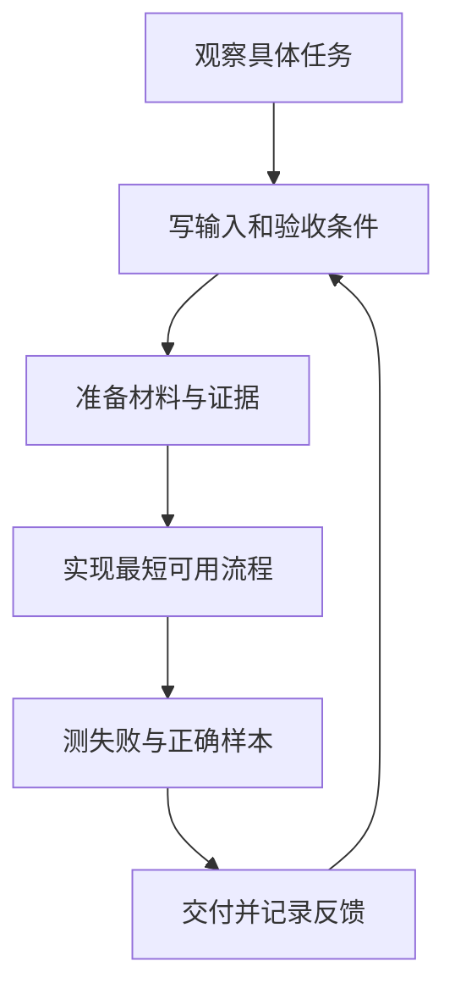

# 第 1 章：把一句需求变成一个能验收的案例

“做一个 AI 答疑助手”可以对应完全不同的系统。它可能查教材原文，可能解释某一道题，也可能在发现学生不理解时转交教师。三个系统的输入、风险和验收方式都不同。如果开发者没有把任务拆开，演示时的一次流畅回答就很容易被当成交付完成。

本章用一个虚构的数学课程团队说明 FDE 的工作过程。教师希望减少重复解释，学生希望知道自己下一步怎么做，运营人员希望能看到哪些问题需要处理。这是本书原创场景，不是某个客户项目的复盘。

## 从结果开始追问

FDE 的常见职责包括深入客户环境、理解问题和完成端到端工程交付。这个视角要求我们同时问业务和技术问题。[Palantir 的 FDE 说明](https://jobs.lever.co/palantir/5168e8fd-fec1-4fea-b7a1-81bdaea65850)

对于课程答疑，先拿一个可以观察的具体问题：“学生问为什么 `(x-2)(x-3)=0` 能得到两个根。”教师想看到的结果不是“字数达到 200”，而是学生能理解零乘积的条件，并能尝试下一题。

开发者需要补齐四项信息：课程允许使用哪些资料；哪些题目在当前教学范围；学生看不懂时如何继续；教师如何修改一条不合适的回答。学生是否真正学会，还需要后续学习任务与观察来验证，不能只由聊天记录推断。

## 本书约定的六步工作法

我们把案例整理为六步。它是便于记录、审阅和复用的工作约定，读者可以根据自己的交付环境调整。



观察阶段保留一条完整业务链：谁提出请求，使用了什么材料，做出什么动作，谁承担结果。实现阶段把这条链做出来；评测阶段主动让它失败；交付阶段确认失败有没有被正确接住。流程的反馈箭头意味着验收条件可以修订，但必须留版本。

### 第一步：保留一条具体任务

案例卡的起点是一段自编的学生提问和教师处理方式。例如学生写出 `x(x-5)=-6` 后停止。教师可以问“右边能否变成零”，再引导因式分解。这里记录的是可观察作答，不把学生归为“视觉型学习者”或根据停留时长推断理解程度。

### 第二步：写明可以验收的输出

输出至少分成内容和动作。内容是解释、证据和后续练习；动作是返回学生、请求补充信息或转交教师。把两者混在一段自由文本里，后端就难以可靠地知道应该做什么。

```json
{
  "case_id": "edu-qa-001",
  "course_id": "math-demo",
  "task": "解释二次方程的因式分解步骤",
  "input": ["student_question", "approved_course_documents"],
  "output": ["explanation", "citations", "next_action"],
  "review_required_when": ["证据不足", "符号不确定", "课程范围不匹配"],
  "version": "0.1"
}
```

`course_id` 用来限定材料范围；`version` 用来追溯本次结果基于哪一版案例。这个小对象是教程里的规格示例，不是原公司接口或数据表。

### 第三步：把资料变成有来源的输入

课程文档需要课程归属、发布状态、内容版本和可引用片段。一个扫描页“看起来相关”还不够：它可能来自另一门课、未经教师确认，或者缺失题干的一半。材料在进入模型之前就需要过滤，不能等答案生成后才发现越界。

### 第四步：实现最短流程

先做“检索已审核资料→提供证据→生成解释→检查结果→处理不确定性”。只有当一个模型需要根据状态决定下一步工具时，才讨论更自由的 Agent 编排。已知业务步骤可以用普通函数或工作流实现，这样更容易查看输入输出、重跑失败节点。

框架可以帮助实现流程，但不能替代业务规格。RAG 指检索外部材料后把它作为生成上下文；检索器和模型分别有失败方式，后续章节会拆开检查。[检索与 RAG 的官方说明](https://docs.langchain.com/oss/python/deepagents/retrieval)

### 第五步：为失败写样本

与正常题一起准备：缺少条件的问题、跨课程的问题、减号模糊的图片、只有答案没有过程的作答。每条样本都写预期动作。对于不确定题目，“请学生确认题干”可能就是正确结果，不能把所有转人工都算作失败。

### 第六步：确认接手人能够操作

交付不仅包含部署命令。教师需要知道怎样修订材料、查看待复核结果、撤回错误版本；开发者需要知道怎样定位一次失败、重跑任务和恢复服务。如果只有编写者能处理异常，案例就还没有具备复用条件。

## 怎样避免把构想写成经验

案例记录要分三栏：当时观察到的业务问题、本书采用的演示设计、已经完成的验证。用户自述能支持经历背景，公开网页能支持产品介绍，离线测试能支持程序行为；这三种证据都不能单独证明生产效果。

| 记录 | 本案例可以写什么 |
|---|---|
| 问题 | 解释步骤与找到答案是不同任务 |
| 设计 | 有课程边界、来源引用和教师处理入口 |
| 本版验证 | 合成样本能检查材料过滤与路由 |
| 待验证 | 模型解释质量、真实使用体验、学习变化 |

这种写法让一本案例集能逐步成长：新增实测记录可以补进已有章节，而不用用更强的形容词掩盖验证缺口。

## 跟做练习

选择一个你熟悉的重复任务，只写一条完整实例。给它添加课程或业务范围、可用资料、输出动作和三个会失败的输入。请另一位读者按这张卡判断输出是否通过；如果两人的结论不同，先修订验收规则，再调整提示词。

本章的成果是一张能被第三方检查的案例规格。下一章把教师讲解经验整理成这张规格可以调用的内容。

[前言](00-preface.md) · [下一章：教师经验](02-teacher-knowledge.md)
