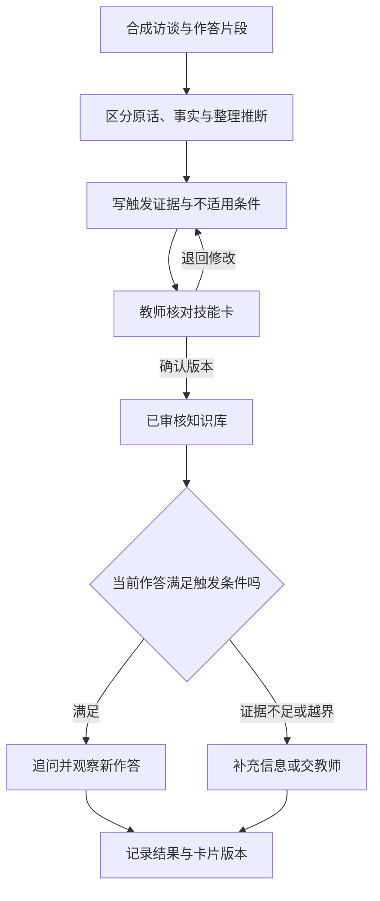

# 第 2 章：把教师的一次判断整理成可复用的知识

学生已经写出 `(x-2)(x-3)=0`，接着说：“所以两个括号都等于零。”答案里的数字可能碰巧正确，理解却有缺口。若答疑系统只检索到一道完整解题例题，它很可能再次列出根为 2、3，错过“同时成立”和“至少一个成立”的区别。教师经验的价值就在这个岔路口：看到什么证据，先问哪一句，什么时候解释，什么时候停下来补基础。

本章把这次判断整理为可调用、可追溯的教学知识。访谈、教师回答、学生作答和技能卡均为本书原创合成材料，供作者与教师审阅，不代表任何公司的内部系统。

## 要留下的是判断依据

[启焰师道公开主页](https://teacheronhand.com/)把教学工作流程、教师审核和经验整理放在“教师 FDE”的产品语境中。这里的教师 FDE 是该公司的培养表述，不能直接等同于工程岗位 Forward Deployed Engineer，也不能据此认定两者有统一的认证标准。本书承接的是一个通用问题：怎样让教师经验进入工程交付，同时保留教师修改和撤回的能力。

解出二次方程属于学科知识；选择一种解释帮助学生理解，则还需要教学判断。Shulman 在讨论学科教学知识时，把内容的表示、解释以及学生可能带来的误解纳入教师知识范围。这为我们拆分材料提供了概念依据，并不自动证明某种 AI 封装方法有效。[Shulman，1986](https://journals.sagepub.com/doi/10.3102/0013189X015002004)

因此，采集对象不能只有一段“标准讲解”。同一道题至少要留下三类内容：可以核验的数学关系，面对特定作答的处理选择，以及这些选择适用的条件。教师说“我通常先问一句”还不足以成为规则；需要追问这句话针对什么证据，如果学生换一种回答，下一步是否改变。

## 用一段反例访谈挖出隐含条件

访谈时把具体作答放在教师面前，避免从“您的教学理念是什么”开始。下面是一段自编访谈，目的不是模仿某位教师的语言，而是展示信息如何被逐步补齐。

**访谈者：** 学生说两个括号都为零，您会怎样接话？

**教师：** 我会先问：“把 `x=2` 放进去，两个括号分别是多少？”让他算出 0 和 -1，再问乘积是多少。

**访谈者：** 如果他算对了，却仍然坚持必须同时为零呢？

**教师：** 那就请他比较 `0×(-1)=0` 和 `(-1)×0=0`，说明乘积为零允许哪个因子为零。再回到原式，分别求 `x-2=0` 或 `x-3=0`，注意这里是“或”。

**访谈者：** 如果他连 `2-3` 都算不对呢？

**教师：** 先核对整数运算，不把这个错误直接归为零乘积规则的误解。也可能是题干看错，先确认原式。

原始访谈留下了措辞和分支，但还不适合直接塞进系统。整理者要先把“学生可能不懂”改为可观察触发条件，把“讲一下”改为具体动作，把“学会了”改为下一次需要观察的作答。访谈后把整理结果交回教师核对，尤其核对整理者新增的推断。新增规则可以作为候选建议，不能伪装成教师原话。

## 从访谈到一张技能卡

这里的“技能”指完成一个有限任务的规则、材料和输出约定，不表示模型已经获得教师的全部能力。下面的卡片只处理零乘积解释中的一个分支。

| 卡片字段 | 本例内容 |
|---|---|
| 标识与版本 | `zero-product-explain@0.1`，状态为待审核 |
| 输入 | 已确认的方程、学生当前步骤、课程允许材料 |
| 触发证据 | 学生明确声称两个因子必须同时为零 |
| 前置条件 | 在实数范围内；原式已成为两个因子的乘积等于零 |
| 首个动作 | 请学生代入 `x=2`，分别计算两个因子及乘积 |
| 分支 | 算术错误先核对运算；计算正确仍误解时比较两个零乘积例子 |
| 禁止动作 | 不把 `ab=-6` 当成零乘积；不要求同一个 x 同时等于 2 和 3 |
| 输出 | 一句追问、使用的规则、观察依据、继续或交教师的动作 |
| 来源 | 合成访谈 `interview-demo-01` 的相关段落；数学规则另行核验 |
| 验收 | 解释“至少一个因子为零”；两根代回原方程成立 |

这张卡保留了范围和拒绝条件。若学生只发来“2，3”，系统缺少足够证据判断他是否存在上述误解，应请他补一句理由。若题目变成 `x(x-5)=-6`，需要先移项并重新因式分解，当前卡不能抢先触发。触发条件越具体，越容易发现它有没有被错误调用。

图中的两次检查承担不同职责。教师审核确认这张卡表达了什么；调用时的条件检查确认眼前任务能否使用它。已经审核的知识也可能在错误场景被误用。

## 让每一次修改都能回到证据

来源追踪记录内容由哪些材料、哪些处理活动和哪些人产生。W3C 的 PROV 文档用实体、活动和参与者描述这种关系；本案例借用这一思路，不要求读者实现完整的标准。[W3C PROV 概览](https://www.w3.org/TR/prov-overview/)

实践中可以保存四条关联：访谈片段的位置，技能卡从哪个片段整理而来，教师确认了哪一版，以及一次回答实际调用了哪一版。原始材料与发布材料分别存放；对真实课堂材料还应先确认可用范围并去除无关身份信息。正文里的访谈是合成数据，无需用真实学生记录才能完成练习。

假设卡片 0.1 只写“代入验证”，教师在复核时补充“先分别计算两个因子，再求乘积”，便产生候选 0.2。审核通过后才把调用入口指向 0.2，已有回答仍记录 0.1。若回滚到 0.1，保留 0.2 的修改原因和审核记录。直接覆盖旧卡会使一次错误回答无法被复现，也无法确认错误来自旧知识还是调用逻辑。

还要区别“数学事实已核对”和“教学策略值得尝试”。代入验证可以确定两根是否成立，却不能单凭一次回答确定学生已经理解。两位教师如果对追问顺序有不同意见，可以保存不同策略及其适用条件，交由课程团队选择。把差异揉成一段折中话术，往往会抹掉本来需要评测的决策。

## 解释能力与形象、声音分别验收

头像、数字形象和 TTS（文本转语音）影响呈现方式；本章的知识卡负责内容和决策。可以先用纯文本检查卡片，再检查语音是否把“或”读清楚、是否把负号漏掉。形象相似、声音自然以及话术亲切，都不能代替数学和分支检查。公开页面出现名师形象相关产品，也不意味着本案例已经实现或验证这些能力。

## 评测要让卡片有机会出错

给候选卡准备同题不同作答：写对式子却说“同时为零”；只写根没有理由；把乘积写成 -6；代入时出现整数运算错误。教师逐条标注应追问什么、应避免什么，再交给系统生成。评测者检查触发是否正确、数学是否成立、解释是否依据当前作答、来源是否可追踪，以及越界时是否停下。不要只问“像不像这位教师”。

还可以让学生解释为什么 `x=2` 时另一个因子不为零仍能成立。Chi 等人的原始研究在阅读人类循环系统材料的任务中考察了自我解释的作用，为“让学习者说出理由”提供研究背景；它没有验证本书的二次方程卡或 AI 答疑效果。[Chi 等，1994](https://education.asu.edu/sites/g/files/litvpz656/files/lcl/chideleeuwchiulavancher_3.pdf)

本例的数学核验有明确结果：`2²-5×2+6=0`，`3²-5×3+6=0`；但教学质量需要进一步观察。生成的问题即使正确，也可能对当前学生过难。若连续两次补充仍无法定位障碍，本例约定交给教师，并附上原式、作答与已做的追问；“两次”是演示的停止规则，需由课程团队调整，不能当成普遍阈值。

## 跟做练习

把合成访谈中的“先核对整数运算”整理成第二张卡，明确它需要哪些作答证据。再用“学生沉默”和“学生把减号看成加号”试调用两张卡：前者没有足够证据下诊断，后者应先确认题干。请另一位读者只凭卡片给出预期动作；若结论不同，补充触发和边界，而不是增加一大段角色描述。

卡片准备好之后，还需要决定它在一次教学任务的哪个环节出现。下一章把材料、生成、教师复核和课堂反馈连成一条可暂停、可修订的流程。

[上一章：FDE 方法](01-fde-method.md) · [下一章：教学流程](03-teaching-workflow.md)
