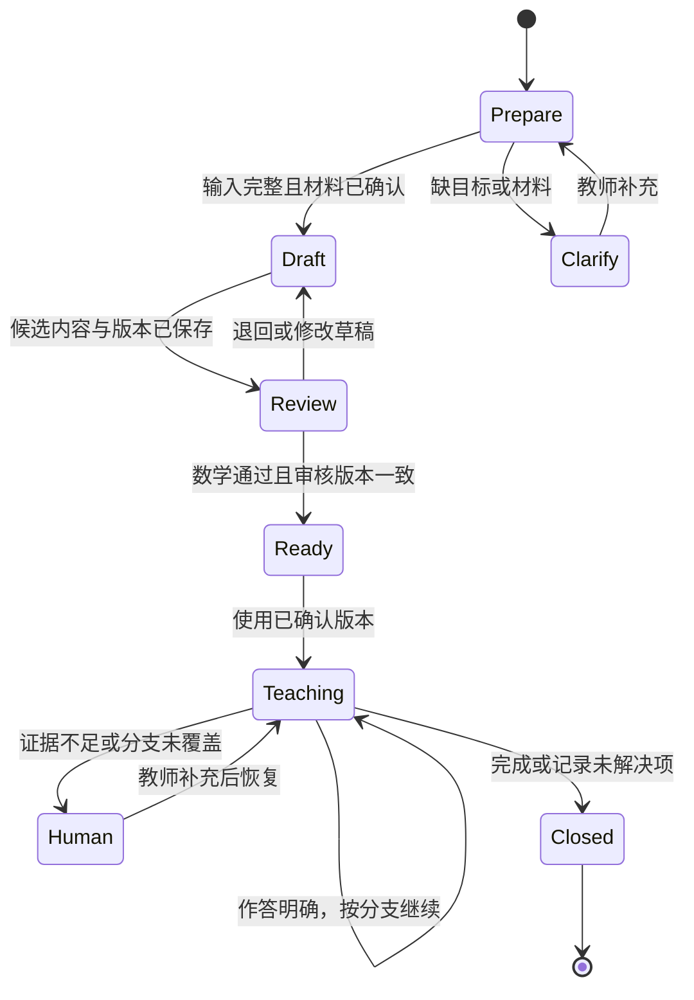

# 第 3 章：让一次备课留下可以执行的流程

一份教学稿可以同时包含目标、例题和练习，却仍然无法执行。学生在第二问答错了，后面的讲解要不要继续？教师修改了答案，原来的审核还有效吗？网络中断后重新运行，会不会再次发布？这些问题需要流程明确回答，不能靠一句“请认真检查”解决。

本章设计一场原创的 20 分钟备课演练：为二次方程 `x²-5x+6=0` 准备短课、回放学生作答并复核教学稿。20 分钟是练习的时间预算，不是实测备课提效结果；课堂讲授时间另行安排。所有材料和失败样本都是合成数据。

## 把活动名称变成输入和结果

SOP 是标准操作规程，说明在什么条件下，由谁使用什么材料，完成什么动作。公开网站以“教师 FDE”描述把工作流程与 AI 应用结合的培养方向，并列出 S7 问题链这一名称。S7 属于该公司的表述，本书不把它当成普遍教学标准，也不复刻其训练内容；下面采用自编的三问和流程。[启焰师道公开主页](https://teacheronhand.com/)

这次演练从一个可检查的目标开始：学生能把原式分解为 `(x-2)(x-3)=0`，说明零乘积条件，并把 2、3 代回原式验证。备课者先确认整数运算和代数展开是本课所需基础；没有这项信息，就保留“前置知识待确认”，不能让模型替教师补成肯定结论。

| 演练时间 | 动作与可检查的产物 |
|---|---|
| 0—3 分钟 | 教师确认目标、范围和材料版本，得到备课输入单 |
| 3—8 分钟 | AI 按输入生成例题解释、三问及分支，得到候选草稿 |
| 8—12 分钟 | 用合成作答试讲，留下每问的预期动作与实际动作 |
| 12—17 分钟 | 教师核对数学、问题顺序和失败处理，得到修改或审核记录 |
| 17—20 分钟 | 检查版本一致性并归档，得到可用版本或待处理清单 |

时间到了仍有错误，就归档待处理清单，不把倒计时结束当作定稿条件。执行顺序可以固定，完成条件必须由产物决定。

为了让程序读懂输入，字段需要约定类型。类型表示一个值允许是什么，例如字符串、整数或受限选项；输出动作也要从有限集合中选择，不能只有一段自由文本。

| 字段 | 类型与约束 | 为什么需要它 |
|---|---|---|
| `course_id` | 非空字符串 | 找到本课可用材料 |
| `material_version` | 非空字符串 | 固定本次生成的证据范围 |
| `goal` | 字符串 | 供教师核对教学目标 |
| `student_work` | 字符串或空值 | 空值意味着尚无作答证据 |
| `next_action` | `ask / explain / review / finish` | 把内容生成与流程动作分开 |

JSON Schema 可以规定对象属性、必填字段以及额外字段的处理。声明某个属性并不使它自动必填，必填要求需要显式写入 `required`。这些检查能挡住缺字段或类型错误；它们不验证数学和教学目标。[JSON Schema 对象文档](https://json-schema.org/understanding-json-schema/reference/object)

## 每问之后要等待一种证据

候选草稿的第一问是“展开 `(x-2)(x-3)`，一次项为什么为 -5x？”能正确展开才进入第二问：“乘积为零，两个因子必须同时为零吗？”第三问要求把求出的根代回原方程。三问分别检查因式分解、零乘积和验证，不因问题数量齐全就宣布目标完成。

若学生在第一问写成 `x²-6x+6`，流程保存这条作答，转去核对两个一次项；若第二问说“同时为零”，调用上一章的零乘积技能卡；若只回复“会了”，要求展示一项计算或理由。没有回答是缺少证据，不能被自动归为“不会”或“已经掌握”。这些分支使用可观察作答，不需要摄像头判断注意力，也不把学生归为固定学习类型。

模型适合提出候选解释，程序负责核对动作是否合法，教师负责确认教学内容和未覆盖的分支。模型若返回集合之外的动作，保持待复核状态；若返回合法的 `explain`，仍要检查它是否在足够证据和当前课程范围内触发。

## 用状态表达哪里可以停下

状态机用有限状态和转换条件表示流程。例如“待审核”接到有效审核才进入“可用”，不是保存草稿后自然进入可用。W3C SCXML 标准明确表达状态、事件和条件控制的转换；这里用更小的图说明同一种建模思路，不要求引入 SCXML 运行时。[W3C SCXML](https://www.w3.org/TR/scxml/)



图中的 `Prepare`、`Review`、`Ready` 分别是准备、待审核和可用。课堂使用阶段保持一个已确认版本；如果临时修改讲解，保存为新的候选版本，重新检查后再使用。恢复任务时也要读回原来的材料版本和已问问题，避免以新的上下文悄悄重做旧任务。

暂停需要保存的不只是最后一句话，还包括草稿、版本、作答和待确认动作。LangGraph 的官方中断机制展示了保存状态、等待外部输入并恢复执行的做法；采用它需要配置持久化和任务标识，本章的状态图本身没有实现这些能力。[LangGraph interrupts](https://docs.langchain.com/oss/python/langgraph/interrupts)

## 一条会误发布的 SOP

下面构造一个可以重现的失败，不把它写成生产事故。最初的 SOP 只有“生成草稿→教师同意→发布”。教师已同意版本 1；随后回放时把版本 2 人为替换为错误草稿：从 `x(x-5)=-6` 直接推出 `x=0` 或 `x=5`。系统仍保留旧审核，得到下面这个合法 JSON：

```json
{
  "plan_id": "quadratic-demo",
  "course_id": "math-demo",
  "status": "review",
  "draft_version": 2,
  "student_work": "x(x-5)=-6",
  "draft_roots": [0, 5],
  "review": {
    "decision": "approve",
    "approved_version": 1
  }
}
```

如果发布条件只有 `review.decision == "approve"`，这份草稿会被放行。失败有两处可直接检查的证据：审核版本 1 不等于草稿版本 2；把 0 或 5 代回原方程都得到 6，均不是根。问题即使没有模型参与也会发生，因而单独更换模型不能修复这条 SOP。

修订后的操作规程可以写得很短：

```text
1. 固定课程、材料版本和目标；缺项则请求教师补充。
2. 生成候选草稿，保存新版本；任何修改使旧审核失效。
3. 核对展开、零乘积前提与两根代入；失败则退回草稿。
4. 教师审核当前版本；审核版本不一致则留在待审核。
5. 使用确认版本；作答不明确或分支未覆盖则交教师。
6. 归档作答、使用版本、未解决项；同一发布键只执行一次。
```

发布键可以由 `plan_id` 与已确认版本组成，用于识别同一发布请求。幂等指同一操作重复执行不会在首次结果之外再增加影响。LangGraph 文档提醒，中断恢复会重新运行所在节点，中断前的副作用可能重做；因此把发布独立出来并做重复检查，不能假设恢复只从暂停的下一行继续。[中断与幂等规则](https://docs.langchain.com/oss/python/langgraph/interrupts)

## 流程跑通之后，怎样判断值得复用

回放不能只用根为 2、3 的正常样本。还要检查空作答、第一问算术错误、第二问概念误解、材料缺版本、旧审核和重复发布。每条样本都记录输入、应到的状态、实际状态和教师判断。流程正确性看它是否去了合法状态；教学质量看问题是否针对障碍、解释是否合适。前者通过不意味着后者也通过。

把这份 SOP 封装为可复用技能时，只开放方程、课程目标、材料和时间预算这些参数，保留类型、版本与审核约束。新题不能因长得像旧题就沿用根、讲解或触发条件；例如不能用整数因式分解处理的题，需要另设策略。可复用的是完成任务的约定，具体数学内容仍需重新核对。

跟做时先用 JSON 样本检查两个发布条件，写出为什么一个放行、一个拒绝。再增加“审核之后修改一个负号”的回放，确认系统回到待审核；最后把第二问替换为只给答案的学生作答，补写它需要请求的证据。只要还有不能确定的状态，就把它留下来给教师处理，不用一段更流畅的总结掩盖。

[上一章：教师经验](02-teacher-knowledge.md) · [下一章：课程答疑](04-course-qa.md)
