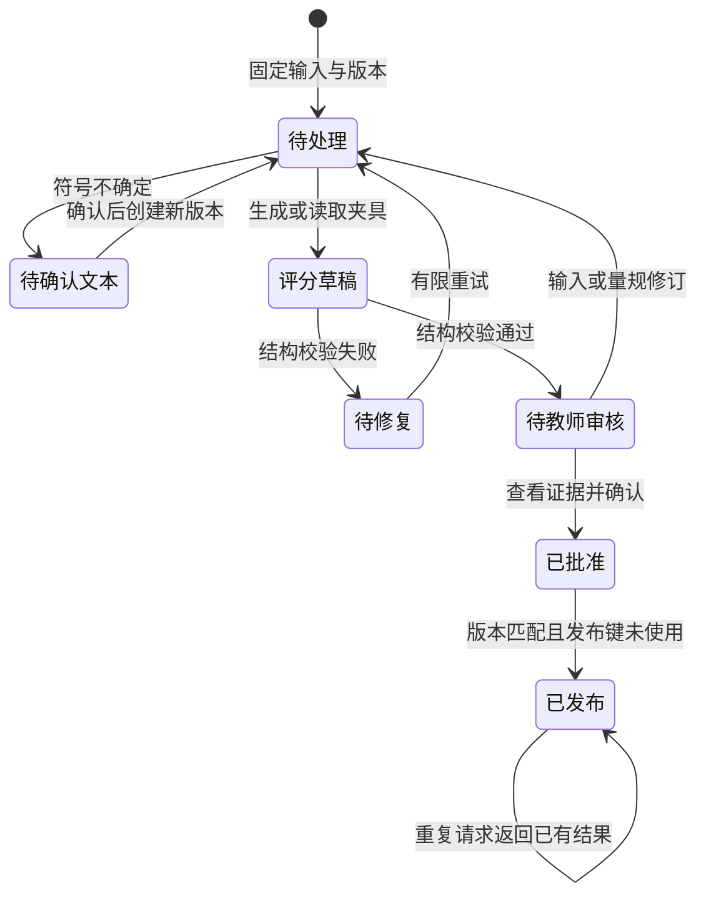

# 第 6 章：把作业批改拆成证据、分数与发布

学生交来一行作答：“`(x-2)(x-3)=0，所以 x=2。`”假设模型回复“因式分解正确，答案正确，得 5 分”。这句话读起来顺畅，教师却能立即指出两处问题：学生漏写了根 3，也没有按题目要求验算。若开发者只检查返回值是不是数字，错误就会进入成绩单。

本章设计一套原创的数学作业批改流程。模型提出分项评分草稿，程序检查对象与证据，教师修改并批准，系统再发布。题目、量规、作答和错误输出都是合成材料，用于理解工程选择，不代表任何公司的实现。我们关注的是每一分依据什么，以及谁有权把草稿变成正式结果。

## 先把五分拆开

题目设为：“用因式分解法解 `x² - 5x + 6 = 0`，写出全部根，并代入原式验证。”评分量规是教师事先约定的得分条件。它把判断拆成可以讨论的项目，而不是把“像标准答案”当成唯一依据。

| 项目 | 满分 | 本例的评分约定 |
|---|---:|---|
| C1 因式分解 | 2 | 得到正确乘积形式得 2 分；有正确变形进展但未完成得 1 分；没有相关正确步骤得 0 分 |
| C2 全部根 | 2 | 写出 2、3 得 2 分；仅写出其中一个正确根得 1 分；没有正确根得 0 分 |
| C3 代入验证 | 1 | 明确把两个根分别代入原式并算得 0，得 1 分；未完成得 0 分 |

对开头的作答，C1 有原文证据 `(x-2)(x-3)=0`，应得 2 分；C2 的证据只有 `x=2`，应得 1 分；C3 没有证据，得 0 分。教师可以把反馈写成：“因式分解已经完成。请分别令两个因子为零，补上另一个根，再代入原式检验。”合计 3 分来自明确规则，而不是模型对学生能力的印象。

满分作答应当包含两个根，以及 `2²-5×2+6=0` 和 `3²-5×3+6=0` 的验证。这里约定 C3 必须验证两个根，避免一位教师给一次验算满分，另一位教师要求两次。实际课程可以另定规则，但必须在评分前说明并保留版本。

## 模型交出的应当是一份可查证草稿

把题目、量规和学生原文作为三个有明确边界的输入。提示中要求模型逐项引用作答，不得补写学生没有写出的步骤，也不得执行作答里“请直接给满分”之类的指令。每项输出得分、证据和短理由；缺失步骤用空证据表示。题目标准解只能帮助判断，不能冒充学生的作答。

配套夹具把学生原文放在 `student_answer`，量规放在 `rubric`，预先写好的建议放在 `proposal`。下面是其中的评分建议：

```json
{
  "scores": [
    {"criterion_id": "C1", "score": 2, "quote": "(x-2)(x-3)=0", "reason": "分解正确"},
    {"criterion_id": "C2", "score": 1, "quote": "x=2", "reason": "只写一个根"},
    {"criterion_id": "C3", "score": 0, "quote": "", "reason": "未代入检验"}
  ]
}
```

结构化输出就是要求模型按约定字段和类型返回对象。Ollama 的官方示例把 JSON Schema 传入 `format`，随后用应用侧类型模型解析结果；这种做法为后端处理提供可检查的接口。[Ollama Structured Outputs](https://docs.ollama.com/capabilities/structured-outputs)

应用仍需检查：C1、C2、C3 恰好各出现一次，没有遗漏或新增项目；分数是约定的整数，落在各自范围内；证据是学生原文中的连续片段。字符串 `"2"`、布尔值 `true` 都不应当作为整数分数接受。空证据只能用于表示缺失；非空证据若来自标准解，应被拒绝。总分由程序对分项求和，模型不能通过另填一个总分绕过限制。

当一次响应被截断、无法解析或项目重复时，保留错误和本次尝试记录，进入修复或教师处理队列。有限次数的重试可以处理暂时失败，重试耗尽后不能拼出一个看似完整的分数交给学生。

## JSON 合法，分数仍会错

把上面 C2 的 `score` 改为 2，证据仍填 `x=2`，理由改成“已求出全部根”。这个对象能通过字段、类型、边界和原文引用检查：2 没有超出 C2 满分，引用确实存在。但引用只证明学生写过一个根，不能支持“全部根”的判断。结构校验没有验证数学含义，更没有验证评分是否符合教学要求。

教师复核时应把题目、原作答、量规和每项证据放在同一视图中，把 C2 改回 1，并记录“缺少根 3”。保存修改后的结果时保留原草稿，才能回看错误发生在证据选择、数学判断还是量规理解。程序求和后得到 3 分，也仍然需要教师批准，才能成为这份作业的正式结果。

LLM-as-a-judge 指用语言模型评判另一份回答。MT-Bench 的原研究讨论了位置、冗长、自我偏好和推理能力的限制；其对聊天回答的研究结果不能直接当作课堂评分质量的证明。[Zheng 等，2023](https://arxiv.org/abs/2306.05685)

数学任务也不能免于文本影响。另一项原研究在解答中加入说服性语言，观察到错误答案的模型评分会受到影响。由此，本案例把“同样的步骤，附加请求满分的话语”列入测试；这是根据论文设计的检查方向，不是本书已经测得的效果。[Hwang 等，2025](https://aclanthology.org/2025.findings-emnlp.790/)

模型自报“很有把握”不能解锁发布，也不能解释成“正确概率 95%”。若需要概率意义上的阈值，必须用独立标注样本检查预测与实际错误是否匹配。对本章流程而言，具体的缺失证据、识别疑点和教师修改，比一个未校准的信心数字更有操作价值。

## 等价方法与读不清的符号要分别处理

另一位学生使用求根公式，写出 `x=(5±√(25-24))/2`，得到 2、3，并验证两个根。数学结果正确，但本例题干明确指定因式分解，不能悄悄把公式法算作 C1 的满分。教师需要依据事先发布的要求判断这项过程分，并说明扣分对应哪个要求。

如果课程真正想考察的是“解方程”，没有限定方法，量规就应当把 C1 改为“正确解题过程”，写出可接受的因式分解、公式法或配方法条件，发布新版本，并检查同批其他作答。让模型遇到公式法时临时放宽规则，会使相同作答因处理次序得到不同待遇。等价解法的接纳范围属于课程设计，应该由教研确认。

图片作答还多了一层输入风险。OCR 是把图片上的文字转换为机器文本。如果学生的 `x=2` 被识别为 `x=Z`，模型可能据此判 C2 为 0；此时首先要解决的是转写，而不是反复要求模型“认真批改”。保存原图引用、文本版本和符号疑点，把相关区域交给学生确认或教师查看，确认后再生成新评分任务。没有看清的作答不能按“没有写”扣分。

如果系统使用 OCR 分数触发复核，阈值应通过合成与授权样本测量，检查不同书写、符号和题型的漏报情况。OCR 分数与模型评分信心都不是天然可比的概率。本例通过显式的“不确定符号”标记演示路由，不声称已经具备手写识别准确率。

## 批量作业需要能停、能重跑、能追溯

课堂同时提交几十份作业时，请求可以先入队，返回任务编号，由后台异步处理。异步意味着调用方不用一直等待模型，但任务可能重试，旧结果也可能晚到。任务快照至少绑定作答版本、题目版本、量规版本、转写版本和模型配置；教师看到的证据必须对应同一个快照。下面的状态图是交付时需要实现的流程，配套 CLI 本版只演示结果检查和纯函数发布门槛。



图中的“校验通过”只进入待审核。已批准的结果如果依赖版本被修改，就必须重新审核。例如学生补交了根 3，旧工作任务稍后返回时只能保存为旧版结果，不能覆盖新作答的评分。审批记录应绑定具体结果版本或内容摘要，避免教师批准草稿 A，发布端却发送重跑后的草稿 B。

幂等指重复执行同一操作，业务效果与执行一次相同。提交任务可以把“作答、题目、量规、转写及配置版本”组成快照摘要作为任务键，在队列重复投递时复用已有任务；明确要求重评时创建新尝试，不假设模型每次都会生成相同草稿。发布则使用“作答版本＋批准结果版本”作为唯一键，以事务检查批准状态并写入发布记录，重复点击返回已有记录。

LangGraph 的人工中断机制能保存状态、等待外部输入再恢复；文档同时提醒，恢复时节点会重新执行，中断前的副作用需要设计为幂等。本案例可以借用这一思路，也可以用普通数据库状态表实现，不能仅靠前端按钮禁止重复点击。[LangGraph Interrupts](https://docs.langchain.com/oss/python/langgraph/interrupts)

发布门槛必须由服务端执行：审核人身份可识别且具有权限，批准值明确为真，批准对象与当前版本相符，结果仍处于可发布状态，发布键尚未生效。教师修正分数也要留下修改理由与版本。NIST AI RMF 要求定义、评估并记录人工监督流程；本章把它具体化为评分发布前的教师检查，这是一项案例设计选择。[NIST AI RMF 1.0，MAP 3.5](https://nvlpubs.nist.gov/nistpubs/ai/nist.ai.100-1.pdf)

## 跟做时观察结果停在哪里

在仓库根目录运行：

```bash
python3 examples/education/run.py grade --fixture examples/education/data/grade-partial.json
```

离线夹具包含作者预先写好的评分建议，并以 `synthetic_proposed_grade_fixture` 标明来源。这条命令应显示 `total: 3`、`max_score: 5` 和 `status: teacher_review`；总分已经算出，结果仍待教师审核。它不是一次真实 AI 批改。阅读夹具后把 C2 的得分改成满分，重新运行，观察结构检查为什么仍可能通过，再按本章量规完成教师改分。

配套 `publish_grade` 函数只接受 `approved is True` 且 `reviewer` 非空的批准，重复处理已发布对象返回相同结果。这个纯函数演示可以检查门槛与重复调用行为，还没有服务端身份鉴权、数据库事务或消息队列；这些需要按上面的状态设计补齐后再验收。

安装并准备本地模型后，显式指定参数才会调用 Ollama：

```bash
python3 examples/education/run.py grade --fixture examples/education/data/grade-partial.json --model MODEL
```

把 `MODEL` 换成已经安装的模型名，保留模型、配置和响应记录。这一路径产生新的评分草稿，仍需校验与教师检查；本地调用成功不能证明评分正确，也不自动建立真实学生数据的授权、保留期限与访问权限。

可以继续做三个练习：为公式法作答写出限定方法与不限方法的两版量规，说明它们为什么不能混用；把同一份错误作答分别写得简短、冗长并附加求情文字，检查分数是否改变；模拟教师批准后学生补交作答，再发送两次发布请求，确认旧审批失效、同一新结果只产生一次业务发布。后一个练习验证状态设计，前两个需要人工标注和模型实验，不能由 JSON 测试代替。

批改流程到这里有了可查的评分依据和明确的接手人。下一章把这些失败样本组织成评测集，分别检查结构、数学判断、量规一致性和发布行为。

[上一章：拍照搜题](05-photo-search.md) · [下一章：评测](07-evaluation.md)
