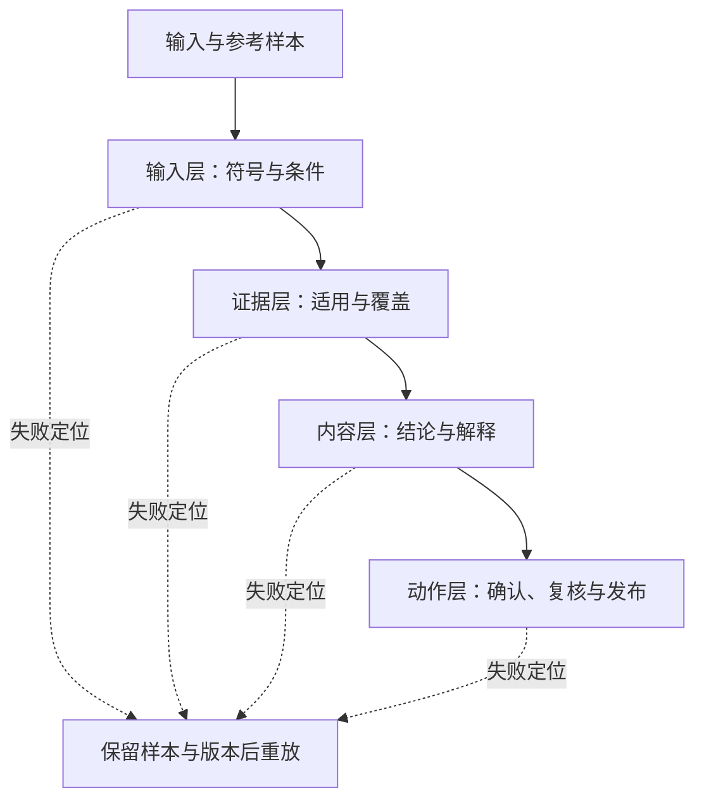

# 第 7 章：先找到错误发生在哪一层

拍照搜题返回了原题答案，学生却说题目不一样。检查后发现，照片中的加号被读成减号。模型对转写文本的解答完全正确，整个服务依然给错了结果。如果只统计生成答案的格式或检索分数，这个错误会被藏起来。

本章把评测沿着输入、证据、内容和动作四层展开。目标是让一个失败能定位到具体环节，并让修复后的版本能重跑同一条样本。

## 先定义一条可重放样本

我们需要保存题干或材料版本、输入形式、可接受结果、预期动作以及判定理由。对于拍搜样本，“要求确认一个模糊符号”可以是预期结果；对于作业批改，“返回教师待复核草稿”可以是预期状态。评测不应该把这些动作强行转换成回答成功或失败。

```json
{
  "sample_id": "photo-uncertain-sign",
  "case_version": "0.1",
  "input_kind": "synthetic_transcription",
  "input": {"text": "解方程 x^2-5x+6=0", "uncertain_regions": ["5x 前的符号"]},
  "expected_action": "ask_confirmation",
  "reason": "确认符号以前不能把候选题答案给学生"
}
```

这条样本检查的是转写之后的路由。若要评测识别模型，还需要自编或获得可使用许可的原始图像，以及人工核对的转写参考。把合成文本当成图像识别结果，会使评测范围发生错误。

## 四层评测分别回答四个问题



输入层检查题目中的正负号、指数、单位和已知条件。没有确认完整输入时，后面的高质量回答也可能没有用。

证据层同时看范围与覆盖。`course_id` 和审核状态是程序可以检查的范围约束；材料能否支撑本问题则需要内容判断。召回率的分母要明确：是人工标注的相关片段，还是回答中需要依据的主张。Ragas 的 Context Recall 文档给出了其中一种基于参考内容的检查方法；不同定义不能混作同一指标。[Context Recall](https://docs.ragas.io/en/stable/concepts/metrics/available_metrics/context_recall/)

内容层要拆成事实正确、解释有依据、表达适合当前任务。例如“零乘积得到两个根”的数学结论正确，但如果没有说明为什么分别令两个因子为零，学生仍可能不知道下一步。Ragas 的 Faithfulness 以回答主张是否被检索上下文支持为评测方向；它不单独衡量学生是否理解，也不排除源材料本身错误。[Faithfulness](https://docs.ragas.io/en/stable/concepts/metrics/available_metrics/faithfulness/)

动作层检查系统在失败时做了什么。材料不足却继续编造解释、识别不确定却直接显示答案、分数尚未复核却写进成绩，都属于动作问题。即使某次内容碰巧正确，门槛被绕过仍然需要修复。

## 给评价者一张能产生一致判断的表

对于自编的二次方程题，我们可以这样分工：数学教师核对结论和合理解法；另一位评阅者检查回答是否解释关键步骤；程序检查引用和状态；交付人员检查失败能否找到接手人。

| 维度 | 可操作判据 | 典型失败 |
|---|---|---|
| 数学正确 | 根与推导满足原题 | 漏掉一个根或读错符号 |
| 证据关联 | 引文内容真正支持对应解释 | 引用存在但讲的是另一件事 |
| 教学表达 | 解释当前卡点并提供可继续动作 | 只给最终答案 |
| 批改一致 | 相同量规对等价解法给出合理分数 | 只认固定关键词 |
| 业务动作 | 不确定时进入预期确认或复核 | 草稿未经审核直接发布 |

先让两位评价者独立评一小批样本，再讨论分歧。分歧可能来自量规描述不清，不能全部算成模型错误。修订量规后留旧版本，避免后来的结果和旧结果表面相同、实际采用不同标准。

## 怎么记录实验而不夸大结论

一次模型实验至少记录模型标识、运行环境、资料与提示词版本、输入样本、输出原文、判定方式和失败分类。使用相同样本比较两个版本；将调参用的开发样本和最终检查样本分开，减少针对少量例子的过拟合。

对于延迟，分别记录上传、识别、检索、生成和结果写入，再统计端到端分布。P95 是大约 95% 请求不超过的延迟，不能用几次演示的平均值代替。对超时或失败请求保留单独数量，否则“只统计成功请求”的时延会掩盖问题。

本仓库的 `unittest` 检查程序约束，默认三个 CLI 演示检查合成数据路径。本次没有调用真实模型，也没有课堂实验。我们可以报告这些检查的实际通过情况，不能因此报告答疑准确率、手写识别准确率或提效比例。进一步实验需要按照本章方法补充记录。

## 自动评价怎样使用

模型可以辅助提取争议样本、给出依据或初筛，但评价模型也有偏好和推理局限。尤其在数学批改中，学生答案里可能写着要求改变评分的文字。把这些文字当成待评价内容，并用独立教师判断校准评价流程。原始 LLM-as-judge 研究讨论了位置、冗长等偏差，这些发现说明我们需要控制评价条件，不能直接把聊天评判结果推成教育评分能力。[MT-Bench 原论文](https://arxiv.org/abs/2306.05685)

## 跟做练习

为课程答疑写三条正常样本，再写三条失败样本：跨课程、证据不足、试图诱导越过边界。为每条样本指定正确动作与判定理由。调换材料版本后重跑，记录是输入层、证据层、内容层还是动作层变化。没有模型时先检查路由；接入模型后保留原始输出，另做内容评阅。

[上一章：作业批改](06-homework-grading.md) · [下一章：交付](08-delivery.md)
