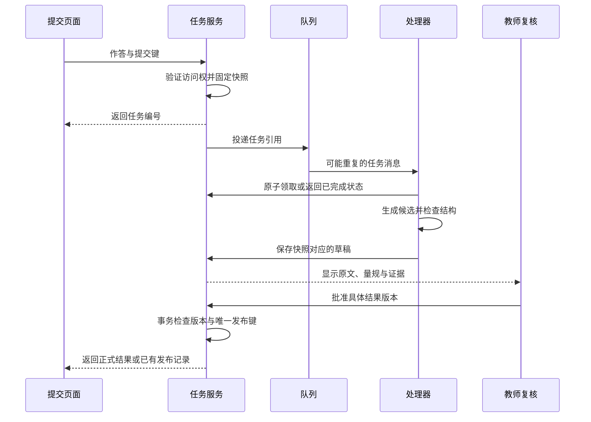

# 第 8 章：把演示交到一个能接手的人手里

本地演示已经返回 3 分，教师也确认了量规。到了试用现场，学生补交了第二个根，旧任务稍后才完成，覆盖了新结果。另一个学生刷新页面，重复创建了评分任务。数学和提示词都没有变化，服务仍然交付了错误状态。

这一章从这些原创失败场景出发，说明如何把单次演示扩展为可接手的服务。下面的队列、数据库与审核页面是交付设计，不是仓库已经实现的产品。配套代码目前只实现离线检查与可选本地模型接口。

## 先约定谁能决定什么

课程团队决定可用讲义、题目要求和量规；教师决定争议解法、内容修订和评分批准；工程团队保证这些决定作用于正确的版本，并留下失败记录。学生可以补充作答或纠正转写，不能通过请求参数替换别人的课程、教师身份或审核状态。

这份分工要落到服务端。登录上下文确定使用者及其课程范围；后端验证其访问权，再取资料。`course_id` 过滤仅在调用者已经确定权限的条件下有效。演示里直接传入课程编号，是为了观察资料隔离，不能当成完整的身份与授权系统。

教师审核也要验证身份、权限和具体对象。请求里有 `approved: true` 只说明客户端传了一个值；后端还须确认谁批准了哪个结果版本。在审核页面同时显示题目、作答、量规、分项证据和改分理由，接手人才能做出有依据的决定。

## 一份提交对应一个不可变快照

快照固定任务启动时的输入，让稍后返回的结果仍能解释。对批改案例，快照至少包含作答、题目、量规、转写和生成配置的版本。模型名称只是配置的一部分；提示词和推理参数改变，也应当形成新配置版本。

| 对象 | 合成任务中的值 | 修订后的处理 |
|---|---|---|
| 作答 | `answer-demo@1`，只写根 2 | 补交生成 `answer-demo@2` |
| 题目 | `quadratic-demo@1`，要求因式分解并验证 | 改要求后创建新题目版本 |
| 量规 | `rubric-demo@1`，总分 5 | 改评分规则后重新评估受影响作答 |
| 转写 | `transcript-demo@1`，已确认文字 | 纠正符号后创建新任务 |
| 配置 | `grading-config@1` | 模型或提示修改后保留旧配置 |

任务完成时比较当前作答版本和任务快照。旧任务结果仍可以留作历史记录，不能写成新作答的当前评分。批准记录同样绑定结果版本；重跑得到新草稿，不继承旧草稿的批准。

版本不是随便增加的数字，它承担的是“这个决定依据什么”的关系。实现时可以使用不可变记录和内容摘要，但内容摘要只能帮助检测变化，不能代替访问控制或教师判断。

## 队列改变等待方式，不消除重复

批量作业可以先创建任务并返回编号，让后台调用模型，前端查询状态。MQ 是消息队列，帮助生产任务与处理任务解耦。消息可能重复投递，消费者也可能在保存结果以后、确认消息以前崩溃。AWS 的标准 SQS 文档明确提醒应用按可能重复接收消息设计幂等处理；这里引用这一机制作为设计依据，不要求读者使用 AWS。[SQS 至少一次投递](https://docs.aws.amazon.com/AWSSimpleQueueService/latest/SQSDeveloperGuide/standard-queues-at-least-once-delivery.html)

“原子领取”表示多个处理器竞争同一任务时，只有符合状态条件的一个能成功推进；领取还需要超时恢复策略，防止处理器崩溃后任务永久卡住。任务保存与投递之间也可能中断：一种做法是将任务及待投递事件一起提交，再由后台补发；另一种做法是定期找出未投递任务。采用哪一种，都要回放“已保存但未投递”的失败，而不是默认两步同时成功。

同一提交键返回同一任务；明确要求重新评分时创建新的尝试。发布使用唯一键和事务，保证同一批准结果只写入一次正式记录。外部通知应独立记录待发送与已发送状态，并让接收端或通知服务识别重复请求；数据库事务不能自动保证外部消息只出现一次。

## 异常页面要告诉人下一步

“处理中”不能无限持续。每类失败需要状态、可理解说明和接手方式：图片不清楚请重新拍摄，模型超时保留任务并按约定重试，材料冲突交给教师，评分结构错误保留诊断记录。重试只针对可恢复原因；错误量规重复调用模型不会自行变正确。

日志优先记录任务号、快照版本、阶段、耗时与错误类型。排查需要原始内容时，通过受控入口查看，避免把全部学生作答和图片写进通用日志。真实数据的访问范围与保留安排由具体机构确认；学习本书可以一直使用合成输入。

一条追踪记录应串起上传、转写、检索、生成、结构检查与复核。不要把模型流式输出了第一个字当成任务已经完成。一次请求的端到端时延还包括排队和人工处理；分别统计机器处理时间与人工等待，才能判断问题需要扩容还是改工作安排。

成本同样要拆开：一次任务的模型调用成本、重试次数、检索或存储费用和人工复核时间。输入输出 token 数乘对应单价只能估算按 token 计费的调用部分；本地部署还涉及设备使用率与运维，不能把云 API 单价直接套成总成本。本版没有实测费用和吞吐量。

## 小范围试用怎样结束

试用前先定义覆盖哪些题型、谁处理未完成任务、哪些情况暂停功能。先让教师查看草稿并比较人工判断，再决定是否扩大范围。每次扩大都会带来新的输入分布，旧的几道演示题不足以验收。

回滚要同时说明程序、配置、材料和审核状态怎样处理。把入口指回上一配置后，已经发出的评分不会自动消失；应保留记录，并由教师确认哪些结果需要修订或通知。NIST AI RMF 强调持续的风险管理与角色职责，可作为组织这类运行检查的参考，不是本案例已经通过的认证。[NIST AI RMF](https://www.nist.gov/itl/ai-risk-management-framework)

一次交接完成时，接手人应当能启动演示、找到失败样本、区分草稿与正式结果，并知道如何停止服务。把这些动作写入[交付检查单](../templates/delivery-checklist.md)，用实际演练留下记录；只签一份“模型效果良好”不能回答上述问题。

## 跟做练习

用纸面状态表模拟两个处理器同时收到一个任务，其中一个在保存草稿后退出；再模拟学生补交之后旧任务才返回。列出每一步当前作答、任务快照、结果版本和允许动作。最后让另一位读者只凭你的交接说明处理一次超时。若对方需要猜测能否重跑，就补上恢复条件。

[上一章：评测](07-evaluation.md) · [下一章：案例复用](09-case-library.md)
