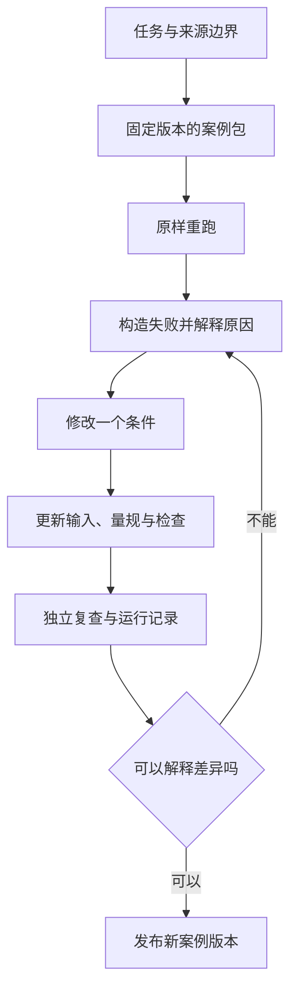

# 第 9 章：让一个案例成为别人可以修改的起点

把提示词、截图和代码放进同一个文件夹，不等于形成了案例。读者运行后得到一个结果，却不知道材料从哪里来、怎样判断正确，也不知道换一道题要修改哪些地方。这份材料适合展示，尚不足以交给别人学习和复用。

本章把前面的教育任务收束为一个最小案例包。它包含问题、输入、实现、失败样本、判断规则和运行记录，围绕可重做的决定组织材料。将来加入企业知识库或物联网场景时，也可以沿用这套约定；它们目前是后续卷的方向，本书没有把未完成的目录写成已经交付的方案。

## 教学案例与公司交付文档分别处理

学习材料的目的，是让读者理解一个决定并验证它。公司内部文档还包含客户关系、真实数据、组织流程、账户权限和运营配置，这些信息通常没有必要进入教程。仅替换名字不能消除文档结构与具体业务关系中保留的信息。

本卷从公开页面获取教育任务的背景，以通用工程机制重新设计流程，用原创例题和合成作答解释边界。公司产品不是本书的代码演示，也不是作者独立开发的开源项目。个人经验能够帮助选择问题，正文的解释和图仍须重新写，并给外部技术依据保留来源。

判断一份素材是否进入案例，可以问三个具体问题：它对理解哪个决定有帮助？能否用原创合成材料表达同样问题？读者能否在没有内部环境的情况下检查结论？如果一段内容只是证明“我曾经接触过”，可以留在个人回忆中，不必成为教程数据。

## 最小案例包应该装什么

以作业批改为例，包里的题目指定因式分解、全部根和代入验证；输入是一份漏写根 3 的合成作答；预期产物是 3 分的待复核草稿。读者能核对每一分，也能故意修改一个评分项看见边界。模型接口是可选步骤，而不是理解案例的前置条件。

| 材料 | 它帮助读者做的事 | 本仓库位置 |
|---|---|---|
| 案例规格 | 看懂任务范围、参与者与允许动作 | [案例模板](../templates/case-spec.md) |
| 正文与图 | 理解机制及取舍 | 本卷各章 |
| 合成输入 | 重跑相同条件 | [演示数据](../examples/education/data/grade-partial.json) |
| 运行入口 | 获得明确标注的产物 | [CLI](../examples/education/run.py) |
| 失败检查 | 确认哪些错误会被拦住 | [测试](../tests/test_education.py) |
| 评测记录 | 知道实际运行了什么 | [记录模板](../templates/evaluation-record.md) |
| 来源与状态 | 区别原创设计、外部依据与未验证能力 | [来源说明](../research/sources.md) |

不要只保留成功截图。结构合法但把 C2 判满分的样本尤其有教学价值：它说明程序检查在哪里结束，内容复核从哪里开始。失败样本要有预期动作与理由，避免维护者修代码时把必要的拒绝路径当成需要消灭的错误。

## 用一次修改检查是否真正理解

案例包可以按四轮学习。第一轮原样运行，读者说清输入、输出和验证范围。第二轮主动制造失败，例如让引文引用不存在的片段或把减号标为不确定。第三轮修改业务条件，例如将“指定因式分解”改为“不限制方法”，同时修改量规和评价参考。第四轮交给另一位读者复查，解释哪些结论得到了运行证据，哪些仍然等待模型或教学实验。

这条路径把“跑通”变成可检查的理解。换题后仍沿用旧答案是输入没有更新；接受新方法却不修改量规是验收条件没有更新；新增模型调用却仍把结果标为离线夹具是实验记录没有更新。读者指出这些差异，比照着提示词获得一段漂亮回答更能说明学习成果。

## 一个仓库怎样同时容纳书与代码

本仓库把章节正文放在 `chapters/`，演示放在 `examples/`，检查放在 `tests/`，复用表单放在 `templates/`，来源说明放在 `research/`。根目录 README 提供阅读路线，合订稿由章节生成。修改正文时改单章，再重新生成，避免单章和合订稿各自维护而互相矛盾。

一个案例版本应关联材料、代码和运行记录。Git 提交能记录文件变化，但不会自动记下机器、模型或运行结果；这些需要填写评测记录。引用外部框架时也写清文档查看日期与所用版本，升级后重跑已有样本，而不是直接替换依赖名。

每次更新说明新增了哪个问题、哪些产物改变、验证了什么，以及仍有哪些限制。合成数据路由通过就写路由通过；没有教师评阅就不写教学有效。若模型实验没有固定数据和判据，先作为观察记录，不把零散输出汇成准确率。

来源整理可以借鉴他人的书籍仓库结构，原文、图和代码的使用仍按各自许可处理。[AI Infra 参考仓库](https://github.com/bojieli/ai-infra-book)提供了一种章节与实验结合的组织方式；本书没有搬运它的章节内容。引用技术文档帮助读者核对依据，不能代替原创案例的设计工作。

## 从教育扩展到其他领域

公共方法继续保留任务、证据、允许动作、人工接手与运行记录。具体领域必须重新设计：课程材料权限不能原样当成企业部门权限，教师评分量规不能直接当成设备告警判断，学生补交作答也不等于传感器补发事件。词汇相似不代表业务约束相同。

后续企业知识库卷可以研究文档版本、跨部门访问和带来源的回答；物联网卷可以研究事件时序、重复消息、设备上下文与告警复核。先选择有公开输入或可合成数据的窄任务，为它写出验收与失败样本，再决定需要多少模型和框架。每个新卷都需要自己的依据与评测，不沿用教育例题的结果作背书。

## 让案例集成为个人主页的入口

一本持续维护的案例集能够展示作者怎样理解需求、处理失败和完成交接。读者点进来应当看到完成的章节、可以运行的示例和清楚的验证范围。发布前的本地草稿与已经公开的作品保持区分；[主页入口草稿](../docs/profile-entry.md)留待真实仓库发布后替换链接。

如果希望把它写成个人经历，可由作者补充自己能够公开且核验的判断：当时遇到什么通用问题，为什么选择某种方案，后来怎样认识到其限制。不要把本书为教学合成的访谈、故障和数字改写成亲历。真实个人视角与原创教学案例可以并存，只要读者能分清来源。

## 最后一项跟做练习

任选答疑、拍搜或批改，填写一份案例规格，并附上一条正常输入、两条失败输入和一份实际运行记录。把材料交给没有参与编写的人，让他找出验证边界并修改一个条件。对方能够完成并解释差异时，这个案例才有了被继续维护的起点。

[上一章：交付](08-delivery.md) · [返回目录](../README.md)
