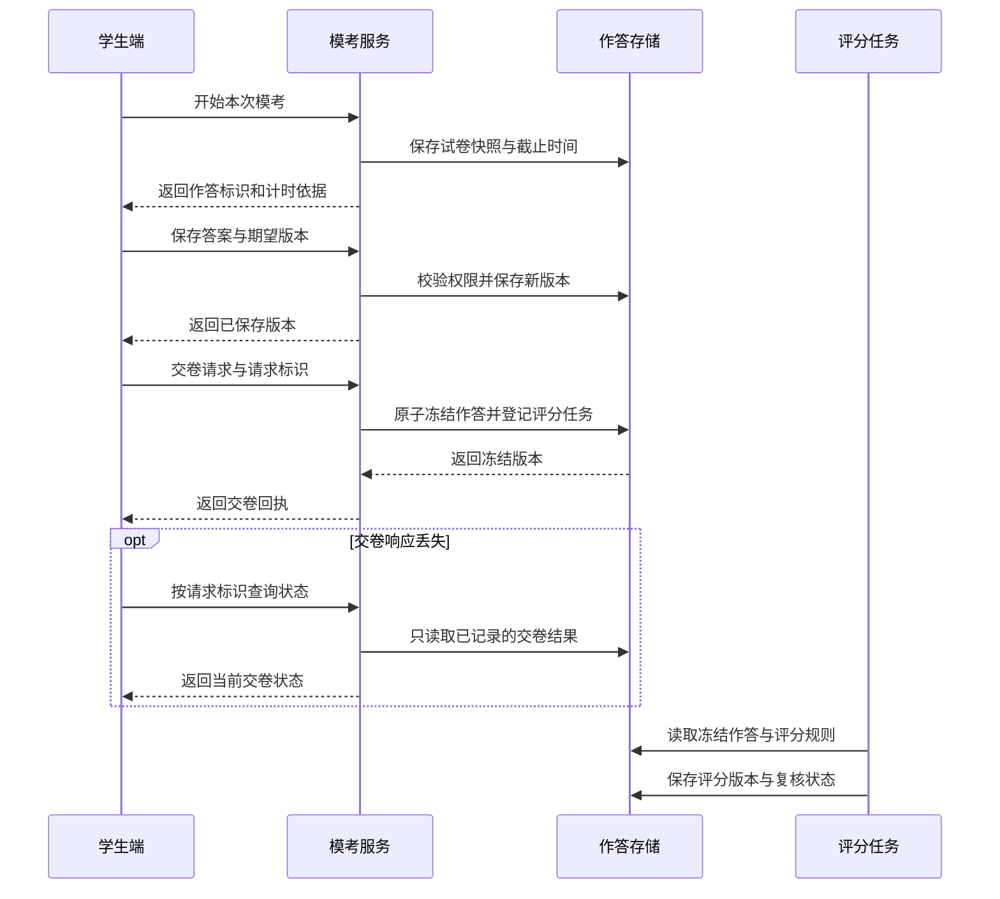

# AI 备考怎样组织练习、模考与复盘

[← 智能作业与教育评价](README.md)

备考产品里，日常练习可以马上给提示，限时模考通常要先让学生独立完成。两种模式共用题库与学习记录，却有不同的计时、反馈和成绩含义。把答疑按钮原样放进模考页，会改变这次作答能够说明什么。

这里把 AI 备考收窄为一条可实现的流程，根据已经确认的考试范围安排练习，生成满足约束的模拟卷，保存可靠作答，再把复盘结果交给后续学习任务。它不承诺预测真实考题或考试成绩。

## 先确定考试范围和本轮任务

学生选择考试类别、科目、目标日期和可用学习时间。产品据此加载有版本的考试要求与课程范围，由学生或教师确认本轮目标。资料年份不明或多个版本互相冲突时，先处理依据，不能让模型凭题目标题猜适用范围。

备考计划可以安排知识补习、专题练习和完整模考，但每类任务要保留各自目的。学生当前证据不足时，可以用短诊断与自选目标开始，不能仅凭档案里的薄弱标签安排整个备考周期。

选哪道题以及怎样根据新作答更新状态，沿用[个性化学习](../digital-teacher/personalized-learning.md)的规则。这里重点处理完整试卷和作答过程，不重新设计一套推荐模型。

## 用组卷蓝图约束候选题

组卷蓝图是一份可检查的试卷要求，写清题型、数量、分值和内容覆盖。下面只用一个配置示例说明约束，不对应任何真实考试。

| 题型 | 数量 | 每题分值 | 小计 |
|---|---|---|---|
| 单选题 | 10 | 2 | 20 |
| 多选题 | 4 | 5 | 20 |
| 解答题 | 3 | 20 | 60 |

这份示例共 17 题、100 分。还可以指定章节覆盖、允许的难度范围、是否避开近期做过的题，以及共用材料不能拆散等要求。多知识点综合题怎样计入覆盖，也需要提前约定，否则同一道题可能被重复计数。

选题服务先过滤未审核、已停用和无权使用的题，再按蓝图搜索组合。大模型可以把自然语言要求转换成待确认配置，也可以解释约束冲突。最终数量与分值由程序计算。候选不足时，返回缺少哪类题，由教师决定缩小范围或调整蓝图，不临场生成未经审核的题来补齐。

难度标签来自教研判断或历史作答统计，二者要分开标记。相同正确率可能来自不同基础的学生，不能据此认定两份卷的测量难度等价，更不能直接推算正式考试分数。

[题目与试卷互操作规范 QTI 的实施指南](https://www.imsglobal.org/spec/qti/v3p0/impl)区分题目、试卷组织和时间约束等概念。这类标准可以帮助梳理数据关系；适配标准与选题算法的有效性需要分别验证。

## 开始作答前固定试卷

一次模考生成后，保存所选题目、内容版本、顺序和分值规则。学生进入时创建独立的作答记录，锁定这份试卷快照。考试中题库内容有更新，也不能悄悄替换正在作答的题。

选项乱序需要使用稳定的选项标识，展示字母只表示本次排列的位置。评分按标识匹配，不能继续拿题库里的原始字母判断。包含依赖位置的表述或有顺序要求的选项，默认不乱序。[QTI 的响应声明](https://www.imsglobal.org/sites/default/files/spec/qti/v3/info/index.html)也将选项交互与响应标识关联起来。

练习模式可以逐题反馈，模考则按配置控制提示与答案发布。后端接口不能提前返回藏在前端的标准答案。是否允许暂停、超时后是否接收作答，都要在开始前展示并保存。

图中的评分任务独立执行。交卷已确认后，即使评分服务暂时失败，学生也不需要重新作答。

## 计时、保存和交卷都由服务端确认

客户端显示倒计时，服务端检查截止时间。切换设备、关闭页面或修改本机时钟，不应重新获得整段作答时间。获准的延时需要留下授权记录，不能靠用户修改请求参数生效。

自动保存要显示最近一次成功回执。每次保存携带此前已确认的作答版本，服务端只接受仍与当前版本一致的更新。请求乱序或多设备冲突时，返回当前状态供客户端处理，不能无条件采用最后收到的请求。

网络中断时可以本地暂存，但暂存不能显示成服务端已收到。恢复后补传仍按截止与迟交规则处理。学生因真实故障无法提交，可以保留故障记录并提供人工处理入口，不能由模型自行延长时限或认定客户端时间可信。

交卷需要幂等，也就是重复点击或超时重试只冻结同一份结果。冻结作答与登记评分任务可以放在一个本地事务里，再由后台可靠发布。交卷后新的保存请求不得继续修改已经冻结的版本。具体的事务任务与补偿方式可以复用[索引同步中的任务设计](../../enterprise-ai-platform/knowledge-engineering/vector-index-lifecycle.md)。

## 复盘依据原始作答，不只展示总分

客观题按明确规则评分，主观题保留证据与人工复核状态，具体方法见[智能批改](grading.md)。发现标准答案错误时，应能定位受影响的试卷与作答，产生新的评分版本并通知相关使用者，保留原结果的更正记录。

学情报告可以区分未作答、答错、超时和获得提示后的答对。用时还要结合保存与切题记录解释，页面长时间停留不代表学生一直在思考。一次错误只能支持有限判断，不能自动给学生固定能力标签。

复盘建议可以先定位出错题与相关知识，再安排少量不同表达的练习。系统记录学生是否完成，以及之后独立作答是否改变。重复原题的成绩提高，需要与迁移到新题的表现分开看。

上线检查除了题目与评分，还要覆盖断网补传、重复交卷、答案乱序和题目版本更新。组卷缺题、答案提前泄露、作答丢失分别统计，不能淹没在整体完成率里。

作为自练产品，模考可以帮助学生熟悉节奏和发现需要复习的内容。只有经过独立的测量研究，才有依据进一步讨论它对正式考试表现的预测能力。
