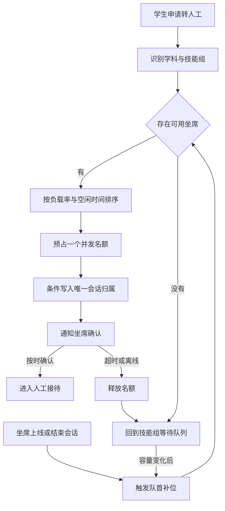
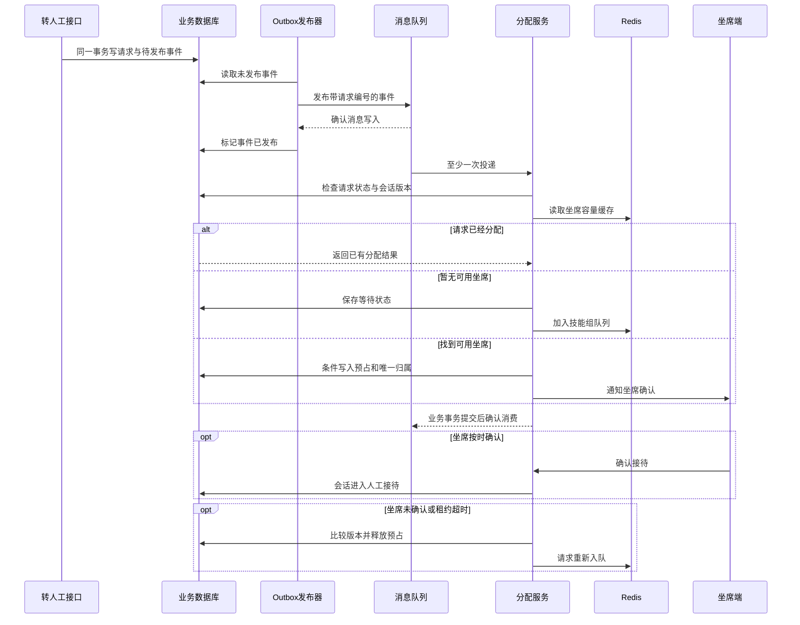

# 在线答疑怎样接入人工坐席

[← 数字名师](README.md)

数字名师可以承担大部分常见学科答疑，学生仍然会需要真人。有时学生不接受 AI 的解释，有时题目来自新试卷，题库和知识库都没有可靠材料。产品可以提供“转人工”按钮，也可以允许答疑教师从后台主动接管会话。

一旦接入真人，问题就离开了单纯的 Agent 流程。系统要知道哪些教师在线、每个人已经接了多少会话、下一道题该分给谁。服务重启、网络中断和消息重复出现时，学生的问题也不能悄悄消失，更不能同时分给两个人。

按钮本身很简单。难的是按钮之后的状态变化。

## 转人工先改变会话归属

学生点击按钮以后，接口先创建一条转人工请求，再把会话从 AI 答疑改成等待人工。请求里保留原题图片、已确认的题目、AI 回答、检索依据和最近几轮对话。答疑教师打开会话就能看到前面发生了什么，不必让学生重新描述一遍。

人工主动接管也走同一套状态变化。坐席点击接管时，服务要用带版本条件的更新抢占会话。只有当前仍由 AI 持有并且版本没有变化，这次接管才成功。AI 在发送每条消息之前也要检查会话归属和版本。人工已经接管以后，即使旧的模型任务晚一点返回，也不能再把答案发给学生。

会话状态不必设计得很多，关键状态要能表达清楚。

- `AI_SERVING` 表示 AI 正在回答。
- `WAITING_HUMAN` 表示已经进入人工队列。
- `ASSIGNED` 表示会话已经分给一名坐席，等待对方确认接待。
- `HUMAN_SERVING` 表示真人已经接管。
- `CLOSED` 表示本次答疑结束。

每次变化都带上会话版本、操作人和时间。归属只能有一个。状态只能按允许的路径前进，旧请求不能把新状态覆盖回去。

## 坐席在线不等于还能接题

后台显示在线，只能说明浏览器或客户端仍在发送心跳。进入分配候选名单前，还要检查坐席是否暂停接待、擅长哪个学科、当前会话数是否达到上限，以及最近一次心跳是否仍然有效。

待接待请求先按进入队列的时间排序。处理同一个请求时，系统筛出符合学科和权限的坐席，再比较当前接待数与并发上限的比例。比例相同，就选空闲更久的人。坐席容量相同时，这个比例会退化成比较当前接待人数。公平在这里并非简单轮流。一个英语教师空闲，也不该因为轮到他就收到高等数学问题。

当前接待数要以会话分配表为准，缓存只负责加速查询。内存里的数字不算最终事实。选中坐席和占用一个接待名额应放在同一个数据库事务里，并通过条件更新或行锁防住并发。两个分配器同时看见同一名坐席还有一个空位时，最终只能有一个事务占到这个位置。

计划下线和意外掉线也要分开。坐席主动下线后，系统停止分配新会话，已经接待的会话可以继续处理或主动转回队列。心跳超时说明客户端可能失联，系统先把坐席标成不可分配，再根据会话租约决定何时回收任务。过早回收会让坐席刚刚恢复时出现两个人同时接待，过晚回收又会让学生一直等待。

## 队列优先和坐席路由可以逐步演进

一种常见的初期方案是按技能组建立 Redis 有序集合。转人工请求用进入时间作为分值，坐席上线后主动拉取，系统也可以在新请求到达或坐席空闲时推送。这套方案容易实现，也能维持单个技能组内的先来后到。技能组较少、坐席能力接近时，它并不差。推拉只发生在转人工请求和容量变化时，会话已经有了负责人，后续聊天消息直接发给当前坐席，不再进入分配队列。

业务变复杂以后，单一队列会开始承担太多事情。熟客优先、上次服务优先、不同坐席容量和当日工作量都要挤进同一套取队规则。此时更合适的做法是让调度中心维护坐席状态，优先直接路由，没有可用容量时再让请求排队。

| 方案 | 主要视角 | 适合的阶段 | 需要承担的复杂度 |
| --- | --- | --- | --- |
| Redis 队列加推拉结合 | 请求按顺序等待，坐席或系统取出请求 | 坐席较少、技能组简单的初期系统 | 取队后的容量预占、复杂优先级和跨状态一致性 |
| 坐席状态路由加排队兜底 | 请求到达时先找有能力且有容量的坐席 | 多技能组、容量不同的企业系统 | 坐席状态同步、容量预占和路由服务可用性 |

[哔哩哔哩公开的坐席调度演进](https://www.bilibili.com/read/cv39839009/)同时使用技能组、当日饱和度、瞬时饱和度和等待队列。当日上限限制一个工作周期内的总接待量，瞬时上限限制同一时刻的并发量。两者合在一起，可以避免先上线的坐席一次吃掉过多积压请求，也能让工作量在一天里更平稳。坐席班次长度不同时，当日上限还要按有效工作时间修正，否则晚班与短班仍会吃亏。

容量不同的坐席不能只比较当前人数。一个上限为五、正在接待四人的坐席，负载已经达到八成。另一个上限为十、同样接待四人的坐席还有较大余量。第一版调度分数可以从有效负载开始。

```text
load(agent) = weighted_active_sessions / concurrency_limit
```

`weighted_active_sessions` 可以先等于当前人工会话数。系统以后如果能稳定区分正在高频交流、等待学生回复和即将结束的会话，再给它们不同权重。负载相同以后，调度器依次比较空闲时长、当日接待比例和上次服务关系。熟客、指定坐席和优先用户都作为附加规则，不能绕过学科技能、在线状态和硬容量。

Redis ZSet 很适合显示排队名次和按时间取出请求。`ZADD` 负责入队，`ZRANK` 查询名次，`ZREM` 处理取消，[`ZPOPMIN`](https://redis.io/docs/latest/commands/zpopmin/)原子地取出分值最低的成员。这个原子性只覆盖 Redis 中的一次取出。进程在取出请求以后、写入会话归属以前崩溃，请求仍然可能消失。

因此，Redis 只保存可以重建的等待索引和短期预占。调度器取出请求时，要把它移入带超时时间的预占区，同时通过数据库条件更新占用坐席名额。预占没有按时确认，扫描任务就释放容量并重新入队。数据库中的转人工请求、分配记录和会话版本仍是最终事实。

混合调度的完整路径如下。



坐席手动邀请仍然可以保留。邀请接口也要走会话版本和容量校验。确实需要临时超出普通饱和度时，可以配置单独的人工上限，不能让前端按钮无限增加并发。

## 消息队列传递任务，数据库决定归属

消息队列适合把转人工请求交给分配服务，也适合削平短时间内的请求高峰。它不适合充当会话归属的唯一记录。[Kafka 对投递语义的说明](https://kafka.apache.org/43/design/design/#message-delivery-semantics)解释了至少一次处理会在故障窗口产生重复。消费者可能在处理完成后、发送确认前崩溃。系统要允许消息再次到达，再由业务层保证幂等。

先落库，再发消息。转人工接口可以在同一个数据库事务里写入请求记录和待发布事件。后台发布器再把事件送进消息队列，收到队列的投递确认后标记为已发布。这种做法叫 Outbox，也叫事务发件箱。[Debezium 的 Outbox 文档](https://debezium.io/documentation/reference/stable/transformations/outbox-event-router.html)给出了数据与事件一起提交的实现方式。它能补上数据库提交成功、消息发送失败之间的空隙。重复消息仍由请求编号和唯一约束处理。

分配服务收到消息后，先用转人工请求编号检查是否已经处理。随后在一个事务中确认会话仍在等待、选择坐席并写入分配记录。事务提交成功以后再确认消费。进程如果在提交后、确认前崩溃，消息会再次送达。第二次处理会命中相同请求编号，直接返回已有结果，不再生成一份新分配。



会话归属还可以带一段短租约。分配器写入坐席、租约截止时间和会话版本，坐席确认接待或持续工作时续租。租约过期并且坐席已经失联，回收任务才能把会话重新放回等待队列。所有回收操作仍要比较版本，防止一条迟到的超时任务抢走正在处理的会话。

## 防丢失和防重复要分开处理

防丢失需要把请求先持久化，再投递消息。发布端使用投递确认，消费端在业务事务完成后手动确认。暂时失败的消息可以重试，超过重试上限后进入死信队列并触发告警。死信队列只保存等待处理的问题，不能代替告警和补偿工具。

防重复依赖稳定的业务键。一次转人工请求只有一个请求编号，一次会话在同一时刻只有一个有效归属。数据库唯一约束、条件更新和会话版本共同挡住重复分配。消费者即使收到同一条消息两次，也能返回同一个结果。

同一会话的事件还要带递增序号。多个消费者和重试可能改变消息实际到达的顺序，应用看到旧序号时应忽略它，不能让“结束会话”之后又出现一条更早的“等待分配”。需要严格串行的动作，可以按会话编号分区，或者让同一会话进入同一个顺序处理单元。

这些机制各管一段风险。消息确认说明队列或消费者已经接过责任，业务幂等说明重复到达不会重复生效，会话版本说明迟到操作不能覆盖新状态。少了其中任何一层，系统仍然可能在故障窗口里丢题或重复派单。

## 人工接管以后仍要保留边界

真人开始接待时，AI 可以退到辅助位置。它可以整理题干、找出相似题、汇总学生已经看过的解释，也可以替教师生成一份待确认的答复。最终发送动作归人工所有，除非教师明确把会话交还给 AI。

人工答疑记录同样需要权限和审计。学生图片、聊天内容和教师回复按课程与机构隔离，后台只能查看自己有权处理的会话。谁接管、谁转派、谁发送了哪条消息，都要留下事件记录。后续拿这些记录改题库或评测模型时，还要遵守数据授权和脱敏要求。

产品也要限制重复转接。学生已经在人工会话中再次点击按钮，接口应返回当前排队或接待状态。坐席想转派给其他学科时，先释放原有归属，再生成一次带来源关系的新请求，不能绕过状态机直接修改负责人。

## 验收时专门制造故障

正常流程只能证明按钮可以用。上线前还要主动测试服务崩溃、消息重复、坐席断网和数据库超时。

- 请求写入成功但消息尚未发布时，Outbox 发布器应能补发。
- 分配已经提交但消费确认失败时，重投消息不应产生第二个负责人。
- 两个分配器同时抢一条请求时，只能有一个写入成功。
- 坐席心跳停止并且租约过期时，会话应回到等待队列。
- 旧模型任务在人工接管后完成时，学生端不应收到它的答案。
- 死信队列出现积压时，监控应能指出失败原因和待补偿数量。

线上可以关注等待时长、分配失败率、重复处理次数、无人持有的会话数、坐席负载差异、转派次数和重新打开的会话。坐席在线人数与正在接待的会话数需要定期和数据库事实核对，不能只相信内存计数。

转人工按钮背后是一套独立系统。会话归属要有唯一事实，消息可以重投，处理必须幂等，坐席掉线以后还要有人把问题捡回来。做到这些，人工接管才能成为可靠的服务能力。
