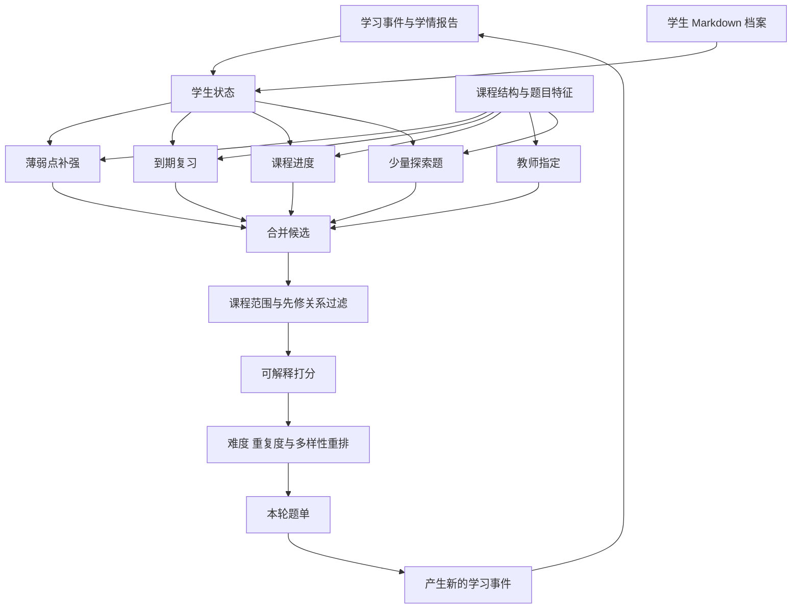

# 个性化学习从学习记录开始

[← 数字名师](README.md)

个性化学习最容易从推荐题目开始做，因为页面上很快就能出现“为你推荐”。难点藏在推荐之前。系统究竟知道学生什么，这些判断有没有时间范围，又能不能区分不会、忘了和一次手误。

## 学习记录先能对得上

一条答题事件至少要能关联学生、课程、题目版本和发生时间。结果之外，还可以记录作答内容、用时、请求提示的次数和最终完成方式。客户端重复上报、断网补传和教师改题都会制造脏数据，事件需要唯一标识，修改也要留下来源。

题目还要和知识点建立关系。这张配置表会受到教材版本、教学进度和题目解法影响。同一道综合题可能涉及多个知识点，各知识点在解题中的分量也不同。自动标注可以给教研人员准备候选项，正式关系仍要能被查看和修改。

没有这两层基础，模型看到的只是零散的对错。推荐系统即使算出很精细的小数，也解释不了小数对应哪一段课程事实。

## 掌握度是估计值

知识追踪指根据学生连续的学习行为，估计他对相关知识的掌握状态，并预测下一次作答表现。传统模型和神经网络模型都可以做这件事。它提供的是概率，不能作为学生能力的最终结论。

一次答错可能来自题意看错，连续答对也可能因为题目过于相似。长时间没有练习，先前的掌握状态还会衰减。系统应当同时保留样本数量、最近更新时间和估计置信度。数据太少时，界面可以说“还需要更多练习来判断”，不必硬给一个显得权威的标签。

大语言模型适合从学生原始作答中提取错误线索，也能把状态解释成学生听得懂的话。掌握度更新仍应由可重放的规则或专门模型负责。这样教师追问某个标签为什么变化时，工程团队能用同一批事件复算，无需从一段自由生成的文字里猜原因。

## 推荐是一道受约束的选择题

候选内容先经过硬规则。它要属于当前课程，满足前置知识要求，没有被教师停用，也没有超出本周教学范围。规则过滤之后，再根据知识缺口、难度、遗忘间隔和近期重复度排序。

推荐结果需要给出简短理由，比如某个步骤连续出错，先补一段例题讲解，再做一道不同表达的练习。理由来自实际特征，不能让模型事后编一个听起来合理的说法。教师若锁定教学计划，系统就把个性化限制在计划内部。学生主动选择复习其他内容时，也应允许他离开推荐路径。

Agent 可以把推荐内容组织成一次小任务。它先说明目标，调用讲解或练习工具，接收学生作答，再把新事件交回状态服务。Agent 可以提出档案更新建议，档案服务负责检查依据、版本与权限，再决定是否写入。具体流程见[学生档案怎样成为长期记忆](student-profile-memory.md)。Agent 也不能绕过内容权限临时找题。执行失败时，本次任务可以退回教师预设的练习包，避免推荐页整个不可用。

## 冷启动不要假装了解学生

新学生没有历史记录，可以从课程进度、一次低风险诊断和学生自选目标开始。诊断题不宜过长，结果也不该立刻形成固定分层。随着真实学习事件增加，系统再逐步降低默认规则的权重。

教师改动推荐是很有价值的反馈。系统要记录教师删掉了什么、替换成什么以及可选原因。这里不能简单把每次修改都当成模型错误。教师可能在照顾课堂节奏，也可能掌握系统不知道的学生情况。产品分析时要把内容问题、状态误判和教学安排分开。

## 三层指标回答三种问题

第一层看状态估计能否预测后续作答，但预测准不等于推荐得好。第二层看推荐是否满足先修关系与课程约束，学生能否在合理时间内完成。第三层才看一段时间后的独立练习、知识保持和教师判断是否改善。

还要持续检查系统是否把部分学生困在低难度内容里。推荐总是追求短期答对率，最稳妥的办法就是反复给简单题，这会让数据很好看，却没有把学生往前带。个性化学习需要保留适度挑战，也要允许教师看见并纠正路径。

## 推题算法先从一条可解释的流水线开始

内容平台的推荐系统有一套成熟的工程结构。[Meta 的 Explore 推荐](https://engineering.fb.com/2023/08/09/ml-applications/scaling-instagram-explore-recommendations-system/)依次经过召回、初排、精排和最终重排，[YouTube 的公开论文](https://research.google/pubs/deep-neural-networks-for-youtube-recommendations/)把系统概括为候选生成与排序两个阶段。[xAI 公开的 X 推荐算法](https://github.com/xai-org/x-algorithm)把候选来源、特征补充、过滤、打分和选择做成可组合的流水线，再把大规模候选检索与后续排序分开。这些做法适合借来组织推题流程。

教育产品要换掉排序目标。视频平台可以把完整播放、点赞和“不感兴趣”当作强弱不同的反馈，[TikTok 对推荐机制的说明](https://newsroom.tiktok.com/how-tiktok-recommends-videos-foryou?lang=en-AU)也提到信号权重、负反馈与内容多样性。学生做完一道题，只能说明他完成了这次交互。题目有没有帮助，要看之后能否独立完成同类题，隔一段时间是否仍然记得，以及错误是否真的减少。

推题可以沿着下面这条流水线运行。



学情报告与学生档案在这里承担不同职责。学情报告来自答题事件与状态模型，保存近期正确率、掌握度估计、错误类型、练习间隔和提示使用情况。这些数据变化快，适合持续更新。`profile.md` 保存学习目标、经过确认的薄弱点、讲解偏好和未完成任务，变化慢一些。排序服务只读取允许进入推荐的固定章节，再把它们转换成目标约束或加分项，不让一段自由文本直接决定题单。

题库还要准备可计算的题目特征。知识点、难度、题型、先修关系、相似题组、预计用时和启用状态都应来自可维护的数据。缺少这些字段时，推荐模型只能从题干猜，教师也很难解释为什么推了这道题。

第一版可以使用一套能回放的加权分数。

```text
score(q) =
    w_gap        * knowledge_gap(q)
  + w_review     * review_urgency(q)
  + w_difficulty * difficulty_fit(q)
  + w_goal       * goal_match(q)
  + w_explore    * exploration_value(q)
  - w_repeat     * recent_similarity(q)
```

`knowledge_gap` 来自相关知识点的掌握度与置信度。`review_urgency` 根据上次练习时间和遗忘风险计算。`difficulty_fit` 衡量题目是否落在当前配置的挑战区间。`goal_match` 读取课程目标与档案中的学习目标。`recent_similarity` 会压低刚做过的同题和同模板题。权重由学科、学习阶段和题单类型配置，不需要在文章里假定一组通用数字。

排序之后还要重排。系统可以限制连续出现的知识点和题型，为到期复习留出位置，也给少量探索题保留名额。熟练内容不能永远消失，薄弱内容也不能一口气堆满整张题单。学生明确反馈太难、太简单或与当前目标无关时，这些反馈进入后续推荐，但一次点击不会立刻改写长期档案。

[Duolingo 的 Birdbrain](https://blog.duolingo.com/learning-how-to-help-you-learn-introducing-birdbrain/)会结合学习者状态与练习难度，预测某个学习者完成某道练习的表现，再由课程生成器挑选合适内容。到期复习还可以参考它公开的[半衰期回归模型](https://aclanthology.org/P16-1174.pdf)，估计一个词或知识点随时间变化的记忆概率。它们比单纯模仿视频平台的点击排序更接近教育产品的目标。

早期题库规模有限，规则召回和加权排序通常已经够用。系统积累了稳定的曝光、作答和延迟评测数据以后，可以引入 Learning to Rank，也就是让排序模型从历史样本中学习各类特征的组合方式。题库大到规则召回成为瓶颈时，再考虑双塔模型，分别把学生状态和题目编码后进行大规模近邻检索。大语言模型适合提取错误线索、补充候选标签和生成推荐理由，最终过滤与排序仍交给能复算、能评测的服务。

这类产品需要推荐算法，也依赖可靠的学习事件、可维护的课程结构和能被教师质疑的状态解释。这些基础决定了算法能否帮助学生，页面上的“系统很懂你”并不能回答这个问题。
