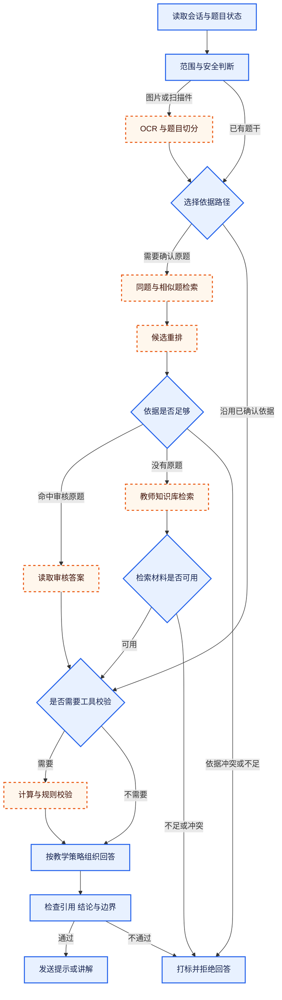

# 数字名师怎样回答一道题

[← 数字名师](README.md)

答疑在页面上只是一问一答，实际输入往往很乱。学生可能拍一张歪斜的作业照片，只圈半道题，也可能追问一句“这里为什么”。系统若拿到文字就直接问大模型，前面的课程、题目和对话对象一旦认错，后面写得越完整，误导越大。

先别急着回答。这些问题来自几个不同的环节。图片可能识别错，当前追问可能缺少上下文，学生也可能已经把话题带到了课程之外。数字名师要先判断自己面对的是什么，再决定该查题库、查教师资料、追问一句，还是停下来拒绝回答。

## 先确定这位名师能回答什么

数字名师的知识不能只靠一份人物介绍。材料先按一节公开课收齐，包括课程介绍、教学大纲、课件、讲义、逐字稿、音频转写、课堂例题和课后答疑。音频先转成带时间位置的文本，课件保留页码，例题与对应讲解建立关联。以后检索到一句话时，系统才能带着课程节点和原始位置返回。

教师简介、常用表达和讲解示例可以帮助模型保持说话方式。决定回答质量的还有教师怎样引出概念、怎样拆步骤、什么时候只给提示。这些规则适合整理成可以版本管理的 Skill。这里的 Skill 指 Agent 处理某类任务时遵守的一组说明和工具约定。数学题要检查符号与推导，英语题要区分语法判断与语境解释，超出当前学科的问题则要停下来。

一位教师通常围绕一个主要学科授课。这篇只讨论单学科答疑。机构或产品仍然是权限隔离的租户，教师与学科更适合做租户下面的知识空间。把每位教师都叫作一个租户，会让账号权限、数据隔离和知识检索三个概念混在一起。

## 第一轮会话先判断学生想做什么

第一次收到消息时，系统还不知道学生是在问题、闲聊、补充上一张图片，还是试图让模型忽略原有规则。这里可以使用 [Jev](https://docs.typesafe.ai/patterns/intent-routing) 一类决策模型，把自然语言判断变成程序能读取的类别、概率和置信度。意图可以先收敛成学科答疑、题干补充、课程闲聊、超出范围和疑似指令注入几类，代码再根据结果选择后续流程。

决策模型只给出判断信号，最终动作仍由程序控制。这一步不能猜。高置信的学科问题进入题目识别，题干不完整时请学生补充，超出范围或疑似攻击的内容直接打标并拒绝。置信度处于中间区域时先问一个澄清问题。连续几轮仍无法确认，流程记录原因并结束这次回答，不继续猜。

进入会话中段以后，不必把每一句普通追问都重新送进完整分类流程。“再讲慢一点”“为什么要移项”这类表达可以由会话状态和提示词处理。安全检查仍然要保留，会改变流程的情况也要重新判断，例如从数学题突然转到课程外话题，或者用户开始要求模型泄露系统指令。

## XML 标签只负责划清结构

把系统要求、课程上下文和用户内容混成一段文本，模型更容易认错各部分的身份。可以用 XML 标签把它们分开。

```xml
<instructions>按照教师的讲解策略回答，只使用允许的工具</instructions>
<course_context>当前学科、知识点与已确认的课程材料</course_context>
<conversation>已经确认的题目和前几轮问答</conversation>
<user_input>本轮由学生提交的内容</user_input>
```

[Anthropic 的提示词文档](https://platform.claude.com/docs/en/build-with-claude/prompt-engineering/claude-prompting-best-practices)也建议用 XML 标签组织复杂提示词。这只是结构约定，挡不住指令注入。学生输入、OCR 结果和检索材料都属于不可信数据，需要正确转义，不能直接拼进标签。工具返回的外部内容还要保留来源并限制权限。输入筛查、输出筛查、工具白名单和最小权限仍然要单独设置。

## 固定题库先做拍照搜题

某专升本公司的场景很典型。考试范围相对稳定，题目总量有限，同一道题或相近题会反复出现在试卷、教材和练习册里。学生拍下一道题以后，直接从题库找回原题，往往比先让大模型重做一遍更稳。

入口仍要保存原图，再做版面检测、题目切分、文字与公式识别。先找同题。检索时可以同时使用题干指纹、文字向量和图片向量，同题没有命中再找相似题。科目、题型和题目状态适合做硬过滤，防止一张包含常见公式的图片把其他学科的题带进来。

检索结果不要只返回一个答案。页面可以展示排在前面的原题图片和归一化后的匹配分，帮助学生确认系统究竟找到了哪一道题。这个分数很容易被误读。它表示当前检索模型下的相近程度，不能当成答案正确率。完全命中并且题目已经审核时，可以直接使用原题答案，再由数字名师按教师的讲解方式解释。几个候选题十分接近时，先让学生选中原题。只有相似题时，页面要明确说明它只是参考，不能把变式题的答案搬过来。

页面还应保留“没有搜准”一类反馈入口。反馈任务记录原图、识别文本、候选题、匹配分、学生选择和当时使用的检索版本，随后进入异步复核。运营人员可以修正题目关联，也可以把新题收进题库。这里处理的是题库维护，学生当前会话不会因此切换到真人。

## 没有原题时再查教师知识库

没有原题，再走 RAG。RAG 指检索增强生成，先从教师的课件、讲义、逐字稿和答疑记录中取回相关片段，再让模型依据这些片段组织回答。检索前先锁定机构、教师知识空间和学科，随后结合关键词与语义召回。每个片段都保留课程节点、原文件、页码或音频时间位置。

知识库可能同时召回几段相互冲突的说法。系统需要按资料状态、发布时间和人工确认级别排序，也要把冲突显式交给后面的检查步骤。材料不足时可以追问题干，冲突无法消除时就说明当前依据不一致，给这次请求打上待检查标记并拒绝继续推导。

稳定题目编号、权限、资料状态和知识空间归属由普通服务查询。大模型适合理解学生在问什么，不能替数据库猜一条资料是否仍然有效。检索结果也只是材料，最终答案还要受到学科 Skill 和回答策略约束。

## Agent 负责串起受控流程

这里的 Agent 指能根据当前状态选择下一步并调用工具的软件流程。一次答疑可能依次经过意图判断、题目识别、同题检索、教师知识检索、计算校验和回答检查。工具结果写回统一状态，下一步只能从允许的动作里选择。到这里才生成回答。

这些节点不需要每次全部执行。读取会话状态、检查范围和审查输出属于必经步骤。只有图片才需要 OCR，已经确认过的原题可以直接沿用题目身份，简单概念题也未必需要计算工具。图中蓝色实线节点是必经步骤，橙色虚线节点根据当前状态选用。



可插拔要靠稳定契约落地。每个可选节点都要声明输入、输出、版本、超时和错误码，也要写清它可以读写哪些状态。超时以后是跳过、重试还是拒答，由运行配置决定。新的图像识别模型或重排器只要遵守这份契约，就能替换原有节点，安全检查和回答出口不跟着改。

这套流程不需要无限自主。工具白名单、最大调用次数、总时限和每一步的失败出口都要写进运行配置。高风险话题、连续低置信判断或资料冲突无法消除时，系统记录触发原因并拒绝回答。输入通过检查也不代表输出一定安全，回答生成后还要再查一遍课程范围、关键结论、引用依据和异常内容。

回答方式由学习目标决定。学生第一次提问时，数字名师可以先给一个能推动思考的提示。学生连续卡住，再逐步展开。完整答案适合复盘，不能成为所有问题的默认出口。若产品只优化一次回答是否被点赞，模型很快就会把结果直接端上来，页面看起来更顺，学习过程却被跳过了。

## 和通用聊天工具拉开差距

学生随时可以把题目发给通用聊天工具。数字名师如果只换一个头像，再给出相似的答案，很难形成产品价值。差异要落在通用工具很难自动获得的上下文上。

它知道学生问的是题库里的哪一道题，能展示原题和经过审核的答案。题库没有命中时，它知道该从哪位教师的哪节课找依据。它还遵守这位教师的讲解顺序，能根据学生前面的尝试选择提示深度。学生对搜题和讲解的反馈会进入题库与评测集，后续版本可以在同一批问题上重新验证。

产品要长期保留题目身份、课程依据、教学策略和反馈记录。底层模型可以更换，这些数据和规则不会随之消失。

## 评测按每一步拆开

离线评测先准备经过确认的题目集，保留原图、图片质量、科目、题型、难度、常见错误和标准原题。教师知识库的样本还要标注哪些片段直接支持答案，哪些只能当补充材料。没有可用资料的问题也要保留，否则评测只会告诉团队系统在“一定有答案”时表现如何。

拍搜和知识检索的目标不完全一样。拍搜希望把某一道标准原题尽量排在第一位。一个知识问题可能同时需要定义、例题和适用条件，此时更关心多个有用片段是否被召回。[Microsoft 的 RAG 检索指南](https://learn.microsoft.com/en-us/azure/architecture/ai-ml/guide/rag/rag-information-retrieval)把 Precision@K、Recall@K 和 MRR 用于排序结果评测，[Elasticsearch 的排名评测文档](https://www.elastic.co/docs/reference/elasticsearch/rest-apis/search-rank-eval)也给出了对应的计算方式。

| 指标 | 怎样计算 | 适合回答什么 | 看不到什么 |
| --- | --- | --- | --- |
| Top1 Accuracy | 排在第一位的题是标准原题的查询数除以查询总数 | 拍搜第一屏能否直接找到原题 | 正确题排在后面时有多靠后 |
| Hit@K | 前 K 个结果至少包含一个正确项的查询占比 | 候选区里有没有可供学生确认的原题 | 多个相关结果被找回了多少 |
| Recall@K | 前 K 个结果中的相关项数除以全部相关项数 | 定义、例题和限定条件能否被覆盖 | 前 K 个结果里混入了多少噪声 |
| Precision@K | 前 K 个结果中的相关项数除以 K | 送给模型的材料有多少可以支持回答 | 还有多少有用材料没被找回 |
| MRR@K | 取前 K 个结果里第一个正确项排名的倒数，再对全部查询求平均 | 第一个正确结果是否足够靠前 | 第一个以后的其他相关结果质量 |
| nDCG@K | 根据相关性等级给结果计分，位置越后折损越大，再与理想排序归一化 | 直接依据、补充材料和弱相关材料的顺序是否合理 | 标注等级本身是否准确 |

MRR 只看第一个正确结果。三条查询的原题分别排在第一位、第二位和前 K 位之外，MRR@K 就是 `(1 + 1/2 + 0) / 3`，结果约为 `0.50`。它会明确惩罚“虽然搜到了，但排得很后”。向量相似度只是某个模型下的距离或相似分，不能代替这些基于人工标注的评测指标。

入口层看题目切分与公式识别，拍搜层看原题排名与同题误判，意图层检查闲聊、跑题和指令注入。这些通过以后，回答层再看结论、关键步骤、引用支持、引用完整、提示深度和异常内容。检索失败和生成失败要分别记录，一个总分会把两类问题混在一起。

拒答也要测。题干残缺、课程外请求、高风险内容和冲突资料都要进入评测集。低置信策略也要单独验证，既要避免系统一不确定就拒答，也要防止它在没有依据时硬答。

评测集至少分成两份。固定回归集长期保留，用来判断新版本是否把已经解决的问题重新弄坏。近期困难集持续吸收搜错题、无结果和边界反馈，用来发现新问题。每次报告还要按图片质量、题型、科目、新旧试卷与是否存在原题分组，平均分不能掩盖某一类题已经失效。

线上关注题目确认率、“没有搜准”的反馈比例、同题误命中、工具失败、拒答原因和学生追问位置。学生是否能在提示后继续作答，比对话轮数更接近教学目标。最终若要判断学习效果，应比较一段时间后的独立作答，不能拿当场看完答案的满意度代替。

## 搜不准以后仍要靠人工整理

向量检索不会取代传统题库录入。新试卷、错误 OCR、多个高相似候选和学生反馈都要进入一个异步复核队列。当前会话不等这个处理结果。系统已经拿到可审核依据时继续讲解，依据不足时使用教师预设内容或拒绝回答。

运营人员处理的是业务数据。他们可以修正题干和选项，补录原图、标准答案、解析、科目、知识点和来源，再标出两道题属于同题、变式题还是只有知识点相同。修正先写入业务数据库，索引服务随后生成新向量。运营页直接改线上向量，会让业务记录和检索结果很快对不上。

这个传统流程还承担另一个作用。每一次经过确认的搜索失败，都可以成为后续评测集的候选样本。数据库怎样把变更同步到向量库，历史题怎样去重和灰度迁移，详见[向量索引怎样和业务数据保持一致](../../enterprise-ai-platform/knowledge-engineering/vector-index-lifecycle.md)。

能说出一段答案只是起点。数字名师还要认出学生正在问哪一道题，知道这位教师在哪节课讲过相关内容，也知道什么时候可以提示，什么时候必须停下。做到这些，名师的知识和教学方法才算进入了产品。
