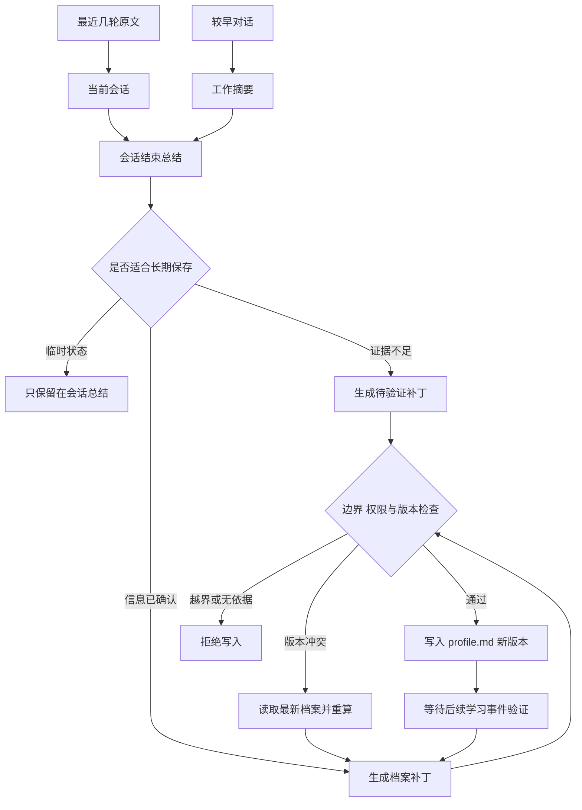

# 学生档案怎样成为长期记忆

[← 数字名师](README.md)

个性化学习做过几轮以后，很快会遇到一个具体问题。学生上周已经说过自己的学习目标，也在几次答题中暴露了相同的错误，新会话开始时，系统还要不要从头问一遍。

把全部聊天记录重新塞给模型，短期内似乎省事。会话越来越长以后，费用和延迟都会上升，旧内容还会挤占当前题目需要的上下文。把历史对话全部切片并放进向量库也不合适。系统已经知道这名学生是谁，需要的是一份确定、可读、能修改的教学档案。

## 先把四类数据分开

学生做过什么，系统怎样估计他的状态，本轮对话正在处理什么，跨会话应该记住什么，这四件事不能只靠一段摘要承担。先分层。

| 数据 | 主要内容 | 保存位置 | 使用时间 |
| --- | --- | --- | --- |
| 学习事件 | 答题、课程进度、提示使用和练习结果 | 业务数据库 | 复算掌握度与解释推荐 |
| 当前会话 | 最近几轮原文、当前题目和工具结果 | 会话存储 | 理解省略、追问和本轮状态 |
| 会话摘要 | 较早对话的压缩结果与本次会话总结 | 会话存储或 Markdown 文件 | 延续长会话与会后整理 |
| 学生档案 | 学习目标、讲解偏好、近期薄弱点和未完成任务 | `profile.md` | 跨会话个性化 |

学习事件是事实记录。掌握度、薄弱点和学习偏好都可能变化，应当保留判断来源与更新时间。当前会话负责眼前这道题，`profile.md` 负责下一次见到这名学生时仍然值得知道的内容。

档案只收教学相关信息。课程目标、学习阶段、经过确认的讲解偏好和反复出现的知识问题可以保存。家庭情况、情绪经历和日常生活不进入这份档案，那些内容涉及另一类产品责任与隐私边界。

## 已知学生不需要向量召回

代码 Agent 经常直接查文件和符号。[Codex 的官方提示指南](https://developers.openai.com/cookbook/examples/gpt-5/codex_prompting_guide)明确建议用 `rg` 搜索文本与文件。原因很朴素，代码仓库有路径、文件名和符号名，很多问题可以确定性地定位。[Claude 的 Memory 工具](https://platform.claude.com/docs/en/agents-and-tools/tool-use/memory-tool)也把跨会话信息保存成可读写的文件，再按需打开。

向量检索仍然适合教材、教师讲义和大规模题库。它们包含大量未知文本，用户的问题也未必能对应一个精确文件，语义与关键词混合检索仍然有价值。学生档案的条件不同。系统已经拿到学生编号，也知道档案路径。先按学生编号读取文件即可。

档案较小时可以完整载入。文件变大以后，服务先解析固定标题，再按本轮意图读取相关章节。需要找一条明确记录时，可以使用精确文本搜索。这个过程无需把每份档案切成片段，也不用在档案变化后重建向量索引。

Markdown 在这里承担档案格式。生产环境可以把文件放在受权限控制的对象存储或文档存储里，不能提交到 Git，也不应依赖某台应用服务器的本地磁盘。数据库保留学生编号、对象路径、档案版本、更新时间、更新来源和校验值，用来处理权限、并发和审计。

## 档案要让人能看懂

自由文本很容易越写越乱。`profile.md` 可以继续使用 Markdown，但标题和字段应当稳定，让程序能够按章节读取，也让学生或教师能够检查系统记住了什么。

```md
---
student_id: "<student-id>"
profile_version: 12
updated_at: "<timestamp>"
---

## 当前学习目标

- 内容
- 确认来源
- 最近确认时间

## 已确认的讲解偏好

## 近期薄弱知识点

## 已掌握但需要复习的内容

## 待验证判断

## 尚未完成的学习任务
```

稳定事实和模型推断要分开放。学生明确选择“先给提示，再展示完整步骤”，可以进入已确认的讲解偏好。一次作答中出现计算错误，只能形成待验证判断。后面的学习事件反复支持这个判断，系统再把它移到近期薄弱知识点。

近期状态还要有失效时间。学生补完一个知识点，旧判断应当更新或删除，不能一直留在档案里。版本历史负责回答“以前写过什么”，当前档案只保留仍会影响教学决策的信息。

## 长会话先压缩当前上下文

压缩先解决眼前的问题。

代码 Agent 已经在用压缩处理长会话。Claude Code 会在上下文接近上限时自动总结，也允许用户通过 [`/compact`](https://code.claude.com/docs/zh-CN/commands) 提前压缩，还可以用 `/resume` 回到一段已有会话。OpenAI 的 [Compaction](https://developers.openai.com/api/docs/guides/compaction)也会把较早的上下文压缩成更短的状态，让当前任务继续。

这里可以借鉴的是压缩当前工作状态。恢复旧会话、延续眼前任务，与维护跨会话的学生档案仍是两件事。前者尽量保住当前题目和处理进度，后者还要确认哪些信息稳定到值得长期保存。

学生答疑可以同时设置两种触发方式。上下文接近预算时自动压缩，一个知识点讲解完毕或一道综合题结束时主动压缩。最近几轮原文继续保留，前面的内容写进工作摘要。

教育场景里的工作摘要至少要留下当前题目、学习目标和学生已经尝试的步骤。已经确认的错误、没有帮助的解释、仍未解决的问题同样要留下。聊天中的寒暄、重复措辞和已经失效的工具结果可以删掉。摘要承担的是本轮工作状态，不负责给学生下长期结论。

会话结束后，系统再生成一份可读的 Markdown 总结，放在类似 `sessions/<session-id>.md` 的位置。它记录这次会话处理过什么，也保留需要后续确认的问题。压缩摘要可以偏向模型继续工作，会话总结则要方便人查看与后续处理。

## 长期档案通过补丁更新

档案更新要慢一点。

学生或教师明确修改学习目标、课程阶段和讲解偏好时，系统可以立即生成档案更新建议。一次会话结束、一个练习阶段完成，或者同类错误重复出现以后，AI 也可以主动整理候选记忆。

这几层数据的流向可以画成下面这样。



AI 不直接覆盖整份 `profile.md`。它输出带依据的结构化补丁，说明要增加、修改或删除哪个章节的哪条记录。档案服务随后检查章节是否允许修改，证据是否存在，内容是否越过教学边界，最后比较档案版本并写入新文件。

```json
{
  "profile_version": 12,
  "operations": [
    {
      "op": "add",
      "section": "待验证判断",
      "content": "<candidate-memory>",
      "source": "sessions/<session-id>.md"
    }
  ]
}
```

两个会话可能同时结束。它们都从第十二版档案生成补丁时，第一个写入者得到第十三版，第二个写入会遇到版本冲突。档案服务需要重新读取第十三版，检查新旧补丁是否重复或矛盾，再决定怎样合并。让模型直接重写文件，会把这个并发问题藏进一段自然语言里。

主动更新也不该每轮都跑。明确的目标变化可以及时处理，短期错误等到会话结束再整理，需要多个样本支持的判断则在阶段结束后合并。更新频率跟着信息稳定程度走，档案不会因为学生说错一句话就反复改写。

## 回答时只载入需要的部分

新会话开始后，系统先载入固定的产品规则和当前课程，再读取学生档案。档案很小时可以全部带入，变大以后只取当前目标、相关知识点、讲解偏好和未完成任务。随后加入上一次会话总结、本轮最近几条消息，需要课程依据时再检索教师知识库。

档案内容属于数据，不能拥有系统指令的权限。学生曾经输入的文本即使被写入会话总结，也不能改变 Agent 的工具范围或安全规则。载入服务需要转义内容并标明来源，模型只把它当作学生状态使用。

回答结束后，Agent 可以提出档案补丁，仍然要经过更新服务。这样一次错误回答不会自动变成长期记忆，学生或教师也能查看、修改和删除档案中的教学信息。

## 评测要故意制造错误记忆

离线样本应当同时包含明确事实、短期状态、相互冲突的说法和不该进入档案的内容。评测既看应该写入的内容有没有留下，也看一次偶发错误会不会被长期保存。会话压缩还要检查题目、学生尝试和未解决问题是否丢失。

工程测试要覆盖并发更新、版本冲突、对象存储失败、重复补丁和旧信息过期。权限测试则要确认一个学生不能读取另一名学生的档案，课程教师也只能看到职责需要的章节。删除请求完成以后，后续会话不能再从摘要、缓存或旧版本中重新带回那条信息。

线上可以观察档案更新成功率、冲突重算次数、学生或教师的修正比例、过期记录数量和每次载入占用的上下文。修正比例升高时，应先检查哪类候选记忆最容易写错，不能用增加更多自动总结掩盖问题。

学生档案能够被查看、纠正和删除，系统也能解释每条判断来自哪次学习活动，这份 Markdown 才适合进入下一次个性化回答。
