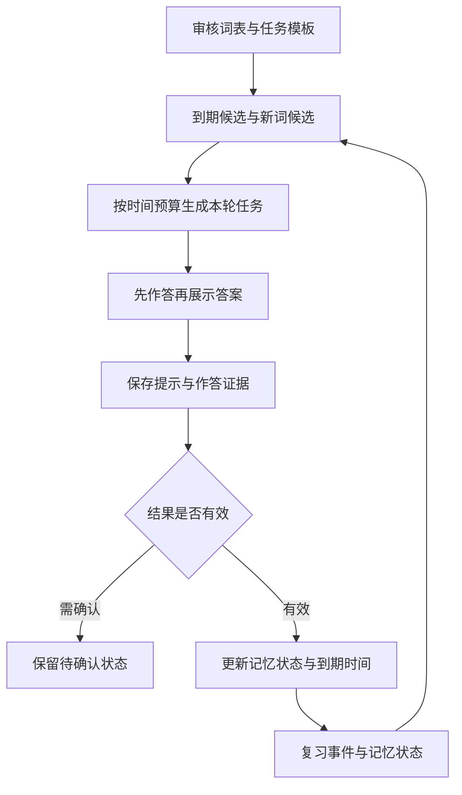

# AI 背单词怎样安排下一次复习

[← 数字名师与智能学习服务](README.md)

学生看到单词，觉得眼熟，翻开释义后点了认识。系统如果把这次点击记录成独立回忆成功，后面的复习时间就可能越排越远。背词产品需要先知道一次交互证明了什么，再决定下一次什么时候出现。

词义解释、例句和记忆提示可以由 AI 辅助组织。记忆状态与复习安排则需要依赖可追溯的学习事件，不能从聊天语气里猜学生已经记住。

## 学习单位需要细到词义与任务

词表先确定来源、适用范围和版本。拼写、词性、释义与例句保留审核状态，不能把不同词典或课程中的条目不加区分地拼在一起。发现释义错误后，也要知道哪些练习使用了它。

以 `bank` 为例，认出金融机构的含义，不能直接证明学生理解河岸的含义。看到英文选择中文，与根据中文写出英文，也提供不同的证据。学习记录至少关联词条、目标词义、任务类型和内容版本。

这不意味着把每种题型都独立计为一个全新单词。同一词义的不同练习需要关联起来，防止重复任务把掌握数量抬高。系统可以为识别和主动回忆维护不同证据，再决定是否共享某部分记忆状态。

模型生成的新例句先核对目标词义、语法和难度，再进入可复用内容库。反复生成可以增加表达变化，也会增加检查成本。第一版先使用审核过的例句与任务模板更容易控制。

## 把独立回忆和看过答案分开

一次复习可以先展示问题，接收作答，再展示答案。答错后重新输入正确拼写，属于本轮纠正，不应被当作又一次独立成功。系统要记录答案是否揭示、是否请求提示，以及作答最终如何完成。

自评按钮需要明确含义。忘记了就按失败记录，费力但独立想起来才算成功。[Anki 的复习评分说明](https://docs.ankiweb.net/manual/deck-options#fsrs)提醒，把忘记误标为困难会影响调度。借鉴这个区别，产品应避免用含糊的“差不多认识”混合两类反馈。

选择题、拼写题和口头作答可以共用界面，但评分不能直接互换。拼写题的容错规则应提前约定，语音识别不确定时允许重试，不能自动判成记忆失败。模型对回答的解释，可以补充说明，不能越过明确规则修改结果。

## 记忆模型估计当前风险

[IES 对学习研究的整理](https://ies.ed.gov/learn/blog/building-casl-improving-education-through-cognitive-science-research)把间隔学习与测验列为可用于教学的学习原则。原则提供方向，具体学生的复习间隔仍需要通过记录与后续表现检验。

一种可理解的参考是[语言学习中的半衰期回归模型](https://aclanthology.org/P16-1174.pdf)，根据学习历史估计记忆变化。下面的公式表达这类模型中的一个基本关系。

```text
p(recall) = 2 ^ (-t / h)
```

`t` 是距相关学习事件过去的时间，`h` 是模型估计的记忆半衰期，两者使用相同单位。若 `t` 等于 `h`，公式给出二分之一的回忆概率。这是模型假设下的估计，不能据此声称一个学生必定在某天忘记。

另一个可选实现是 FSRS，即根据复习历史安排间隔的调度算法。它使用难度、记忆稳定性和当前可回忆程度等状态，接入时应采用其实际实现，不能套用上面的半衰期公式。[Anki 的调度配置](https://docs.ankiweb.net/manual/deck-options#desired-retention)还说明，目标记忆保持率提高会增加复习负担。

目标保持率属于调度配置，不能当成学习效果保证。刚开始没有足够记录时，可以用默认参数或简单间隔规则，先保证事件含义正确。积累数据以后，再检验是否需要按学生或内容调整参数。

## 到期队列还要服从当天的学习负担

调度器根据状态计算下一次到期时间，再结合学生当天的可用时间生成任务。词表范围、教师要求和主动暂停等条件先过滤，到期程度与本轮负担再影响排序。



学生几天没来，积压的到期任务可能超过当天能完成的数量。产品可以减少新词、优先部分复习，并明确还有哪些任务未完成。不能为了清空队列，把未复习内容标成已完成，或者假定推迟后的记忆状态与原计划一样。

考试临近时，可以单独提供考前复习任务，优先处理考试范围内的重要内容，同时保留长期调度记录。短期集中练习的结果需要单独标记，不能自动解释成稳定记忆的大幅提升。

## 补传作答以后，复习计划怎样调整

学习事件的标识、版本与重复提交处理，沿用[学习记录与状态管理](personalized-learning.md)。背词调度还需要区分实际作答时间与接收时间。学生昨天离线完成的复习，今天才上传，不能当成刚刚又复习了一遍。

迟到事件进入记录后，按确定的顺序重算受影响的记忆状态与下一次到期时间，保留调度算法和评分规则版本。已经完成的任务不重复派发，尚未开始的计划可以调整。对学生展示日期时再换算到其时区，跨日也不能多计一次复习。

生成模型只读取获准提供的学习摘要，用来解释为什么复习、怎样理解词义。调度状态可以保存在可查询、可重放的数据存储里；长期目标与偏好仍按[学生档案](student-profile-memory.md)的规则管理，不必把每次作答追加到 Markdown 档案中。

## 用延迟回忆检查调度

离线可以按时间先后划分数据，用过去事件预测后来的独立作答，不能把同一事件以不同副本放到两边。检查总体预测之外，还要看不同任务、时间间隔与样本量下是否稳定。界面或评分规则改变后，旧记录与新记录需要区分。

线上则同时观察延迟后的独立回忆、每天完成任务所需时间，以及积压与放弃情况。当天连续答对很容易受到重复和答案暴露影响，不能直接代替长期保持。想判断一种调度是否优于另一种，还要尽量控制词表、学习时间与任务形式。

学生反复失败时，可以减少任务、补讲词义或改变练习形式。先检查内容与反馈是否有问题，再决定调整调度参数。把每次困难都解释成学生不够努力，对产品改进没有帮助。
