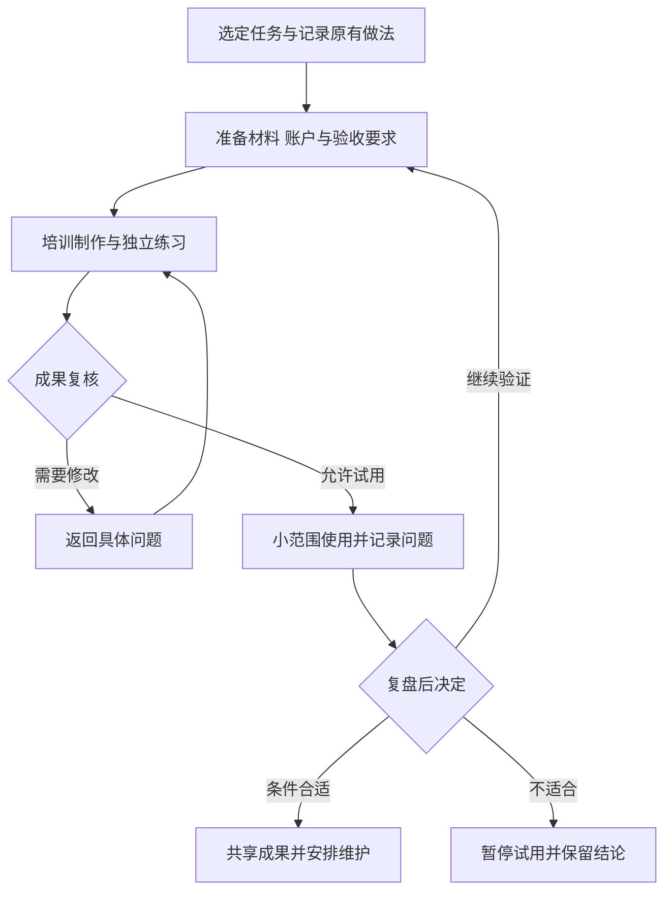

# 教师 AI 培训怎样变成可验收的教学实践

[← 学校运营与教育治理](README.md)

一场培训结束，教师提交了几份 AI 生成的教案，学校可以确认培训产生了作品。至于这些作品能否用于下周的课堂，教师需要改多久，换一个人还能不能继续使用，需要另外收集证据。

教师培训可以围绕一次教学任务组织。选定一个当前需要完成的问题，带着已有材料制作，经过复核后小范围使用，再决定是否保留这套方法。下面讨论的是这种组织方案，不把培训参与情况直接当作教学效果。

## 先问教师正在重复做什么

备课、制作练习和整理课堂反馈，都可能成为实践入口。选择时需要看任务是否真实发生，输入材料能否提供，教师能否判断结果是否合格。无法明确验收的任务，不适合直接成为第一批成果要求。

例如，学校可以选择把一份已经确认的教案加工成可编辑课件。原教案与旧课件作为输入，课堂投影和教师讲稿作为交付要求。这样，培训前后能够对照同一种任务，也能检查教师花了多少时间核对答案、调整版式和重新导出。

教师的起点需要通过任务了解。有人尚不熟悉上传资料和保存文件，有人已经能生成内容，却难以发现错误。已有实践的教师还可能需要整理自己的方法，供同事使用。这些情况对应不同的支持，不能只按教龄或一次自评问卷分组。

[UNESCO 教师 AI 能力框架](https://www.unesco.org/en/articles/ai-competency-framework-teachers)同时讨论基础应用、教学、伦理和专业学习，并设置逐步发展的能力层次。借鉴到学校实践中，教师既要会操作，也要知道哪些材料不能上传、哪些判断需要自己完成。首次培训可以从现有工具入手，无需要求每个人开发能够自主选择步骤和调用工具的 Agent。

## 把任务与验收约定放在一起

开始制作前，组织者、教师与教研人员先确认交付要求。课件是否可编辑、例题答案是否正确、学生版是否隐藏答案，都应提前说清。若最后才增加这些要求，很难区分返工来自工具问题，还是任务本身变了。

技术支持负责账户、文件处理、运行故障和导出问题。教研人员负责教学内容与学科依据的复核，任课教师决定是否用于自己的课堂。学校还需要有人确认材料使用范围、成果共享权限，以及试用出现问题后怎样暂停。

这些责任可以落实到任务页面与记录里。每份成果关联输入材料、工具和模型版本，保留教师修改、审核结论及最终交付物。涉及学生信息时，只保留本次任务必要的内容，并按学校允许的方式处理。测试材料可以优先采用去标识的样例，但去掉姓名以后仍要检查其他内容是否可能识别人。

任务记录应能解释一次结果怎样产生，无需默认保存教师所有聊天内容。采集范围、查看权限和保存期限应在试用前明确。

## 培训现场要留出独立练习

演示可以帮助教师认识工具，接下来需要让他用自己的合规材料完成同类任务。讲师展示一份已经调好的课件，不能证明参与教师也能独立制作。

可以先共同检查一份带有明确问题的样例，再由教师独立制作，并说明自己删掉或修改了什么。教研人员依据同一份评分量规复核，量规把内容正确性、教学目标和交付要求写成明确的检查标准。技术支持记录文件、交互和运行方面的问题，反馈落到具体页面或步骤上，方便下一次修改。

[EEF 的教师专业发展指南](https://educationendowmentfoundation.org.uk/education-evidence/guidance-reports/effective-professional-development)讨论目标设定、反馈和回顾既有学习等机制。用于这里，可以把一次讲授拆成示范、独立练习、反馈和后续再用。具体安排仍要适应教师时间与学校条件，这些原则不能保证某次 AI 培训必然有效。

试用计划也需要允许停止。[EEF 的学校实施指南](https://educationendowmentfoundation.org.uk/education-evidence/guidance-reports/implementation/process)把实施组织为探索、准备、实施和持续维护几个可调整阶段。学校可以据此安排试点，而不用在第一场培训后立即推广。

图中的复核与推广决定由指定人员完成。发现内容错误或数据问题时，可以直接暂停，不必等到试点周期结束。

## 分清作品合格、实际使用与学习效果

验收可以沿着成果进入课堂的过程收集证据，不宜把所有结果压成一个总分。

| 要回答的问题 | 可以收集的证据 | 不能直接推出的结论 |
|---|---|---|
| 教师能否独立完成任务 | 独立制作记录、求助步骤与复核结果 | 在讲师协助下交作业不等于能够独立使用 |
| 产物是否符合要求 | 内容检查、可编辑性、导出与设备检查 | 文件能够打开不等于适合课堂 |
| 方法是否进入日常工作 | 试用记录、后续再次使用和放弃原因 | 账户活跃不等于教学使用 |
| 工作负担是否改变 | 材料准备、生成、复核和返工的总耗时 | 首次生成快不等于整体省时 |
| 是否帮助学生理解 | 与目标对应的独立作答或课堂证据 | 满意度与互动次数不能代替学习证据 |

例如计算再次使用的比例，应事先说明分母是哪些教师、观察多长时间，以及什么算一次有效使用。只看仍在活跃的教师，会遗漏中途放弃的人。放弃原因可能指向材料不足、工具不合适，或检查成本过高，同样需要保留。

比较时间时，任务范围和质量要求要尽量一致。课件页数、教师熟悉程度以及是否获得现场协助，都会影响耗时。记录口径明确以后，才能判断节省发生在哪个步骤。小范围试点只支持有限的结论，不适合直接外推到全校教师或所有学科。

若项目只验证了课件制作与交付，可以停在工作量和产物质量。要研究学习效果，应另外设计与教学目标匹配的观察任务，并说明比较条件和局限。

## 培训结束以后，保留支持与退出方式

教师在真实材料上遇到的问题，未必会出现在培训样例里。后续应有明确的求助入口，区分内容疑问与技术故障，并约定谁处理、怎样反馈。不能让教师在多个群里重复解释同一个文件出了什么问题。

成果共享也要经过整理。完整学生记录不进入公共资源库，个人讲解偏好不自动变成学校规则。其他教师复用时需要知道适用条件、来源和维护人。可以把稳定的方法继续加工为[教学 Skill](../teacher-assistant/teaching-skill-library.md)，具体课件与互动页面则保留各自的审核版本。

工具升级或服务调整后，应重新跑一遍代表性的任务。旧模板不能继续使用时，给教师提供替代方法或导出材料；维护成本超过收益时，可以停止该项实践。

下一轮培训要针对已经记录的问题安排。有些问题需要补操作训练，有些需要教研人员澄清标准，也有些应交给产品团队修复。上一次的失败记录能够帮助判断下一步该做什么。
