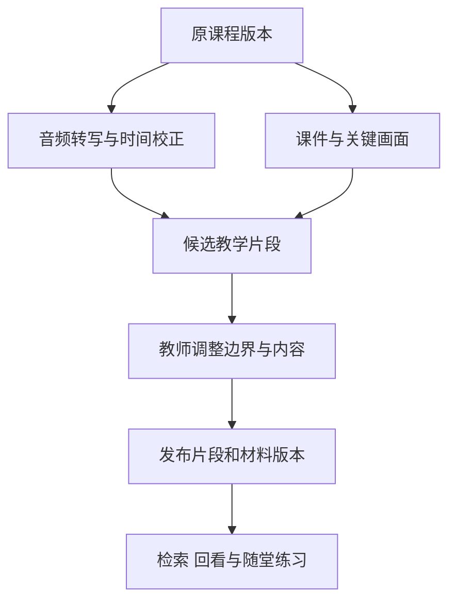

# 课程视频怎样变成可检索的知识片段

[← AI 智慧课堂](README.md)

学生想重看某一步推导，播放器通常只知道他上次停在哪里。要让系统找到对应讲解，需要把视频里的声音、课件和教学结构联系起来。单纯生成一份全文摘要，仍然难以回答应该从哪一秒开始看。

这里讨论已录制课程的加工与学习支持。它可以为回看、答疑和随堂练习提供材料，与[实时视频教学](realtime-video-teaching.md)的运行控制分别实现。

## 先建立一条可靠的时间轴

录入课程时登记使用范围、课程归属和视频版本，保存原文件与媒体时长。音频、字幕和截图都是派生产物，处理配置与来源版本要能找到。重新剪掉片头后，即使课程名称没变，原来的时间位置也可能全部失效。

语音识别可以生成带时间位置的候选文本。例如 [Azure Speech 的批量转写接口](https://learn.microsoft.com/en-us/azure/ai-services/speech-service/batch-transcription-create)提供词级时间信息的配置。不同实现支持的粒度可能不同，接入时需要检查实际返回结果，不能只保存一段没有位置的全文。

提取音频、分块转写以后，片段内的相对时间要换算回原视频。分块之间有重叠时，去除重复文本也要保留正确位置。否则搜索虽然找到那句话，播放器跳过去却是上一段内容。

[WebVTT](https://developer.mozilla.org/en-US/docs/Web/API/WebVTT_API/Web_Video_Text_Tracks_Format)用开始与结束时间描述同步文本。它适合交付字幕，不直接定义知识点边界。字幕校正以后还要复核时间，公式、否定词和教师口头修正尤其需要回听。

## 知识边界结合讲解与画面判断

课件换页可以提供候选边界，板书变化和语音停顿也能提供线索。教师可能用几页讲同一个概念，也可能在同一页切换两个例题，因此不能把每次画面变化都保存成新知识点。

第一版可以让系统提出切分建议，由教师在时间轴上调整。一个片段保留讲解对象、前置概念、例题和结论的位置，必要时关联前后片段。先出现的错误推导与后面的纠正，应当放在能够一起理解的范围内，避免单独检索出错误结论。

| 产物 | 记录什么 | 后续用途 |
|---|---|---|
| 校正字幕 | 原视频位置与已确认文字 | 搜索与字幕展示 |
| 教学片段 | 时间范围、主题及前后关联 | 回看定位与课程导航 |
| 课件和关键画面 | 图像位置与关联讲解 | 补充公式、图表和板书依据 |
| 摘要与检测题 | 所依据的片段及审核版本 | 学习提示与随堂练习 |

教师说这里的三角形，转写文本本身无法确定他指向哪里。检索材料需要带回关联画面；缺少画面或标记不清时，系统应保留疑点，不能让模型补出图形条件。

摘要与知识点名称可以由模型生成候选，教学依据来自已确认的字幕和画面。模型补充的解释要另行标记，不能冒充教师原话。

## 先做逻辑片段，不急着生成新视频

逻辑片段只保存原视频标识和起止位置，播放器按这些位置回放。这样教师调整边界时，不必为每次修改重新转码。确实需要离线包或独立分发时，再生成有明确版本的物理切片。

[W3C 的媒体片段规范](https://www.w3.org/TR/media-frags/)提供按时间寻址的表示方式，并说明时间表示不等于逐帧准确。实际交付仍需检查播放器、编码和网络环境。不能只验证链接有参数，就认定它一定从正确画面开始。

时间范围至少满足开始位置非负、结束晚于开始，且不超出课程时长。部分片段可以有少量上下文重叠，不能强行要求所有教学片段无缝互斥。课程目录和字幕轨如果有不同约束，应分别校验。

## 检索返回可观看的依据

学生提出问题后，先按账号、课程范围和资源状态过滤，再结合关键词与语义检索找候选。图像、字幕和摘要可以各自辅助召回，但最终回答应引用经过确认的材料。

返回结果可以包含片段标题、简短依据和回看入口。回答中涉及两个不同位置时，分别标明，不把多个片段拼成教师说过的一段完整话。当前材料解释不了的问题，可以说明缺口，按课程规则补充资料或暂停回答。

点击片段仍需服务端检查访问权限，再提供可用的播放地址。资源标识和时间范围长期保存，临时播放地址按需生成；链接里的时间参数不承担权限隔离。

向量索引怎样跟随字幕修改和课程下架，复用[索引生命周期](../../enterprise-ai-platform/knowledge-engineering/vector-index-lifecycle.md)的规则。业务元数据还要记录哪些摘要、检测题和片段依赖哪份课程，便于修订后重新审核。

## 弹题需要跟随学习任务

检测题可以关联到已确认片段，在适当位置提示学生尝试。题干、答案与教学依据需要提前审核，不能在学生观看时临时生成一道题，再立即当作可靠测验。

学生跳转、倍速播放或反复回看，都会再次经过触发位置。播放器与学习服务需要共同记录本次任务是否已经展示、是否提交，以及是否允许重做。不能只在视频时钟到达某一秒时重复弹窗。

看过讲解后的即时作答，需要与稍后独立作答分开保存。观看进度可以帮助恢复播放，不能单独证明学生理解；一道检测题答对，也只提供有限证据。推荐与档案更新继续走[学习记录与状态管理](../digital-teacher/personalized-learning.md)，不由播放器直接改写长期判断。

替换课程版本时，先核对时间轴，再检查哪些片段、摘要与检测题受到影响。字幕纠正不一定改变时间位置，剪辑重排则可能使全部旧位置失效。新版本确认以前，线上继续使用已发布版本；涉及错误或权限问题时，可以先停止相关入口。

验收需要人工确认的查询和片段样本，分别检查能否找对讲解、起止是否保留必要条件，以及回答是否忠于画面与原话。还要抽查公式和口头纠错片段，并实际点击回看。找到一个包含关键词的字幕块，只能通过其中很小的一部分检查。
