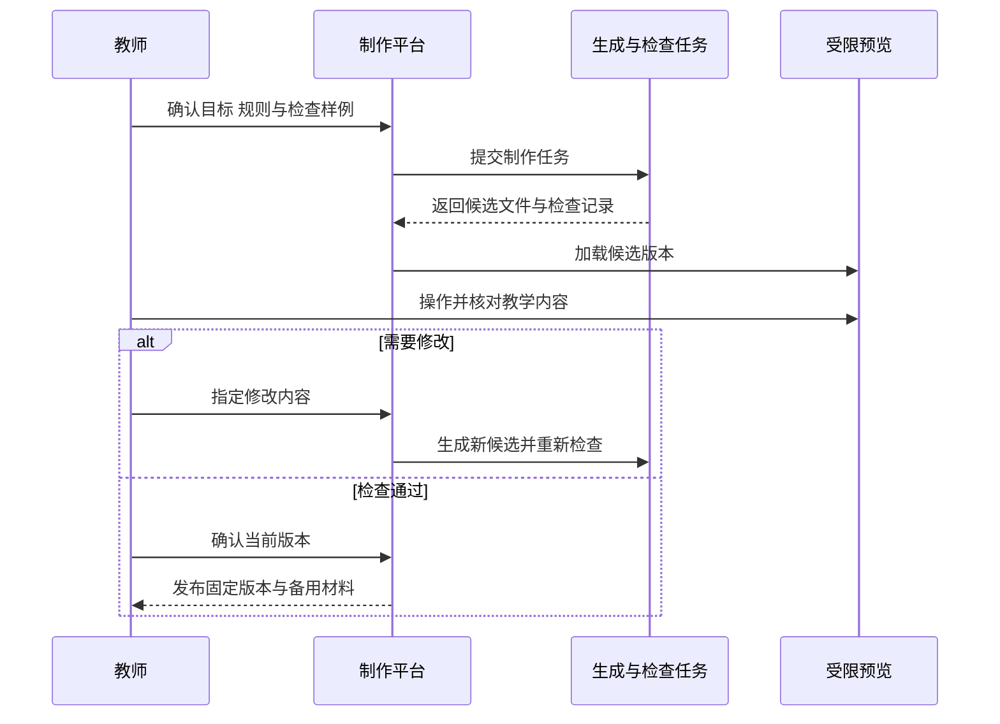

# 教师怎样用 AI 制作互动教学工具

[← AI 智慧课堂](README.md)

教师想讲清一次函数中参数的作用，可以在课件上准备几幅图，也可以做一个允许学生调整参数的小页面。拖动以后图像立刻变化，学生能对照自己的预测观察结果。这样的工具增加了一种课堂活动，同时也增加了计算、交互和设备适配方面的检查。

AI 可以帮助生成页面代码、整理活动说明，随后根据教师要求修改。下面以函数 `y = ax + b` 为设计示例，讨论怎样把生成结果交付到课堂。第一版可以只做一个单页工具，由平台承担测试、发布与维护。

## 先确定学生要观察什么

工具可以让学生先固定 `b`，比较不同 `a` 对图像的影响，再固定 `a`，观察改变 `b` 时图像怎样移动。教师可以让学生先预测变化，操作后解释理由，最后离开页面完成一道独立问题。

这份活动要求要与页面一起保存。只写“生成一个函数演示”，模型很难知道是否应该允许自由修改参数，是否需要同时显示两条图线，以及答案何时揭示。

[PhET 的教学资源](https://phet.colorado.edu/en/teaching-resources/teaching-with-phet/small-group)把活动单作为引导探究与合作的一部分。借鉴到这里，工具应当和观察问题一起设计。动画是否流畅、学生是否点击，只能说明一部分使用情况。

还要决定是否确实需要新做。已有工具满足教学目标且获准使用时，可以先配合活动单试用。确实缺少某种展示或交互，再生成一个范围较小的工具。这样能减少课前测试和以后维护的工作。

## 给模型一份能核对的需求

对于这个函数工具，教师可以先确认参数范围、坐标范围和默认状态。横轴与纵轴分别表示什么，坐标是否保持比例，也需要明确。显示区域之外的线段可以裁切，但不能让裁切结果被误认为数学上的终点。

交互可以限定为两个参数输入、恢复默认值，以及一项对照功能。页面不必在每次拖动时询问大模型。模型负责协助制作工具，运行中的数值与图像由确定性的程序计算。这样的页面可以在没有模型服务的情况下继续使用。

为了核对生成代码，可以在需求阶段就写下几组检查数据。

| 检查条件 | 预期结果 | 主要排查的问题 |
|---|---|---|
| `a = 1`，`b = 0` | 图线经过原点和 `(1, 1)` | 坐标与取点是否正确 |
| `a = -1`，`b = 2` | 图线经过 `(0, 2)` 和 `(2, 0)` | 负号和截距是否正确 |
| `a = 0`，`b = 2` | 显示水平直线，并提示它属于常量函数 | 零值分支与术语是否正确 |
| 恢复默认值 | 参数、图线和说明同步恢复 | 界面是否存在旧状态 |
| 输入超出允许范围 | 明确提示并保持有效状态 | 是否静默截断或生成异常数值 |

一次函数通常要求 `a` 不为零。若教学上需要比较零值，页面应把它标成常量函数；若本课不讨论，就限制该取值。这个决定由教师作出，不能让滑块范围悄悄决定教学定义。

这些检查数据可以供教师手工核对，也可以转为自动化测试。测试的预期值需要独立确认，不能只让同一个模型生成代码后，再自行宣布结果正确。

## 生成代码先进入受限预览

AI 生成的网页包含可以运行的代码，应按不可信内容处理。它不应与学校管理系统共享登录凭据，也不应默认获得学生档案、摄像头或任意外网访问权限。

一种实现方式是把预览放到独立来源的页面中，通过浏览器沙箱限制能力。沙箱指对运行内容设置权限边界。[MDN 的 iframe 文档](https://developer.mozilla.org/en-US/docs/Web/HTML/Reference/Elements/iframe#sandbox)特别提醒，同源内容同时获准执行脚本和保留同源身份时，可能破坏预期隔离。简单套一层 iframe，不能自动保证安全。

外部脚本、图片和网络请求还要分别限制。[内容安全策略](https://developer.mozilla.org/en-US/docs/Web/HTTP/Guides/CSP)可以约束不同类型的资源加载，工程实现需要覆盖实际使用的资源通道。依赖包应采用经过审核的来源和固定版本，页面中不放模型密钥。若生成任务需要在服务端安装依赖或执行构建，还要为构建进程单独限制文件、网络和资源权限。

对于范围固定的课堂小工具，更容易控制的方案是先提供经过检查的图表与输入组件，让模型生成配置和说明。只有模板无法表达需求时，才考虑开放更自由的代码生成，并提高审核要求。

修订次数与任务时限需要设上限。失败时保存候选文件和问题，由教师决定继续修改。预览通过以前，候选页面不能自动替换课堂正在使用的版本。

## 修改以后，要重新检查受影响的部分

教师说把字体放大，通常只涉及布局；把参数改成分数输入，可能同时改变计算、输入校验和说明。平台可以记录修改范围，再运行相关检查。无法可靠判断影响范围时，重新检查整个小工具更稳妥。

发布记录应关联源文件、依赖、教师确认和最终产物。只要代码或教学规则发生变化，原确认就不能继续证明新版本可用。教师可以选择一个已通过的版本用于课堂，后续修改留在草稿里。

投影与个人设备也要分开检查。投影时轴标签需要看清，手机上输入框不能遮住图像，参数恢复后页面不能残留旧解释。[W3C 的表单指南](https://www.w3.org/WAI/tutorials/forms/labels/)要求为控件提供清楚关联的标签。教学页面也应检查键盘操作、可见说明，以及不依赖单一颜色表达差异等问题。

浏览器没有报错，只能通过一部分技术检查。教师仍要核对概念、示例与操作顺序，再用实际课堂设备试一遍。

## 先做不采集学生身份的版本

教师在投影上演示，通常不需要学生登录。学生独立操作时，也可以先在设备本地保存当前参数，不记录姓名与完整轨迹。工具的教学目标能够在这种条件下完成，就不用顺带接入学生档案。

需要汇总作答时，再增加受控接口，明确保存哪些数据、供谁查看。服务端应校验班级权限与活动版本，不能相信页面自行提交的身份和结果。传给生成页面的数据也要限定在本次活动需要的范围内。

课堂前应准备静态图、活动单或已验证的离线版本。离线交付要实际检查字体、脚本和图片依赖；一个导出的 HTML 文件仍可能依赖外部资源。页面失效后，教师能继续用备用材料完成原定活动。

验收时可以分别看操作是否可靠，以及学生能否解释图像变化。后者可以通过课后独立问题观察，不能用拖动次数替代。若学生只是照着页面上的文字复述，就需要检查活动是否过早展示结论。

工具交付后还要指定维护人。发现数学错误时，先撤下受影响的版本，再保存复现条件并修复。下次开课前使用哪个版本，应由教师明确选择。
