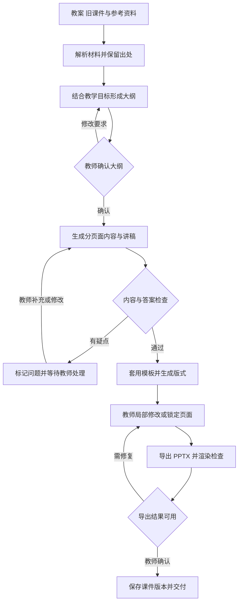

# 教师课件怎样从教学资料生成

[← 教师智能助手](README.md)

教师拿到一份 AI 生成的课件，接下来的工作往往才决定它有没有用。例题要换成课堂正在讲的内容，答案不能提前出现在学生面前，投影时公式得看清，临时删掉一页以后，后面的讲解还要接得上。能下载一个 PPTX 文件，只完成了其中一部分。

[Manus 的教师课件页面](https://manus.im/zh-cn/playbook/powerpoint-generator-for-teachers)把上传教案、组织幻灯片、生成讲稿和继续修改放在同一条流程里。这说明了产品可以怎样组织，页面对速度与课程适配的描述仍属于厂商宣称。要判断它是否适合教学，还得把生成结果交给教师修改，再检查最终交付物。

[智能备课](lesson-planning.md)讨论教学目标、资源与课堂活动怎样安排。这里把范围收窄到一项具体产物，讲清怎样把已经准备好的教学资料加工成可编辑课件。下面是结合公开实现整理的工程方案，尚未对这些产品进行真实教学材料的横向测试。

## 先让系统知道这节课要交付什么

一次课件任务可以从已确认的教案和旧课件开始。教师补充授课对象、课时、已有基础和本次需要讲清的问题，再选定输出模板。资料不足时，系统先列出待确认项，大纲确认后再展开页面。

比起要求教师填写很长的提示词，产品可以把影响结果的约束直接做成可修改的选项。

| 输入内容 | 对课件生成的影响 |
|---|---|
| 教学目标与学生基础 | 决定解释到哪一步，哪些概念可以略过 |
| 已确认的教案、例题与解析 | 限定本次内容，保留答案和材料出处 |
| 旧课件或机构模板 | 提供版式、术语和常用表达的参考 |
| 课时与教学环节 | 为讲解、提问和学生练习分配时间 |
| 展示与交付要求 | 区分课堂投影、教师讲稿和学生资料 |

这些输入需要有明确的优先级。教师锁定的教学目标与已审核材料优先，外部搜索负责补充候选资源。搜索到一份标题相似的课标，不能直接证明它适用于当前地区、学段和教材。不同来源冲突时，应保留疑点，由教师选择依据。

资料解析也要留下位置。PDF 的页码、旧课件的页号与引用片段都应能回到原文件。图片里的公式可以先识别成候选文本，无法确认的符号进入复核。图像来源和使用范围要随素材保存；未获准提供给外部模型的材料，不进入相应服务的请求。

## 大纲确认以后，再生成每一页

直接生成整份演示文稿，会把内容取舍和版式决定混在一起。更容易修改的做法是先保存一份结构化内容稿，也就是把教学目标、页面内容和素材关系拆成可单独处理的记录，随后再生成版式。

每页可以保存稳定的页面标识、目标、正文、例题引用、讲稿、素材、锁定状态和内容版本。页面顺序变化时，标识保持不变。教师以后说替换某道例题，系统才能找到对应记录，连同引用它的解析和练习一起检查。

例如在一个方程复习课的教学示例中，教师希望先让学生尝试，再展示完整解法。题目页、提示页和答案页需要标明各自用途，教师讲稿可以提醒何时揭示答案。若把所有文字一次压进一张图片，局部修改和分步展示都会受到限制。

大纲阶段主要核对教学目标与环节。页面内容阶段检查事实、题目及解释，版式阶段再决定文字、图表和配图怎样摆放。目标确认之后仍可修改，但修改范围需要明示，不能让一次换模板悄悄改变教学内容。

图中的回路表示在有次数和时间上限的条件下修订。失败时保存问题、产物与已完成阶段，由教师决定继续修改或使用已有材料。系统不应一直自动重试，也不能为凑齐页数补出未经确认的内容。

## 接入开源生成器以后，还缺哪些业务能力

[Presenton](https://github.com/presenton/presenton)提供文档或提示生成演示文稿、自定义模板、可编辑 PPTX 导出和生成 API。按项目文档，它既可以作为自部署的工具使用，也可以由业务系统通过接口调用。教师试用时，可以先选材料、模板和模型配置，在生成后手动修改；接入教育平台时，再把它放到课件任务的文件生成环节。

[PPTAgent 的论文](https://aclanthology.org/2025.emnlp-main.728/)研究了参考演示文稿分析、大纲规划与迭代编辑，并从内容、设计和连贯性三个方面评价生成结果。[项目当前主分支](https://github.com/icip-cas/PPTAgent)还提供面向编码 Agent 的 Skill，用于创建、修改和视觉审阅演示文稿。Skill 在这里是一组任务说明与工具约定。复现论文时，需要按仓库说明选择对应版本，避免把旧论文的实现与当前工作流混在一起。

这些项目可以减少文件生成与排版工具的开发量。教育产品仍要管理教学资料权限，保证生成内容与教师确认的要求一致，并提供复核和版本记录。生成器的内容、设计和连贯性评测，也需要补上学科正确性与教学目标检查。

第一版可以用固定工作流安排资料解析、教师确认和文件导出。Agent 在需要选择素材、组织页面或根据检查结果提出修改时参与，工具调用只对当前任务授权。即使采用自部署，所连接的文本模型、图像服务和搜索服务仍可能在外部运行，需要分别检查材料会被送到哪里。

## 局部修改要能停在局部

教师把某页的讲解改好了，下一次重生成应当保留这项劳动。可以把内容与布局分开锁定，让教师决定只换版式，还是允许同时修改正文。例题、答案和讲稿之间的引用关系要保存下来，避免换题后仍沿用旧解析。

修改请求还需要携带基础版本。如果生成任务基于旧稿运行，教师此时又手动改了同一页，任务返回后应显示差异，等待合并确认，不能直接覆盖最新内容。改动影响其他页面时，列出受影响的页供教师复核。

生成、配图和导出可能耗时较长，适合以后台任务运行。界面展示当前阶段，允许取消并保留已有产物。重试时使用同一个任务标识和相应阶段版本，减少重复生成与重复计费；外部服务是否真正支持去重，还要按其接口能力确认。

平台内部的结构化稿与教师在 PowerPoint、WPS 中修改的文件，也可能形成两份版本。第一版若无法可靠回读外部编辑，就明确把下载后的文件作为独立交付物，后续上传为新版本。自动双向同步需要额外处理元素对应与编辑冲突，不能仅凭文件名推断内容已经一致。

## 导出之后，检查实际文件

可编辑需要逐项验收。文字应能修改，公式最好保留可编辑表示，重要图表应能更换数据。整页图片虽然也能放进 PPTX，教师却无法直接改其中一句话。确实需要以图片保留的复杂图示，可以同时保存源文件或替代素材，并标明编辑限制。

导出后的 PPTX 应重新打开并渲染成预览图，检查文字溢出、遮挡和缺图。生成页面时的预览通过，也不保证导出后字体、公式和布局完全相同。系统应按实际交付文件检查，教师再在计划使用的软件与设备上抽查显示效果。依赖网络的视频或动画，还要准备可用的替代材料。

内容检查与视觉检查分开进行。符号或计算工具可以辅助核对计算题，教师仍要确认题意、适用条件和讲解顺序。模型看图没有发现错误，只能作为一次检查结果，不能代替所有学科判断。自动修复内容后，原来的教师确认应失效，重新进入复核。

教师版和学生版要分别导出。教师备注里的答案、内部批注和学生信息，不能因为放在非展示页就默认安全。导出时检查备注、隐藏页和附加内容，学生资料只包含获准交付的部分。素材引用与来源记录可以保存在教师侧，便于后来核查。

## 省下来的时间，要扣掉复核与返工

备课辅助有实际研究依据。EEF 发布的[教师备课试验](https://educationendowmentfoundation.org.uk/projects-and-evaluation/projects/choices-in-edtech-using-generative-ai-chatgpt-for-ks3-science-lesson-preparation-2024-teacher-choices-trial)涉及英国 68 所学校、259 名教师。获得使用指导的 ChatGPT 组，在指定的初中科学课程备课任务中，平均每周用时为 56.2 分钟，对照组为 81.5 分钟，相差 25.3 分钟，约减少 31%。专家盲评没有发现所评资源质量受到明显影响。

这项结果支持在相应条件下尝试备课辅助。它没有单独验证上述课件产品，也没有证明生成课件能提高学生成绩。教师使用前获得了学习与练习时间，产品试点同样需要把上手成本算进去。

实际验收可以用相近难度的备课任务，比较原有方式与辅助方式。从整理输入开始计时，算上审阅和最终返工，以教师确认可用作为终点。生成等待占了多久、教师实际操作用了多久，分别记录，避免把后台运行时间与教师工作时间混在一起。

| 验收对象 | 可以记录的结果 |
|---|---|
| 教师工作量 | 输入准备、核对、修改与导出后返工所需时间 |
| 内容质量 | 事实与答案错误、缺失目标、无依据的引用 |
| 交付质量 | 可编辑性、文件打开情况、字体与公式显示 |
| 后续使用 | 教师实际采用哪些页面，哪些内容反复被删改 |

时间减少的前提是质量达到要求。错误答案不能靠更快生成抵消，教学效果还要结合独立作答与课堂后的表现另行评估。

第一轮试点可以限定为把已审核教案和旧课件加工成新课件，先选择明确的学科与课型。教师仍在熟悉的软件里完成最终修改，平台记录他保留了哪些结果、在哪里返工。等这段工作确实变轻，再考虑扩展到从主题开始搜索与生成完整课程。
