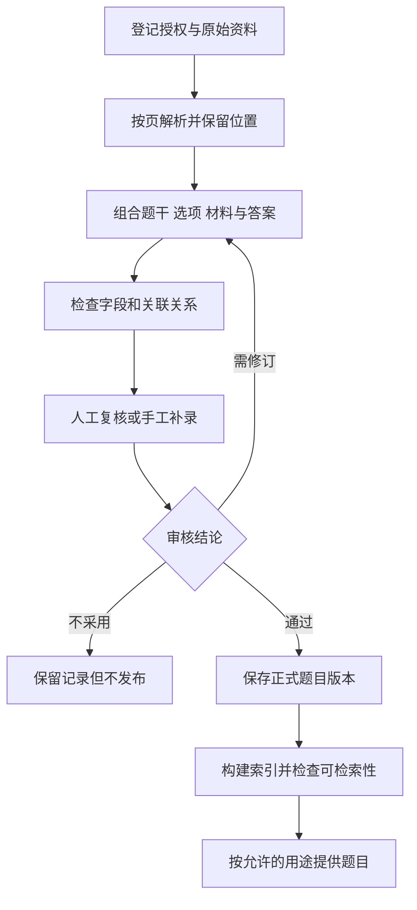

# 一份教学资料怎样变成可用的题库

[← 教师智能助手](README.md)

把试卷识别成文字，离录成一道可用的题还有一段距离。题干可能跨页，阅读材料供几个小题共用，答案集中在文末，配图里的标记又没有出现在文字里。录题系统要恢复这些关系，后续拍搜、组卷和批改才有可靠输入。

这里讨论从获准使用的 PDF、图片和已有电子文档生产题库的流程。[通用文档解析](../../enterprise-ai-platform/knowledge-engineering/document-conversion.md)负责读出内容、版面和来源位置。录题继续处理题目关系、教研确认与按用途发布，这些判断需要教育产品自己设计。

## 原文件与识别结果分开保存

上传时先记录资料来源、使用范围和文件版本。原始文件保留一份，旋转、去噪和裁切得到的图片另行保存。这样审核人发现一个负号不对，还能回到原页确认，重新跑识别也不会覆盖原始依据。

每块内容都应保留原页位置，以及到处理后图片的坐标变换。录题复核需要沿着这些位置找回跨页条件、共用材料和图例。即使文字全部识别正确，题干、答案与配图仍可能配错。

## 按题目关系组织内容

录题可以先按页面提取，再按题号、版面与材料关系组合候选题。题干中的序号可能是小问，也可能只是正文的编号。题目切分不能只靠一个匹配数字的规则。

阅读理解可以把共用材料保存为独立对象，几个小题分别关联它。几何题需要同时保留题干和图，公式则保留原图及识别表达。文末答案与解析先按题号匹配，缺失、冲突或多出一项时进入待确认状态。

| 内容 | 应保留的关系 | 常见检查点 |
|---|---|---|
| 题干与小问 | 父题、子题和原页位置 | 是否漏掉条件或合并了相邻题 |
| 选项 | 稳定标识、内容与原始顺序 | 是否漏项，答案是否仍指向正确内容 |
| 共用材料与配图 | 被哪些题引用 | 图片裁切后是否缺少图例 |
| 答案与解析 | 对应题目及各自来源 | 原资料是否真的提供了答案 |

如果资料没有解析，系统可以另外生成候选讲解，但要标明生成来源，经过审核再发布。不能把模型补出的内容标成原书解析。

大模型适合协助理解题目结构和补充候选标签。题目数量核对、选项标识检查和版本管理，可以交给普通服务。知识点与难度也先作为建议，特别是缺少真实作答数据时，难度标签只代表教研判断。

## 把人工录入做成正常入口

复核界面可以左边显示原页，右边显示题目编辑区，点一个字段就定位到来源。审核人能够调整题目边界、关联共用材料，也能直接手工录入。低质量扫描件或少量特殊题型，手工处理可能更省时间。

疑点要落到字段。负号缺失、公式无法解析、答案题号对不上，分别提示处理。一个总体置信度很难告诉审核人应该看哪里；不同模型输出的分数，也不能直接当作同一种可靠程度。

即使自动检查没有报错，第一批资料也需要抽样与端到端复核，观察当前版式是否存在系统性错误。公式集中出错时，可以暂停这类题的发布，保留其他已经确认的内容，不必整批清空重来。

人工修改后的字段要有确认状态。重新识别可以产生新的候选结果，不能把已经审核的内容静默覆盖。修订回路由操作人员发起，任务本身有重试上限和失败记录。

## 去重时保留题目的出处

同一题出现在不同试卷中，拍搜时仍可能需要展示各自的题图与位置。数字变化、否定词变化或选项顺序不同，也会影响是否能够复用答案。文件重复上传与题目内容相同，是两类不同的判断。

系统可以生成同题或近似题候选，由复核人员确认关联关系。保留题目在资料里的出现记录，再决定是否关联到已有标准题。历史数据不要因为相似度高就直接删除，具体规则见[向量索引怎样和业务数据保持一致](../../enterprise-ai-platform/knowledge-engineering/vector-index-lifecycle.md)。

## 发布前检查整道题能否使用

按页并行解析以后，需要再做一次题目级核对。父题引用的子题是否齐全，共用材料有没有丢页，答案是否指向当前版本的选项，都要在发布前确认。某一页处理成功，只能说明这一页有了产物，不能据此宣布整道题已经完整。

审核通过也不等于立即在所有入口可见。拍搜可以展示获准使用的题图，练习需要可作答的题干与答案，模考还要检查分值和反馈规则。同一题可以先开放拍搜，暂不进入自动组卷。

正式题目与审核结论保存在业务存储中，向量库只承担检索索引。发布绑定经过确认的题目版本；后续索引同步失败，只重试对应索引任务，不回头重新识别整份文件。有人修订选项时，应生成新版本，避免已经发布的试卷跟着改变。

题目交换格式可以参考 [1EdTech 的题目与试卷互操作规范 QTI](https://www.imsglobal.org/sites/default/files/spec/qti/v3/info/index.html)，它分别描述题目、试卷与响应处理。内部第一版可以先管理好自己的对象关系，需要对接其他系统时再实现具体格式，不能因为导出了文件就声称完全兼容标准。

验收应保留一组人工确认的整份资料。按普通文本、公式和跨页题分别检查，再看一道题的关键字段与关联是否全部正确。文字识别率很高，仍可能把唯一一个答案认错。

还要统计复核与补录花了多少时间，以及发布后拍搜误命中、组卷缺图和答案纠错等问题。反馈进入独立的[数据反馈与评测流程](../../enterprise-ai-platform/data-foundation/data-feedback-evaluation.md)，审核后的修正再回写题库。录题任务负责生产可追溯的题目，不直接用投诉内容改线上答案。
