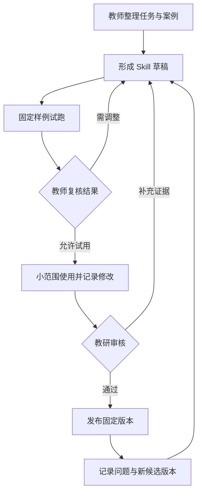

# 教师经验怎样变成可复用的教学 Skill

[← 教师智能助手](README.md)

把一份优秀教案交给模型，可以帮助它了解这节课讲了什么。要让它遇到另一份学生作答时仍能给出合适的提示，还需要知道老师怎样判断错误、什么时候追问，以及哪些情况下暂时不能下结论。教案里的最终安排，只记录了这些选择的一部分。

前面的[智能备课](lesson-planning.md)和[课件生成](courseware-generation.md)围绕一次教学任务展开。这里继续讨论怎样把任务中可以复用的教学方法整理出来。以下用错题讲解作为设计示例，说明教师怎样提供经验，产品与工程团队又该补上什么。

## 从一次具体处理开始整理

先选一种边界清楚、反复发生的任务，例如根据学生提交的解题步骤，生成供教师复核的分步提示。输入、输出和复核对象都能说清以后，再讨论怎样扩展到别的任务。

以不等式 `-2x > 6` 为例，学生写出 `x > -3`。熟悉这类错误的老师可能会先请学生检查两边同时除以负数时，不等号方向是否需要改变，再让他用一个数验证结果。直接展示正确答案，也能结束这次问答，却没有留下学生检查规则的机会。

整理经验时，应请教师对照题目和作答，说明自己为什么选择这个提示。学生是否写出了中间步骤，是否刚学过相关规则，会改变后续处理。只有一个错误答案时，可以提出候选原因，不能据此认定学生已经形成某种稳定的认知缺陷。

材料可以从一节获准使用的课开始。课件提供讲解结构，逐字稿和录音帮助定位教师怎样追问，课后批注则补充临时调整的原因。整理时保留页码或时间位置，请教师确认提取出来的规则。录音转写只是候选材料，不能把一句针对当时学生的话直接推广成通用方法。

因此，一份可执行的教学说明至少需要写清任务的适用范围、所需材料、处理步骤和停止条件。题干不完整就先补题，学生步骤不足就询问依据，发现标准解析互相冲突就暂停生成。教师经验里的这些分支，比几句模仿名师语气的要求更有用。

## 提示词、知识库与 Skill 各自保存什么

提示词可以规定回答形式，知识库可以提供教学依据。Skill 则把某类任务的操作说明和所需资源组织起来，供 Agent 按任务加载。Agent 在这里指能够读取状态、选择步骤并调用工具的软件流程。

| 内容 | 适合保存的东西 | 在错题讲解中的例子 |
|---|---|---|
| 提示词模板 | 当前任务要求与表达约束 | 先给提示，答案放在教师可见区域 |
| 教学知识库 | 有来源和版本的学科材料 | 不等式规则、已审核例题与解析 |
| 教学 Skill | 处理方法、分支条件与检查要求 | 先核对步骤，再选择提示，最后安排独立验证 |

这几类内容可以配合使用。教师选定的题目和权限由业务系统确认，知识库提供规则与解析，Skill 说明怎样组织本次处理。它们不必一起塞进一段很长的系统提示词。

[Agent Skills 公开规范](https://agentskills.io/specification)用 `SKILL.md` 保存名称、适用条件和任务说明，并允许附带参考材料、模板及可执行脚本。按需读取这些资源，可以避免每次任务都载入整套教学资料。规范解决的是组织和加载问题，教学方法是否有效仍要另行验证。

这里整理教师经验，通常不涉及修改模型权重。它与通过训练改变模型能力的模型蒸馏属于不同的实现过程。

## 把判断写进说明，把检查交给工具

一份错题讲解 Skill 可以先采用下面的目录。它只是组织示例，不要求第一版就开发脚本。

```text
error-explanation/
├── SKILL.md
├── references/
│   ├── teaching-rules.md
│   └── reviewed-examples.md
├── assets/
│   └── hint-template.md
└── scripts/
    └── check-result.py
```

主说明写任务入口、处理顺序和退出条件。参考文件保存经过审核的教学规则，以及适用与不适用的例子。模板约定教师怎样看到错误位置、候选原因、提示和待确认项。脚本只承担能够明确计算或校验的工作，例如核对代入结果、检查必填字段。

参考材料应保留使用范围。只有内部查阅权限的课件，不应随 Skill 打包分享。需要时由受控接口按当前使用者的权限读取；从材料中读到的文字也不能自行扩展工具权限。

对前面的不等式，输出可以区分学生已经写出的步骤、系统推测的错误原因，以及建议教师使用的提示。三者不能混成一段确定的诊断。教师若否定了候选原因，系统应当保留这个修改，重新选择提示，不能继续沿用原判断。

Skill 文件也不能承担权限控制。公开规范中的 `allowed-tools` 仍属于支持情况可能不同的实验字段，产品不能把它当作唯一的安全措施。是否能读学生记录、调用哪个工具、能否发布给学生，都要由运行环境和业务接口校验。

对于固定的处理顺序，普通工作流已经够用。需要根据学生步骤选择参考案例或校验工具时，再让 Agent 参与决策。没有必要为了使用 Skill，把每一个确定步骤都改成模型选择。

## 先试用，再进入共享资源库

教师个人整理的材料可以先以草稿保存。系统记录适用学科、任务范围、维护人和材料版本，但不让其他教师默认使用。共享发布需要有明确的审核人，也要保留试用结论。



图中的修订由教师或审核人发起，不表示后台无限自动重试。存在严重错误时，可以暂停该版本的新任务，已经开始的任务保留版本记录，以便还原问题。

个人偏好和共享规则要分开维护。教师偏好的讲解长度，可以留在个人配置里。学校审核的答案依据和发布要求，不能被一次个人修改覆盖。教师把某个例子改得更适合当前班级，也不代表这次修改应该立即影响所有使用者。

共享资源库保存的不只是 Skill 文件。它还要记录关联材料、适用范围和审核状态。材料是否需要向量检索，由规模与查找方式决定；少量且范围明确的教学说明，用目录、标签和关键词就能管理。通用的资料权限与版本规则可以复用[知识工程](../../enterprise-ai-platform/knowledge-engineering/README.md)的设计。

## 用反例检查方法是否真的可复用

试跑样例需要覆盖正常作答和容易误判的情况。围绕同一种错误，可以准备步骤完整、只有最终答案、出现其他错误，以及题干缺失等不同输入。教师为每份样例注明允许的提示、必须询问的内容和不能直接下的判断。

检查时把学科正确性和教学处理分开。答案算对了，仍可能过早泄露完整解法；提示语气温和，也可能完全没有回应学生真正出错的位置。教师复核可以按同一份评分量规进行，量规就是把判断要求写成可重复使用的评价标准。

更新 Skill 时，在同一批样例上比较新旧结果，保留模型、工具和资料版本。线上发现的问题先进入候选案例，核对原因后再加入测试，不能把学生原始对话直接当作标准答案。用于调试的样例与保留检验效果的样例应分开，避免反复针对同一批题修改以后高估效果。

换一个客户端，也要重新检查资源加载、工具支持和权限。文件格式能够读取，不足以证明执行行为相同。

第一版的验收可以落在教师能否复核、修改是否减少、其他教师能否正确使用这些方面。若要判断学生是否学会，应再观察他离开提示后能否独立完成同类任务。两类证据各自回答问题，不要用一次生成被采纳，替代对学习效果的判断。

当教师反馈某个提示不合适时，维护人应能找到当时的输入、采用的规则和具体版本，决定修改案例、调整方法，还是缩小适用范围。共享资源库需要有人持续做这些工作。
