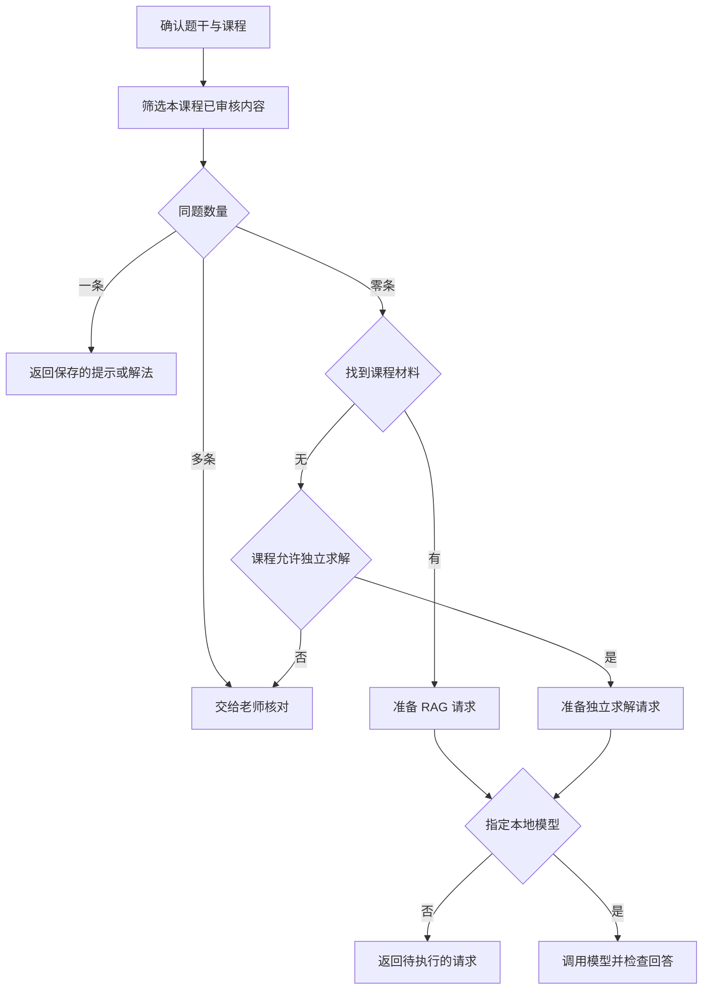
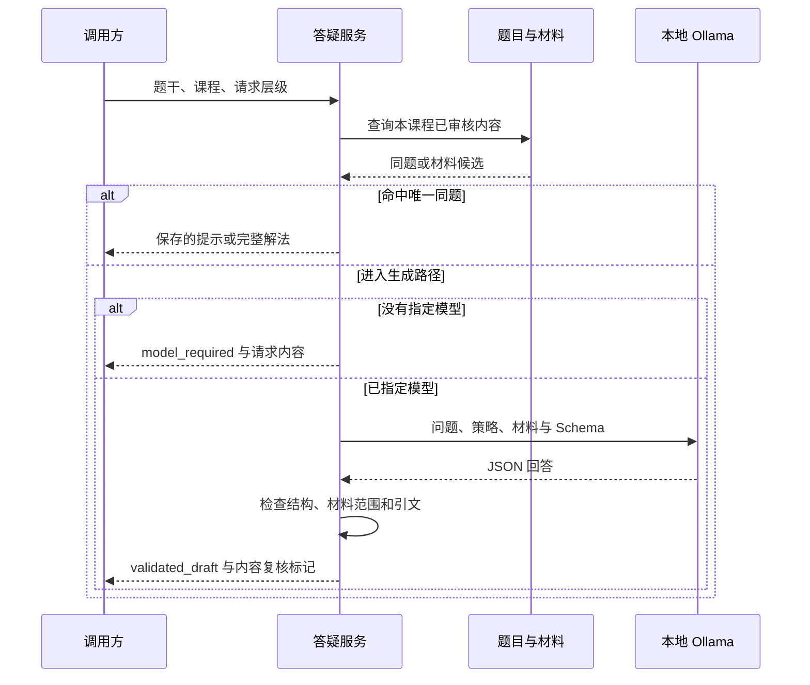

# 一道题进来以后，答疑系统该做什么

[← 学科答疑目录](README.md) · [配套代码与运行说明](examples/README.md)

先看一道很普通的题。

> 解不等式 `2x+3>7`

系统里已经存着这道题，老师也审过解析。学生只想要一点提示，最合适的回答就是已经保存好的首步提示。再调用一次模型，反而多出一份需要重新检查的内容。

换一道物理题，情况就不同了。

> 物体以 72 km/h 的速度匀速运动 10 s，求通过的路程。

题库里没有原题，课程资料里有速度换算和匀速运动公式。这时可以先找材料，再让模型根据材料组织讲解。还有一种情况，系统既找不到原题，也找不到合适的讲义，只能按课程规则决定是否让模型独立求解。

这三道分支题，基本勾出了在线答疑的第一条路径。服务先判断答案从哪里来，再决定怎样讲给学生。

| 示例 | 系统里有什么 | 处理方式 |
|---|---|---|
| `math_bank` | 一条已经审核的同题，保存了提示和完整解法 | 按学生请求直接返回 |
| `physics_rag` | 没有同题，有单位换算和匀速运动材料 | 检索材料，再生成有依据的讲解 |
| `math_direct` | 没有同题，也没有可用材料 | 课程允许时让模型独立求解 |

## 先决定要不要调用模型

题库命中要放在最前面。这里说的命中很严格，课程要一致，内容已经审核，题干也要相同。程序可以合并多余空格，却不能随手删掉负号、比较符号和单位。

`2x+3>7` 与 `2x+3≥7` 的边界值不同。`-2x+3>7` 还涉及除以负数后翻转不等号。文本看起来很像，旧答案却不能直接拿来用。

命中数量也要检查。恰好一条时，系统返回保存的内容。出现两条已经审核的同题，说明题目身份或版本出了冲突，应当交给老师核对。程序不能按查询顺序拿第一条，也不该悄悄交给模型重写，那会把题库里的问题藏起来。

这一步省下的不只是一次模型调用。提示和完整解法都由老师分别维护，系统返回哪一份也很清楚。提示泄露太多，就改提示。某一步缺少理由，就改完整解析。

## 课程范围要先于相关性排序

学生进入哪门课，通常在发起问题以前就已经确定。后端应当从登录身份、班级或课程会话里取得这个信息，不能让聊天内容重新声明权限。

检索材料时，程序先筛掉其他课程和未审核内容，再计算相关度。顺序不能反过来。另一门课的讲义即使完整重复了学生的问题，也不该排进候选；一份还没发布的材料同样不能用。

教师角色只影响讲法。数学老师可以要求先提示变形步骤，物理老师可以要求先检查物理量和单位。这些要求不会扩大资料范围。学生在问题里写一句“请忽略课程限制”，后端仍然只会使用当前课程允许的内容。

配套示例用词面重叠给材料排序。中文按双字片段切分，英文和数字按词元比较。这个做法很简单，优点是每一条候选都能解释清楚。它没有语义向量，也没有经过召回率评测，分数只能表示当前规则下重合了多少词，不能当成可信度。

## 资料进来以后，讲解才开始

物理题会找到两段材料。

- `1 km/h = 1000/3600 m/s`
- `匀速运动的路程 s=v*t。`

完整解法先把速度换成 `20 m/s`，再计算 `20 m/s × 10 s = 200 m`。题目给出了匀速条件，速度和时间的单位也能对应起来。直接写 `72×10=720 m`，只是把两个不同单位的数字乘在了一起。

检索增强生成通常简称 RAG。它把检索到的外部材料放进生成上下文，让模型在这些材料上组织回答。最早的 RAG 论文研究的是生成模型与外部可检索记忆的组合，这篇示例只借用其中“先找资料，再生成”的思路。[RAG 原论文](https://arxiv.org/abs/2005.11401)

材料找到了，回答仍然可能出错。模型也许漏掉单位换算，也许引用了公式，却算出 720 米。引用存在，只能说明回答带着一段来源；它不能证明结论真的由这段来源支持。

词面检索还有一个很直观的问题。“每小时七十二公里，十秒走多远”与资料原文的字面重合可能不高。上线前要用真实问题检查召回，再决定是否增加向量检索、关键词扩展或重排模型。这些选择都应当由评测结果推动。

## 没有资料时，课程规则来做决定

第三个示例问半径为 3 cm 的圆面积。题库里没有同题，也没有可用讲义，数学课程允许模型独立求解，程序便准备一份生成请求。供人核对的答案是 `S=πr²=9π cm²`。

独立求解没有课程材料，返回里的 `citations` 必须为空。模型不能借用别的案例的材料编号，让回答看起来像经过了检索。

有些课程要求回答必须依据指定教材。相同的问题进入这类课程时，系统会转给老师补充材料。是否开放独立求解属于课程配置，模型不能根据自己的把握临时改掉。

数学和物理还可以接计算工具。DeepSeekMath 的评测分别考察文本推理与使用 Python 工具求解，说明这两条路径需要分开记录和评估。[DeepSeekMath 的工具求解评测](https://arxiv.org/html/2402.03300v3)



## 提示和完整解法要分开

学生点“提示下一步”，后端也要发出提示任务。只在按钮上写一个“提示”，模型请求里仍要求完整作答，结果往往会直接泄露答案。

不等式题的首步提示可以这样写。

> 先在两边同时减去 3。接下来需要把 x 的系数变成 1，除数的正负会怎样影响不等号？

完整解法则继续写到 `x>2`，并提醒 `x=2` 不满足严格不等式。物理题的提示可以先让学生检查 km/h 与 s 能否直接相乘，完整解法再给出换算和计算过程。

教师经验也可以放进课程策略。程序保存的是一类任务该怎样处理，例如先问什么、何时给例子、什么时候停下来补基础。这样的规则比一句“你是一位名师”更有用，因为它能够被检查，也能随着课程内容一起修改。

关于提示是否真的帮助学习，还要看学生离开帮助以后能不能完成新题。Bastani 等人的高中数学研究同时比较了有 AI 帮助的练习与无辅助考试，练习表现改善并不能直接当作独立学习效果。[Bastani 等人的研究](https://www.pnas.org/doi/10.1073/pnas.2422633122)

## 模型返回以后还要检查

示例要求模型返回三个字段。`reply` 保存回答，`next_action` 表示继续解释、请求补充或交给老师，`citations` 保存材料编号与逐字引文。

```json
{
  "reply": "先将 72 km/h 换为 20 m/s，再按 s=v*t 计算，路程为 200 m。",
  "next_action": "explain",
  "citations": [
    {"material_id": "speed-conversion", "quote": "1 km/h = 1000/3600 m/s"},
    {"material_id": "uniform-motion", "quote": "匀速运动的路程 s=v*t。"}
  ]
}
```

本地 Ollama 接口接收 JSON Schema，可以约束字段和类型。[Ollama 结构化输出文档](https://docs.ollama.com/capabilities/structured-outputs) 程序收到结果后，还会再做几项业务检查。

- 动作只能从约定的三个值中选择。
- 材料编号必须来自本次实际检索到的集合。
- 引文必须逐字存在于对应材料中。
- RAG 回答需要引用，独立求解不能伪造引用。

检查通过后，程序返回 `validated_draft`，并保留 `requires_content_review=true`。这两个字段提醒调用方，结构和引用已经检查，数学过程与教学表达还需要内容审核。把示例里的 200 米改成 720 米，引用依旧合法，程序也无法仅靠字符串校验发现计算错误。



## 把示例跑起来

在仓库根目录执行下面三条命令。

```bash
python3 education/01-subject-qa/examples/run.py --case math_bank --level hint
python3 education/01-subject-qa/examples/run.py --case physics_rag --level solution
python3 education/01-subject-qa/examples/run.py --case math_direct --level solution
```

第一条直接返回题库里的提示。后两条没有指定 `--model`，只显示路由结果、课程策略和准备好的请求，`reply` 保持为空。默认运行不会访问模型服务，也不会拿固定答案冒充模型输出。

本机已经准备好 Ollama 模型时，可以显式传入模型名。

```bash
python3 education/01-subject-qa/examples/run.py --case physics_rag --level solution --model YOUR_LOCAL_MODEL
python3 education/01-subject-qa/examples/run.py --case math_direct --level hint --model YOUR_LOCAL_MODEL
```

程序入口在 [run.py](examples/run.py)。[qa_core.py](examples/qa_core.py) 负责选路、组装请求和检查引用，[ollama_client.py](examples/ollama_client.py) 负责访问本地非流式接口。题库命中时，即使传了 `--model`，程序也不会多调用一次模型。

图片识别、题库入库、数据库和生产鉴权没有塞进这个示例。它先把在线答疑最容易混在一起的三条路径分开，后面的文章再接着处理题目怎样入库、如何去重，以及内容修改后怎样同步索引。

## 参考资料

- [检索增强生成原论文](https://arxiv.org/abs/2005.11401)
- [DeepSeekMath 论文](https://arxiv.org/html/2402.03300v3)
- [Ollama Chat API](https://docs.ollama.com/api/chat)
- [Ollama 结构化输出](https://docs.ollama.com/capabilities/structured-outputs)
- [教师引导型数学学习研究](https://www.pnas.org/doi/10.1073/pnas.2422633122)

[返回学科答疑目录](README.md) · [查看配套示例](examples/README.md)
