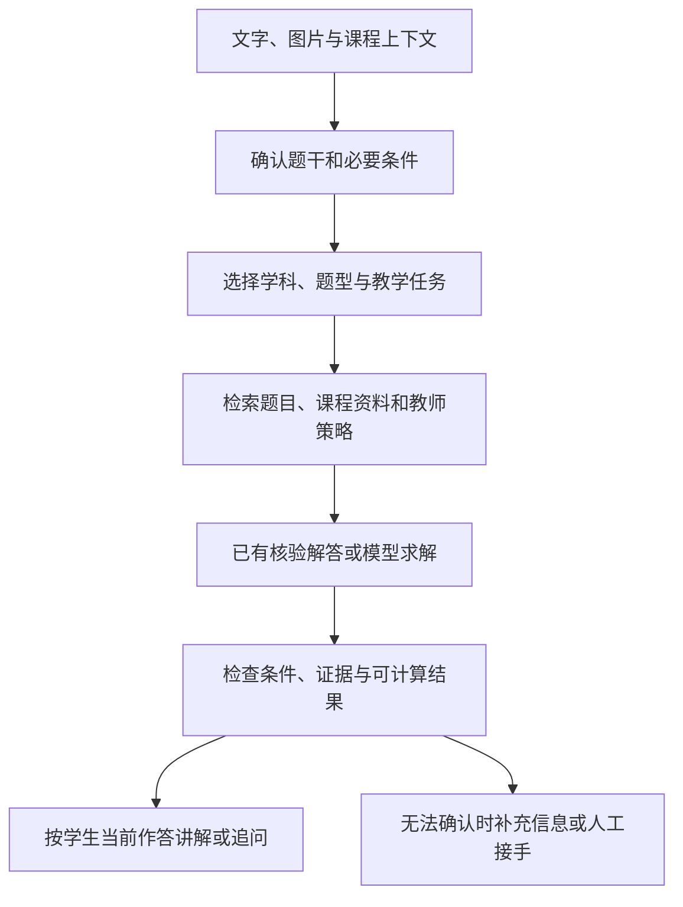
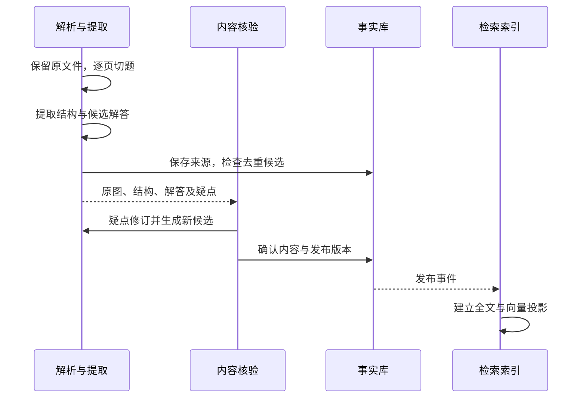

# AI 学科答疑的技术路线与工程设计

[← 学科答疑目录](README.md)

这一页整理公开产品能力、论文与工程设计。厂商页面用来确认对外展示的功能，不能据此推断内部架构或模型效果。

## 公开方案能告诉我们什么

| 页面 | 可以确认的内容 | 资料边界 |
|---|---|---|
| [阿里云辅学方案](https://www.aliyun.com/solution/tech-solution/ai-homework-helper/) | 页面将视觉模型、函数计算与百炼组合，用于解题、批改和题目数字化 | 能确认公开方案组成；页面没有给出完整题库、去重、RAG 和审核实现，帮助中心对应页面也无法打开 |
| [Manus 作业助手](https://manus.im/zh-cn/playbook/homework-helper) | 文字、照片、PDF 输入，分步讲解、追问和练习生成 | 产品交互说明，不足以判断内部是否使用题库、RAG 或某种特定 Prompt |
| [有道教育方案](https://ai.youdao.com/new/ai-education.s) | OCR、切题、题库、批改、错题和学情分析是分别组织的能力 | 产品页面的题量及效果属于厂商声明；技术字段继续查对应 API |
| [36氪产业链盘点](https://eu.36kr.com/zh/p/3973199045636354) | 提供视频教学、写作反馈和陪伴等检索线索 | 有评测说明，但未找到样本、评分公式、模型版本或具体榜单出处；不采用其中分数与排名作技术证据 |

产品资料告诉我们“它公开提供什么”；官方 API 和技术论文帮助解释“哪些机制能够实现”。无法公开核对的内部策略，留作未知项。

## 答疑至少有三条实现路线

**题库匹配。** 输入文字或图片，识别题干并寻找已有题目，返回已有答案与解析。有道的[精品题库 API](https://ai.youdao.com/DOCSIRMA/html/learn/api/jptk/index.html)返回转写和相关题目的内容、答案、解析、知识点。相关结果仍需要核对条件和图形，接口结果也不自动赋予重新分发或建立自有题库的使用范围。

**资料增强。** 检索教材、讲义、标准解答或教师规则，作为本次生成的上下文。这才属于 RAG 的典型任务。检索出的材料与模型推理分开检查；材料相关不保证解释正确。[RAG 原论文](https://arxiv.org/abs/2005.11401)

**模型求解与工具辅助。** 从题干形成新解答，需要时调用计算工具。DeepSeekMath 的研究区分直接文本解答与 Python 工具求解。训练使用数学语料，不等于每次请求都检索题库。[DeepSeekMath 原论文，1.2 与 2.3 节](https://arxiv.org/html/2402.03300v3)

产品可以组合三条路线。例如先找经过核验的同题，没有同题时查课程资料并求解。相似题只提供方法参考，不能把它的答案当作输入题目的答案。输入条件不完整时，先补充题干，不以“召回到了熟悉题目”替学生猜条件。

## 学科差异进入哪些配置

下面是建议设计，不是对某家企业内部 Prompt 的复原。

使用者身份决定访问范围；教学角色决定采用哪类讲解规则；展示的教师形象决定呈现方式。三者分别配置。聊天里写“我是教师”不能改变服务端权限，切换成“物理老师”也不应切换到其他课程的私人资料。

课程上下文可以包含学科、年级、教材版本、已学方法和输出语言。题型还需要进一步区分：数学证明、计算和应用题，英语语法与阅读，政治概念解释与材料分析，都不宜只靠一个角色名称解决。模型路由只从允许集合中选择；跨学科题保留多个标签，不确定时询问。

| 学科 | 具体需要保留的条件 | 可以做的检查 |
|---|---|---|
| 数学 | 定义域、变形前提、指定解法、学生已学内容 | 代入、约束和形式化计算；平方得到的候选根仍需回原式检查 |
| 物理 | 采用的物理模型、方向、单位、已知条件 | 单位和量纲；例如匀速条件下 72 km/h 行驶 10 s 为 200 m |
| 化学 | 物态、温度、浓度、催化条件和反应语境 | 原子、电荷守恒；配平不能证明反应在给定条件下会发生 |
| 语文 | 原文位置、上下文、题目指向和表达要求 | 引用原文及论据关系，允许有依据的不同表述 |
| 英语 | 语言语境、年级、词汇范围和语法任务 | 区分语法、自然表达和改变原意 |
| 政治 | 教材概念、材料日期、事实来源和作答范围 | 教材解释与时事事实分开记录，过期或冲突材料复核 |

正常政治课程问题按正常教学任务处理。评价时同时检查正确回答与误拒绝；“教学用途”不是改变平台规则的权限开关。换 Prompt 是否减少误拒绝，需要在具体服务和样本上观察，不能先作保证。

工具也有适用范围。SymPy 的单位转换在无法转换时可能原样返回，不能用“调用没抛异常”判断检查成功。[SymPy 单位文档](https://docs.sympy.org/latest/modules/physics/units/index.html) 化学里的温度、浓度等条件会影响反应速率，不能在提取题干时删掉。[OpenStax 反应速率章节](https://openstax.org/books/chemistry-2e/pages/12-2-factors-affecting-reaction-rates)

## Prompt、SOP 与 Skill 怎样分工

Prompt 保存本次交给模型的指令与资料；SOP 保存处理任务的步骤；Skill 保存某个有限教学任务的适用条件、材料、工具和输出约定。建议按职责组合：平台规则、课程上下文、学科与题型、教师策略、当前问题与作答证据。每次只选与当前任务有关的部分。

教师 Skill 至少说清：何时调用，需要哪些作答证据，先给哪一级提示，何时展示完整解法，工具能做什么，何时请求补充或交给教师。讲课全文可以作为资料，不能自动变成每条提问都该执行的流程。

教师经验与提示设计有研究依据，但效果仍需检验。PNAS 的高中数学研究使用教师提供的解法、常见错误和提示构建 GPT Tutor；练习时表现改善，不等于移除辅助以后取得学习增益。[Bastani 等，2025](https://www.pnas.org/doi/10.1073/pnas.2422633122)

下面这条在线链路是参考方案：



Java 或 Go 可以管理接口、权限、任务和版本，Python 提供需要的学科计算服务。这是语言分工的一种选择；先有明确服务契约，不要求把所有步骤都改写成自主 Agent。LangGraph 的路由与工作流文档提供了可检查的条件分支示例。[官方工作流文档](https://docs.langchain.com/oss/python/langgraph/workflows-agents)

## 题库建设：AI 加进来以后改哪里

典型入库对象包含题干、条件、选项、公式、配图、共享材料、子题、答案、解析和来源。向量索引负责召回，事实库保存题目身份、版本与审核结果。讲义片段和完整题目也分别处理：前者提供知识依据，后者必须保留完整作答条件。

传统录题中，教师可以使用 OCR 辅助再整理字段。AI 能扩展结构提取、标签建议和候选解析，但这些产物需要保留与原文件的位置关系，才能发现漏图、错符号或把答案混入题干的问题。

有道[题目切分 API](https://ai.youdao.com/DOCSIRMA/html/learn/api/tmsbqf/index.html)提供题目区域及坐标，不能仅据此声称完整语义结构已经提取。百度[试卷切题识别 API](https://ai.baidu.com/ai-doc/OCR/Tlqom5gvh)公开了题干、子题、选项、答案、配图等结构输出；PDF 默认页处理范围需要注意，整份文档由应用安排逐页任务。

建议采用下面的候选与发布链路：



原生 PDF 优先读取文字和坐标；扫描页进入 OCR 或视觉提取。切题要处理跨页、共享题干和附图归属。模型生成解析时标记为候选，不能因它已经出现在知识库中，就把它当作核验过的标准答案。

建议保留三组数据关系：

| 对象 | 保存什么 |
|---|---|
| 来源与出现记录 | 原文件、版本、页码、题号、区域、原始转写、提取版本及使用范围 |
| 规范题与解答版本 | 题目结构、全部来源归属、候选和核验解答、当前发布版本 |
| 派生索引 | 指向已发布题目版本的全文、向量及相关检索元数据 |

同一道题在两本书中出现，内容可以关联到同一规范题，两个来源记录仍然保留。一个来源的使用范围不自动扩散到另一个来源；撤销一个来源时，先核对还有哪些来源支持当前使用。

## 增量去重：先定义什么叫重复

完全一致的题、近重复题和变式题分开处理。改系数、把“至少”改为“至多”、把“选正确项”改为“选错误项”，都可能改变解答。选项重排也需要记录映射，不能直接删除顺序。

建议用保序结构序列化、规范化版本和内容摘要做 exact 候选键：

```text
(dedup_scope, normalization_version, exact_hash)
```

规范化只处理已经确认的等价书写差异，不删负号、单位、限制词和图形信息。摘要命中后再比较完整结构。图形尚无稳定表示时，保留独立候选，不用相同文字强行合并。解答单独版本化，不把某个答案错误当作题干应该变更的理由。

Elasticsearch 的 fingerprint 会排序并去重词项，MinHash 用词项集合相似度寻找近重复；它们适合找候选，不能直接承担数学题的保序身份判断。[fingerprint](https://www.elastic.co/docs/reference/text-analysis/analysis-fingerprint-tokenfilter) · [MinHash](https://www.elastic.co/docs/reference/text-analysis/analysis-minhash-tokenfilter)

在线写入时，上传幂等键绑定文件摘要；相同键、不同文件拒绝。同一事务建立规范题、来源归属和后续事件。并发重复由数据库唯一约束及冲突处理协调，不能只在应用里“查不到就插入”。[PostgreSQL 唯一约束](https://www.postgresql.org/docs/current/ddl-constraints.html) · [ON CONFLICT](https://www.postgresql.org/docs/current/sql-insert.html)

向量、全文或 MinHash 返回候选之后，再检查关键条件、图形和选项。暂不能确认时只建立待核验关系。误合并要能恢复来源归属；相似关系也不能无条件传递，否则 A 像 B、B 像 C，可能把三个不同问题合成一个。

## 全量迁移：历史数据与在线写入共用规则

历史清理和新增入库采用同一结构、规范化版本和归属逻辑。保留旧题 ID 到新题及来源记录的映射，历史作答才不会在迁移后失去引用。

迁移期间保留一个权威写入端。用一致快照搬历史，再从对应日志位置处理新增、修改与删除。CDC 指捕获数据库变化；Debezium 的 PostgreSQL 文档说明了快照与日志衔接，但消费者仍要处理重放。[PostgreSQL connector](https://debezium.io/documentation/reference/stable/connectors/postgresql.html)

对账检查来源记录、映射、发布版本、删除状态和内容摘要。去重后规范题数量会减少，因此不要求新旧题表行数简单相等。切换前先暂停或围栏旧端写入，阻止新的提交，并等待在途事务结束；随后取得最终日志位置，追平到该位置并完成对账，再切换权威写入端和读取入口。旧端保持只读，确认新端可以接收写入后恢复请求。若不能停写，需要另行设计等效的写入交接协议，不能只固定一个日志位置就直接切换。日志链路丢失时先恢复可信快照；新库已经写入以后，回滚也要处理这些新变化。

另一种“两边都写”的方案也会遇到一边成功一边失败、版本先后和撤回等问题。实现起步时，优先选择能够解释完整数据顺序的迁移方式。

## 修改和删除：索引是投影，不是最终状态

发布、修订、撤回和待发事件在同一数据库事务中保存。Outbox 是把待发送事件与业务数据一起记录的方式，避免“题目保存了，消息却没发出”。事件包含题 ID、版本和事件 ID；全文与向量消费者分别记录进度。[Debezium Outbox](https://debezium.io/documentation/reference/stable/transformations/outbox-event-router.html)

索引用确定性的题目版本及片段 ID，重试复用相同 ID。Qdrant 支持相同 point ID 的幂等覆盖，但幂等只处理重复执行，不保证旧版本不会覆盖新版本，也不能自动阻止删除后的旧事件重新插入。[Qdrant Points](https://qdrant.tech/documentation/manage-data/points/)

| 故障 | 恢复方式 |
|---|---|
| 索引写成功、消息确认失败 | 重放同一事件及相同 ID |
| 全文成功、向量失败 | 保留各自进度，补投失败的一侧 |
| 旧版本迟到 | 按版本处理，不能改变当前发布指针 |
| 撤回后旧 upsert 重放 | 检索结果回查当前状态与访问范围，清理残留投影 |
| 重建索引期间仍有更新 | 使用新代际追平事件并对账，再切换入口 |

检索结果返回内容前，仍以事实库的当前发布版本、撤回状态和访问范围为准。定期对账可以补齐丢失投影和清理多余投影；不能只盯着一次向量写入是否返回成功。

## 序章里的历史与观点怎样处理

2018 年侯建彬专访披露约 1.8 亿题库，属于采访中的公司陈述，并非独立审计。[虎嗅专访](https://www.huxiu.com/article/253202.html) 近两万名老师的线索来自 2016 年采访刊载页，目前只能读到检索摘要，因此不把它合并成 2018 年的同一项声明。[线索页](https://www.sohu.com/a/111598347_247350)

“2013 年每题 5 元”和“近半融资用于题库”缺少可靠原始依据，本文不采用。作业帮与小猿的官方页面仍展示教育产品，这些页面不能证明经营状况，也不支持“已被 AI 淘汰消失”的结论。[作业帮智能](https://smart.zuoyebang.com/brandAdvantage.html) · [小猿 AI](https://xykspt.yuanfudao.com/)

可以讨论模型生成怎样改变对已收录题目的依赖，以及题库价值怎样转向核验内容、课程组织和评测。这属于作者分析。“以后是否完全不需要题库”，取决于具体任务的成本、可靠性、内容要求和教学目标，暂时保留为讨论。

## 后续正文与实验

第一篇先解释三类实现选择和组合方式，接着写学科策略，再分别展开入库、增量去重、历史迁移和同步。上述数据库与事件设计还没有在本仓库实现，不报告吞吐量、成本、准确率或已经解决生产问题。

评测至少覆盖：题干是否保真、资料是否适用、解答是否正确、解释是否针对学生，以及动作是否符合当前任务。运行成本按模型调用、图片处理、检索、重试与人工处理分别记录。学习效果需要无辅助任务等独立证据，不能仅以练习时答案更快更准代替。

其他功能的公开线索可继续从[豆包爱学开发者说明](https://apps.apple.com/cn/app/id6469102455)查起；视频课堂、写作、知识问答和陪伴分别研究，不用一份产品功能列表推断全部后台实现。
