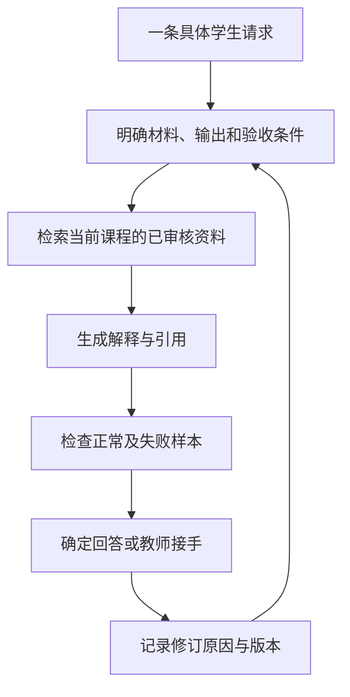

# 第 1 章：课程答疑要验收什么

学生问：“为什么 `(x-2)(x-3)=0` 就能得到两个根？”

回答“因为因式分解”没有解决他的困惑。他已经看到了分解式，缺的是零乘积这一步：两个数的乘积为零，至少一个数为零，所以分别求 `x-2=0` 和 `x-3=0`，得到 2、3。还可以让他检查 `2×3` 为什么不满足乘积为零，区分“至少一个为零”和“两个都为零”。

同样叫答疑，返回教材片段、解释推导、安排下一题，是三种不同的交付结果。需求讨论时如果只写“回答正确”，实现和验收很容易各自理解成不同的事。

## 先写一条完整请求

下面这张规格只处理一个问题：依据当前课程资料，解释二次方程的因式分解步骤。它没有承诺覆盖所有数学问题。

```json
{
  "case_id": "edu-qa-001",
  "course_id": "math-demo",
  "task": "解释二次方程的因式分解步骤",
  "input": ["student_question", "approved_course_documents"],
  "output": ["explanation", "citations", "next_action"],
  "review_required_when": ["证据不足", "符号不确定", "课程范围不匹配"],
  "version": "0.1"
}
```

`course_id` 决定去哪里找材料，审核状态决定哪些材料可用。`next_action` 决定这次结果是直接回答、请求补充，还是交给教师。动作应当有独立字段，否则后端只能从“建议找老师看看”这样的自由文本里猜流程。

写规格时，拿一条学生请求顺着走完：输入从哪里来，用了哪份资料，输出交给谁，收到错误回答后在哪里修改。暂时无法回答的地方，就是还需要补充的需求。

## 把“正确”拆成能检查的条件

对这条请求，可以分开检查：

| 对象 | 验收条件 | 检查办法 |
|---|---|---|
| 材料 | 属于当前课程，且已审核 | 程序过滤课程与状态 |
| 引用 | 片段存在，原文没有被改写成引文 | 对照文档 ID 与引用文字 |
| 数学 | 正确解释零乘积条件，得到两个根 | 教师核对推导与反例 |
| 表达 | 回答学生当前卡点，而非只给答案 | 按提问逐句评阅 |
| 动作 | 资料不足时交给教师 | 运行缺证据样本 |

程序能确认引文确实存在，却不能只靠字符串检查确认它支持了回答。学生是否学会，也需要让学生完成新的任务来观察，不能从一次流畅的对话直接推出。

这张表最好在写提示词之前完成。让两个人各自判断同一条回答，如果结论不同，先看是不是标准含糊。例如“解释充分”很难复查，“说明至少一个因子为零，并分别解两个一次方程”就具体得多。

## 从最短流程开始

已知业务步骤时，普通函数或工作流就能把过程串起来。先检索已审核材料，再生成解释，检查引用，最后决定回答还是复核。需要模型根据中间结果选择工具时，再增加 Agent 的决策环节。



RAG 是把检索到的外部材料提供给生成模型。检索器可能找错，模型也可能误用找对的材料，因此两个环节要分别观察。框架提供的检索与编排接口，可以帮助实现流程，但任务范围和验收条件仍要自己确定。[LangChain 检索文档](https://docs.langchain.com/oss/python/deepagents/retrieval)

失败样本和正常样本一起准备：跨课程的问题、没有相关讲义的问题、缺少题干条件的问题，以及要求模型忽略课程限制的问题。每条样本写预期动作。资料不足时请求补充，是一次符合约定的处理，不应被统计成“没有回答所以失败”。

## FDE 在这里的作用

FDE，即 Forward Deployed Engineer，常见工作包括进入具体业务环境、厘清问题并完成工程交付。[Palantir 的岗位介绍](https://jobs.lever.co/palantir/5168e8fd-fec1-4fea-b7a1-81bdaea65850)体现了这种工作范围。这里借用的是贴近业务、负责到底的视角，并没有为课程团队规定一套职业认证流程。

对这个答疑案例，交付还包括教师如何修订材料、如何处理待复核结果，以及开发者如何重放一次失败请求。接手的人能完成这些动作，规格才算落实到了系统里。

[前言](00-preface.md) · [教师经验](02-teacher-knowledge.md)
