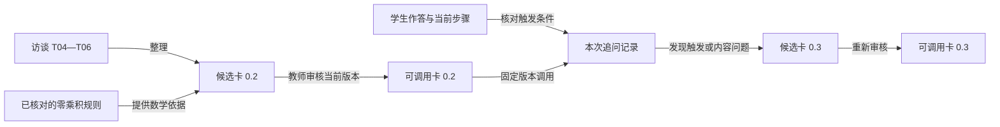

# 第 2 章：教师的判断怎样进入答疑系统

教师经验中最难整理的部分，是讲解之间的选择。学生写出 `(x-2)(x-3)=0` 后说“两个括号都必须等于零”，教师需要处理“同时为零”的误解；学生只写“根是 2、3”，则还没有足够信息判断他懂不懂零乘积规则。两条作答可以对应相同答案，却需要不同的下一步。

把完整解题过程放入知识库，能为系统提供数学材料。要让系统选择追问，还需要保存教师依据什么作答证据做判断、为什么选这句话，以及出现什么情况时改变处理方式。这几项信息决定了经验能否被正确调用。

## 采集一段决策，而不是整堂课的概括

Shulman 把学科教学知识称为 Pedagogical Content Knowledge，简称 PCK。它包含怎样表示和解释学科内容，也包含对学生误解的认识。按照这个区分，访谈既要记录“知识怎样成立”，也要记录“面对这条作答怎样教”。[Shulman，1986](https://journals.sagepub.com/doi/10.3102/0013189X015002004)

以方程 `x²-5x+6=0` 为访谈材料，可以先给教师看一条具体作答，再逐步改变条件。问“您会怎样讲二次方程”，通常只会得到一般性的讲解；问“学生已经分解正确，却坚持两个括号同时为零，您下一句问什么”，才能把某个教学选择单独取出来。

下面三条记录围绕同一个选择展开。片段编号是后来查找原话的入口。

| 片段 | 访谈记录 | 需要保留的信息 |
|---|---|---|
| T04 | “让他把 2 代进去，分别算两个括号，再算乘积。” | 起始追问与计算顺序 |
| T05 | “如果把 2−3 算错，先看整数运算，不能马上认定是零乘积没理解。” | 改变处理方式的证据 |
| T06 | “如果右边不是零，这个方法先不能用。” | 数学前提与停止条件 |

T04 说明动作，T05 说明分支，T06 说明边界。整理者还要追问：学生算出 0 和 -1 后，怎样继续？是否需要教师给出完整解释？哪些回答足以进入下一步？这些问题的答案进入候选规则，由教师核对。整理者新增的规则单独标记，保留“访谈没有回答”的位置，避免把自己的补充算作教师经验。

[教师访谈表](../templates/teacher-interview.md)可以保存这种记录。录音转写、访谈原话和经过整理的规则各有用途：转写帮助回看上下文，原话说明判断来源，规则供系统执行。直接把长篇转写作为提示词，会把闲谈、例外和正式规则混在一起。

## 一张规则卡要能拒绝不合适的任务

先把任务限制为“澄清零乘积中的或关系”。它只处理原式已经变成两个因子的乘积等于零、且学生明确提出“必须同时为零”的情况。规则卡至少有以下内容：

```json
{
  "skill_id": "zero-product-explain",
  "problem_id": "quadratic-demo",
  "version": "0.2",
  "scope": "实数范围，两个因子的乘积等于零",
  "trigger": "学生明确声称两个因子必须同时为零",
  "first_question": "代入 x=2，两个因子分别是多少，乘积是多少？",
  "branches": {
    "arithmetic_error": "先核对整数运算",
    "still_requires_both_zero": "比较 0×(-1) 和 (-1)×0",
    "insufficient_evidence": "请学生补充理由"
  },
  "source_fragments": ["T04", "T05", "T06"],
  "status": "review"
}
```

`review` 表示待审核。这份 JSON 描述任务约定；落地时还需要程序核对输入、选择分支并保存调用记录。它没有要求模型扮演某个人，而是把一个有限的教学决定写清楚。

卡里的代入值 2 绑定当前题目，因此保留 `problem_id`。零乘积原理可以用于别的方程，这句追问却不能原样搬过去。换题后重新选择用于说明的取值，再核对两个因子和乘积，避免把本题的常数当成通用教学规则。

判断条件要对准学生实际说了什么。仅出现“2、3”不能触发“同时为零”的纠错；没有作答时，先请求理由。`x(x-5)=-6` 也不符合规则卡的前提，应该先移项并因式分解。若系统只看到“两个因子”就调用卡片，便会把一个正确的教学方法用错地方。

这张卡的数学内容可以直接核验。代入 `x=2`，两个因子是 0 和 -1，乘积为零；代入 `x=3`，两个因子是 1 和 0，乘积也为零。在实数范围内，若两因子都非零，乘积就不会为零。因此求解时分别考虑 `x-2=0` 或 `x-3=0`，得到两个可能的取值。这里的“或”不能写成同一个 x 必须同时等于 2 和 3。

## 来源和版本决定能否查清一次错误

一条回答至少要留下卡片版本、触发它的作答片段和实际采取的动作。否则，教师看到错误解释时只能重新问一遍，无法判断是规则本身有错、触发条件过宽，还是生成结果偏离了规则。

来源追踪常用 provenance 一词，表示一份内容由哪些材料、活动和参与者产生。W3C PROV 用实体、活动和参与者表达这些关系。这里可以借用它的建模思路，把访谈片段、规则卡和调用记录关联起来。[W3C PROV](https://www.w3.org/TR/prov-overview/)



修改时创建新版本，不覆盖旧卡。例如 0.1 的动作只有“代入验证”，0.2 补充了“先分别计算因子，再求乘积”。审核通过后，后续调用使用 0.2；已有回答仍指向 0.1。如果新版本表现出问题，可以把调用入口指回旧版，同时保留修改原因。回滚改变后续使用的版本，不应改写过去的回答记录。

数学依据与教学策略也要分别记录。零乘积前提可以核验，追问顺序则需要教师结合课程与学生作答判断。两位教师对顺序有分歧时，可保留不同候选策略和适用条件；不要把它们拼成一段无法解释选择理由的折中话术。

整理材料时还要防止修订来源。转写中的负号、指数或指代不清，可以在旁边补充校对结果，但原片段保留原样，校对者和修改理由另记。否则，系统生成了错误解释，回查却只能找到整理者已经“修好”的访谈，会误以为模型没有依据来源。规则卡发布之前核对所引用片段是否真的支持这条规则；片段编号存在，只能帮助找到原话。

调用记录也不必收集整段课堂聊天。保存与判断有关的作答和追问，便于教师核对；其他内容不参与本次决策就不附入卡片。这样能减少无关上下文，也让“这个分支依据什么”有一个清楚的答案。

## 内容检查和教学检查各自看什么

先给规则卡准备几条短作答，写出预期动作，再观察系统选择。检查表可以直接用于人工回放：

| 学生输入 | 应观察的处理 | 必须拦住的错误 |
|---|---|---|
| “两个括号都要等于零” | 请他代入一个根，分别计算因子 | 接受同时为零的说法 |
| “答案是 2、3” | 请求一句求根理由 | 没有证据就认定存在误解 |
| `x(x-5)=-6` | 先整理为右边为零的形式 | 直接令 x 或 x−5 为零 |
| `2−3=1` | 核对整数运算 | 把算术错误归为概念错误 |

程序能检查卡片标识、版本和分支是否合法，也可以核对本题两根的代入结果：`2²-5×2+6=0`，`3²-5×3+6=0`。解释是否针对当前障碍、问题是否适合学生，由教师评阅。若无法从作答确定该走哪个分支，调用结果应保留“需要补充信息”，同时带上题目和已经做过的追问。

让学生解释“为什么另一个因子不为零仍能成立”，可以获得比“会了”更具体的作答证据。Chi 等人的研究考察了阅读循环系统材料时的自我解释，为这种提问提供研究背景。研究任务与这里的数学答疑不同，是否适合本课仍要根据作答评阅。[Chi 等，1994](https://education.asu.edu/sites/g/files/litvpz656/files/lcl/chideleeuwchiulavancher_3.pdf)

语音输出需要另做一轮呈现检查。TTS 是文本转语音；它可能漏读负号，或让“或”关系听不清。先保留可核对的文本，再检查朗读。声音和形象无法补足规则卡中缺少的触发条件，也无法替代教师对解释的审核。

[上一章：需求与验收](01-fde-method.md) · [下一章：教学流程](03-teaching-workflow.md)
