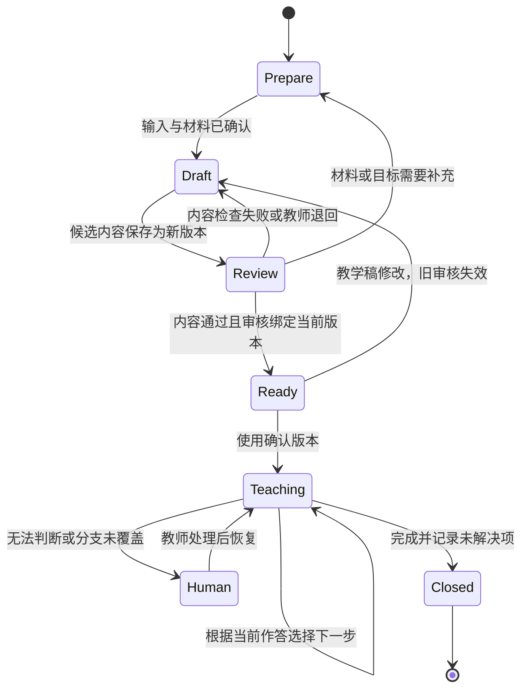

# 第 3 章：备课流程中的状态、分支与审核

教师审核的是某一份教学内容。草稿改了，原来的同意就不能继续生效。用一个 `approved: true` 表示整项备课任务“已经审核”，会把这层关系丢掉：它不能说明教师看过哪一版，也不能阻止修改后的错误内容进入课堂。

因此，接入 AI 之前先把备课任务拆成三个对象：输入单固定目标和材料，草稿保存候选内容，审核记录指向具体草稿版本。模型负责提出候选；进入可用状态的条件由程序检查，教学内容由教师确认。

## 先用一个工作单检查审核条件

方程仍为 `x²-5x+6=0`。版本 1 已经得到审核，版本 2 却从 `x(x-5)=-6` 直接推出 `x=0` 或 `x=5`。两版内容不同，审核记录仍然指向版本 1：

```json
{
  "plan_id": "quadratic-demo",
  "draft_version": 2,
  "status": "review",
  "student_work": "x(x-5)=-6",
  "draft_roots": [0, 5],
  "review": {
    "decision": "approve",
    "approved_version": 1
  }
}
```

这个对象的字段和类型没有问题，数学和审核关系都有问题。把 0 或 5 代回原方程，结果都为 6；零乘积规则也不能直接用于右边为 -6 的式子。若程序只检查 `review.decision == "approve"`，它仍会放行版本 2。

发布条件至少要同时检查：当前状态允许发布，审核指向当前草稿，必要内容检查通过。任何修改都创建新版本，并使旧审核失效。这里的版本必须对应不可变内容；若同一版本号下面还允许改字，比较版本号也无法知道教师到底看过什么。

审核失败时保留原因。数学错误退回草稿，版本不一致请求重新审核，材料缺失返回准备状态。不同原因有不同恢复方式，统一返回“请重试”只会让错误再次发生。

## 输入单决定哪些内容可以生成

备课输入需要包含课程、材料版本、教学目标、所需基础和任务约束。以本题为例，目标可以写为：完成因式分解，解释零乘积中的“或”关系，并将两根代回原方程。所需基础是整数运算和代数展开；若尚未确认学生是否具备这些基础，输入单保留待确认项。

字段类型约定了程序允许接收什么值。`course_id`、`material_version` 是非空字符串；`draft_version` 是整数；学生作答是字符串或空值；动作从 `ask / explain / review / finish` 中选取。空作答表示缺少证据，不能转换成“学生不会”或“学生掌握”。

JSON Schema 可以描述对象属性、字段类型、必填项和额外字段。`properties` 中出现字段不会使它自动必填，需要另写 `required`。用这些约束先拒绝缺字段和错误类型，再检查课程范围、版本及具体内容。[JSON Schema 对象文档](https://json-schema.org/understanding-json-schema/reference/object)

动作应当和解释文本分开返回。例如模型提出 `ask`，并附上“请展开两个括号”的问题；程序先确认当前状态能提问，再展示文字。模型返回了合法动作名称，也不意味着动作适合当前作答。生成结束只是得到一个候选结果。

## 把流程放在状态转换中

状态机表示任务现在处于哪里，以及发生什么事件后可以去哪里。准备状态等待完整输入，待审核状态等待教师处理，可用状态固定已确认内容。W3C SCXML 用状态、事件和条件表达这种转换关系；实现小型流程时也可以用普通函数和数据库记录，不必先选复杂编排框架。[W3C SCXML](https://www.w3.org/TR/scxml/)



`Prepare` 是准备，`Draft` 是候选草稿，`Review` 是待审核，`Ready` 是可用。图上从待审核到可用的箭头有明确条件，不能用超时自动批准。课堂需要临时补充解释时，也要记录补充内容；改变正式教学稿则回到草稿状态，重新审核后形成可用版本。

一次 20 分钟的备课安排可以用来回放这张图：前 4 分钟确认输入，随后 6 分钟生成候选，接着 6 分钟检查作答分支，最后 4 分钟复核与归档。时间安排帮助控制任务范围，不替代完成条件。到时仍有未解决问题，就留下待处理项和接手人。

## 课堂分支要跟随作答证据

教学稿除了说明讲什么，还要说明看到什么作答时怎样继续。本题可以安排三个检查点：展开 `(x-2)(x-3)`，解释乘积为零的条件，将根代回原方程。它们分别检查变形、求根依据和验证。

学生在展开时写成 `x²-6x+6`，先让他分别计算 `-2x` 与 `-3x`，不要继续讲求根。展开正确却认为两因子必须同时为零，使用零乘积解释卡，让他代入 2 并比较两个因子。只回复“2、3”时，请他补充求根理由；两根和理由都正确，再检查代入过程。

把每一条分支写成“证据→动作→需要观察的新作答”。这一约定使教师能够回放系统为何问了某一句，也能发现提示是否过难。连续追问仍无法定位问题时，交接材料应包含题目、原始作答、已经问过的问题和未确定之处，教师不必从头猜测。

自动检查适合处理稳定条件：是否有作答、动作是否在允许集合、材料是否属于课程、审核版本是否匹配。解释针对哪个障碍需要内容评阅。不要把模型自报的高置信度当成某个分支已经得到证据。

## 暂停后恢复，必须读回同一份任务

等待教师时，需要保存输入单、材料版本、草稿版本、已问问题和待处理动作。只保存聊天中的最后一句，恢复后就可能重复提问，或者用更新后的材料解释旧任务。新材料要通过明确修订进入流程。

LangGraph 的 `interrupt` 展示了一种暂停、保存状态、等待外部输入再恢复的方式。使用它需要持久化配置和任务标识。恢复时会重新运行中断所在的节点，中断前执行过的写入或通知可能再次发生。[LangGraph interrupts](https://docs.langchain.com/oss/python/langgraph/interrupts)

幂等表示重复执行同一个操作不会增加首次结果之外的影响。发布可以使用“任务 ID＋确认版本”作为唯一键，将状态检查和写入放在同一事务中；已有同键结果时返回已有记录。先查后写的两个独立操作仍可能被并发请求穿过，单靠客户端按钮禁用也挡不住重试。

通知是另一项副作用。发布成功并不保证通知发送成功；恢复时也不能因为再次发送通知而再次创建发布记录。分别记录待发送和已发送状态，保留可重试的通知任务。具体队列和持久化方案可在交付设计中选择，备课流程先明确哪些动作可能被重复执行。

## 用失败回放决定流程要补哪里

检查这条流程时，同时放入正常作答和会改变动作的输入：缺材料版本、展开错误、零乘积误解、没有作答、旧审核、重复发布。每条记录包含起始状态、输入、预期动作、实际动作和判定理由。旧审核应停在待审核；相同发布键不应增加正式记录；“会了”应请求证据。

数学检查与状态检查分别给出结果。根 2、3 的代入值为零，只能说明这两个取值满足方程；审核版本相同，只能说明批准记录指向当前内容。教师还需要看问题顺序是否合理、解释是否针对当前障碍。一次回放有分歧时，修订相应条件并保留失败记录，不能用整体“通过”遮住分歧。

换题时，保留输入类型、审核绑定和恢复规则，重新准备数学内容与作答分支。不能用整数因式分解的题，需要另设求解策略；把方程参数换掉却继续沿用旧根和旧问题，属于任务内容没有更新。[交付检查单](../templates/delivery-checklist.md)可用于记录这些需要接手人实际回放的条件。

[上一章：教师经验](02-teacher-knowledge.md) · [下一章：课程答疑](04-course-qa.md)
