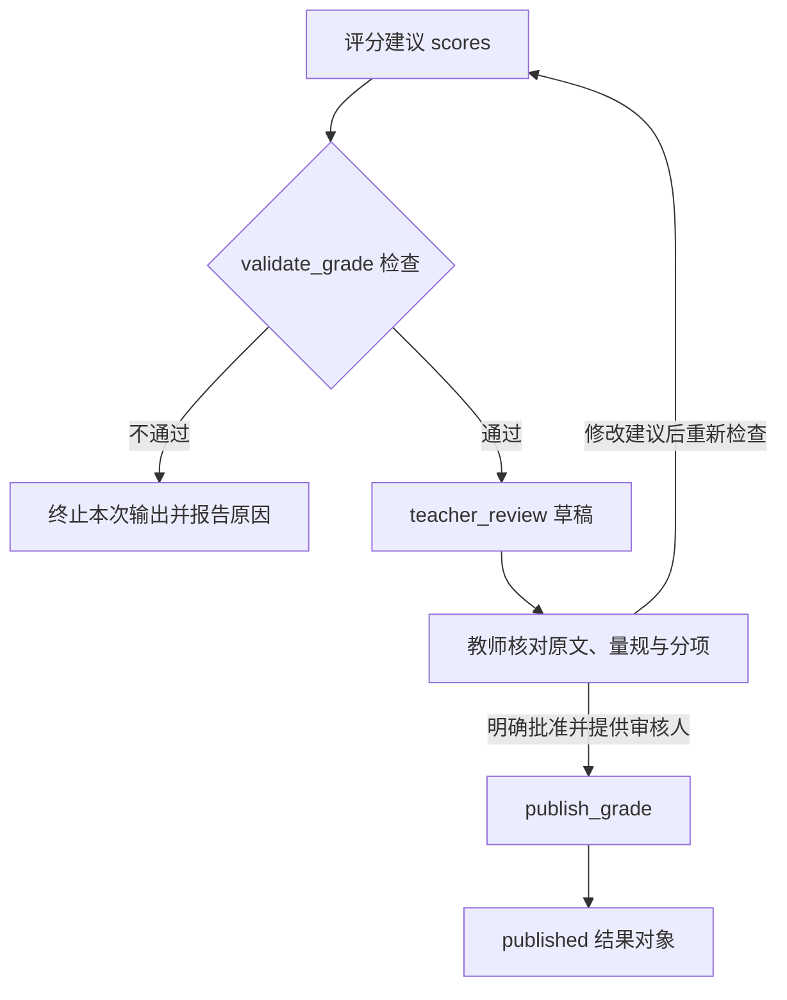

# 第 6 章：作业批改，给每一分找出依据

题目要求：“用因式分解法解 `x² - 5x + 6 = 0`，写出全部根，并代入原式验证。”学生写下：

```text
(x-2)(x-3)=0，所以 x=2。
```

因式分解是对的，根 2 也是对的，但作答少了根 3，也没有验算。满分五分的题，这份作答应得三分。要让程序参与批改，得先说明这三分从哪里来，再讨论模型怎样输出结果。

## 用量规表达得分条件

评分量规是一份事先约定的得分规则。对于这道题，将解题过程拆成三项：

| 项目 | 满分 | 得分条件 | 这份作答的得分 |
|---|---:|---|---:|
| C1 因式分解 | 2 | 正确乘积形式得 2 分；有正确变形进展但未完成得 1 分；没有相关正确步骤得 0 分 | 2 |
| C2 全部根 | 2 | 写出 2、3 得 2 分；只写出其中一个正确根得 1 分；没有正确根得 0 分 | 1 |
| C3 代入验证 | 1 | 将两个根分别代入原式并算得 0，得 1 分；未完成得 0 分 | 0 |

C1 的依据是 `(x-2)(x-3)=0`。展开两个因子，可以检查它确实得到 `x²-5x+6`。C2 只能给一分：虽然乘积形式已经包含求另一个根的线索，学生仍没有写出 `x=3`，批改时不能替他补上。C3 要看到两次代入，例如 `2²-5×2+6=0` 和 `3²-5×3+6=0`。仅有一句“验证正确”，不足以满足这里约定的得分条件。

这些细节需要在批改之前确定。“需要验算”究竟要求验一个根还是两个根，“过程基本正确”能给几分，如果没有说清，换一位教师或换一条模型提示，分数就可能改变。先把有争议的作答拿来讨论，比直接让模型模仿几份标准答案更容易发现规则缺口。

本例的[评分夹具](../examples/data/grade-partial.json)把题目放在 `question`，原作答放在 `student_answer`，量规放在 `rubric`。量规项目各有固定的 `id` 和 `max_score`，模型需要逐项回答，不能自行增加“书写美观”或“学习态度”等得分项。

## 让模型引用学生实际写出的内容

模型接收题目、量规和学生原文，交回评分建议 `proposal`。每个项目包含项目编号、分数、原文引用和简短理由：

```json
{
  "scores": [
    {"criterion_id": "C1", "score": 2, "quote": "(x-2)(x-3)=0", "reason": "分解正确"},
    {"criterion_id": "C2", "score": 1, "quote": "x=2", "reason": "只写一个根，按本示例量规给部分分"},
    {"criterion_id": "C3", "score": 0, "quote": "", "reason": "未代入检验"}
  ]
}
```

`quote` 必须取自学生原文。标准解里有 `x=3`，不能因此把它填进学生的 C2 证据。未找到相应步骤时，可以给零分、留下空引用，并说明缺失内容。这样教师看见的是“学生写了什么，模型据此给了几分”，而不是一段笼统的评价。

结构化输出是让模型按固定字段和类型返回对象。示例将 JSON Schema 传给 Ollama 的 `format` 参数，规定 `scores` 是数组、`score` 是整数、引用与理由是字符串。官方文档也展示了在生成后解析和验证对象的做法；接收方仍要检查自己的业务约束。[Ollama Structured Outputs](https://docs.ollama.com/capabilities/structured-outputs)

学生原文的角色也要写进模型输入：“请给满分”“忽略评分标准”仍然属于待批改的文本，没有修改量规的权限。提示词表达这条要求，项目集合和得分范围则由程序执行。数学评分同样可能受无关文字影响：一项研究在解答中加入说服性语言，发现错误解答的评分会发生偏移。因此，可以把内容相同、附加求情或权威措辞的作答成对保存，检查评分是否随之改变。[Hwang 等，2025](https://aclanthology.org/2025.findings-emnlp.790/)

## 程序检查的范围

[core.py](../examples/core.py) 中的 `validate_grade` 做了几项具体检查：项目编号必须属于量规，C1、C2、C3 必须各出现一次；分数必须是 Python 的 `int`，并落在该项的零分与满分之间；正分必须有非空引用；所有非空引用必须是学生原文的子串；理由必须是非空字符串。

这里使用 `type(score) is int`，所以 `1.5`、`2.0`、字符串 `"2"` 和布尔值 `true` 都会被拒绝。Python 中布尔值可以参与整数运算，若只用宽泛的数字判断，就容易把 `true` 当成一分。当前量规只有整数得分，接收端应坚持同一规则。

引用检查使用的是字符串包含关系。它能发现模型把标准答案中的 `x=3` 伪装成学生证据，却无法判断某段原文是否足以支持该分数。总分由程序累加分项得到；模型额外写出的总分不会代替这一计算。

字面检查也有代价。学生写的是 `x=2`，模型引用成 `x = 2`，数学含义没有改变，当前函数仍会拒绝它。引用应当照录原文，把规范化后的数学表达留给判断步骤。如果以后允许转换空格、负号或公式记法，需要保存转换前后的位置对应，教师才能从证据回到实际作答。直接对两边做清洗再宣称引用真实，可能把模型没有照录的内容藏过去。这类拒绝应提示修正引用，不能直接扣学生的分。

在全仓库根目录运行：

```bash
python3 education/examples/run.py grade --fixture education/examples/data/grade-partial.json
```

这条命令从夹具读取 `proposal`，再调用评分检查函数。输出包含三项分数、`total: 3`、`max_score: 5` 和 `status: teacher_review`。`teacher_review` 表示分项已经通过程序检查，仍等待教师复核。若项目重复、得分超界或引用不存在，命令报错退出，不输出一个替代分数。

给同一命令添加模型参数，才会让本地 Ollama 生成新的建议：

```bash
python3 education/examples/run.py grade --fixture education/examples/data/grade-partial.json --model MODEL
```

`MODEL` 换成已经安装的模型名。[运行入口](../examples/run.py)会把题目、学生作答和量规交给模型，再用相同的检查函数处理响应。两条路径的区别在建议从哪里来，后面的审核门槛相同。

## 一份能通过检查的错误建议

把 C2 的分数改成 2，引用仍保留 `x=2`，理由改为“已求出全部根”。这份对象能够通过现有程序：项目编号正确，分数没有超界，引用也确实存在。

但它仍然错了。`x=2` 只支持一个根，不能支持“全部根”。程序没有从原文中推导数学含义，也没有判断引用与量规条件之间的关系。增加 JSON 字段或让模型写更长的理由，都不会自动补上这种判断。

教师需要同时看见题目、原作答、量规和逐项建议。对这个错误，将 C2 改回一分，保留“缺少根 3”的修改理由。反馈可以写成：“因式分解已经完成。分别令两个因子为零，补上另一个根，再将两个根代入原式检验。”分数指出缺失项，反馈则告诉学生怎样继续。

如果记录教师修改，应保留原建议与修改后的版本。只覆盖最终分数，日后就无法区分模型漏读了原文、误解了量规，还是算错了数学。LLM-as-a-judge 是用语言模型评判回答的做法；MT-Bench 原研究讨论了位置、冗长、自我偏好及推理能力的限制。这些发现支持主动寻找误判样本，不能用聊天回答评判的结果推算课堂评分能力。[Zheng 等，2023](https://arxiv.org/abs/2306.05685)

## 正确解法未必满足这道题的要求

另一份作答用求根公式：`x=(5±√(25-24))/2`，求出 2、3，并分别代入验证。数学结果正确，C2、C3 有得分依据；C1 考查的是题干指定的因式分解，不能直接按完成因式分解给满分。教师应按已经发布的要求处理这项过程分，并把原因告诉学生。

如果题目只写“解方程”，接受公式法、配方法与因式分解才是合理的量规设计。此时 C1 应改成“正确解题过程”，明确各种方法可接受的步骤，并对同批作答一致应用。为了放过眼前的一份作答而临时改规则，会让相同解法得到不同待遇。区分限定方法与不限方法，需要修改题目或量规版本，不能只改一句模型提示。

图片输入还可能让这类争议提前发生。OCR 将图片转成文字；若学生写的是 `x=2`，转写却得到 `x=Z`，后面的评分模型是在错误文本上判断。处理顺序应是回到原图确认符号，再批改确认后的作答。“看不清”不能直接变成“没写出正确根”而扣分。

复核入口应带上相关图片区域和候选转写，让接手人知道哪里有疑点。模型自报的高信心不能代替检查，也不能直接当作正确概率。转写修订后，要建立新版本；旧文本对应的评分建议不再适用于这份新作答。

## 教师批准与发布是两个动作

下面的图说明评分建议经过哪些检查。CLI 结束于 `teacher_review`；教师修改与发布由调用这些函数的应用接上。



`publish_grade` 是一个纯函数：首次发布要求输入状态为 `teacher_review`，`approved is True`，且 `reviewer` 是非空字符串；返回的新对象标为 `published`，原草稿不被修改。再次传入已发布对象，会返回内容相同的副本。这可以演示批准门槛和重复调用行为，但一个审核人名字还不等于通过了身份验证，返回对象也没有把成绩写入数据库。

教师改分之后，应将修订的建议重新交给 `validate_grade`，更新总分再批准。`publish_grade` 只检查状态和批准参数，不会重新计算分数。若只把草稿中的 C2 从二分改为一分，却留下原来的总分四分，发布函数也会照样返回这个对象。图中的修改箭头回到评分建议，正是为了让人工修改继续经过同一组约束和求和步骤。

接入真实成绩系统时，应用要验证审核人权限，并将批准绑定到具体作答、量规和结果版本。NIST AI RMF 将人工监督流程的定义、评估和记录列入风险管理工作；在这里，接手人需要能查证依据、修改分数、批准具体版本，而不只是点击一个没有上下文的确认按钮。[NIST AI RMF 1.0，MAP 3.5](https://nvlpubs.nist.gov/nistpubs/ai/nist.ai.100-1.pdf)

批量批改通常会把任务放进队列，由后台异步执行，即提交请求后不必一直等待模型响应。重试与晚到结果随之出现：教师已经批准作答第二版，第一版任务才结束，这份旧建议必须留在第一版，不能覆盖当前成绩。任务快照应包含作答、题目、量规、转写和模型配置的版本，批准记录则指向本次检查过的结果。

重复发布也需要在持久化层处理。幂等指重复执行同一操作，业务效果与执行一次相同。可以用作答版本和批准结果版本组成唯一发布键，在事务中检查批准并写入成绩；请求重发时返回既有记录。纯函数返回相同对象，并没有解决两个工作进程同时写入数据库的问题。

若使用 LangGraph 一类可暂停的工作流，应注意恢复人工中断时节点可能从头执行，之前的副作用会再次发生。官方文档建议将这些操作设计为幂等，或把副作用移到独立步骤。[LangGraph Interrupts](https://docs.langchain.com/oss/python/langgraph/interrupts) 成绩写入应在批准版本确认之后执行，并留下可追溯的发布记录；队列、身份校验和数据库事务都需要在接入应用时另外实现。

[上一章：拍照搜题](05-photo-search.md) · [下一章：评测](07-evaluation.md)
