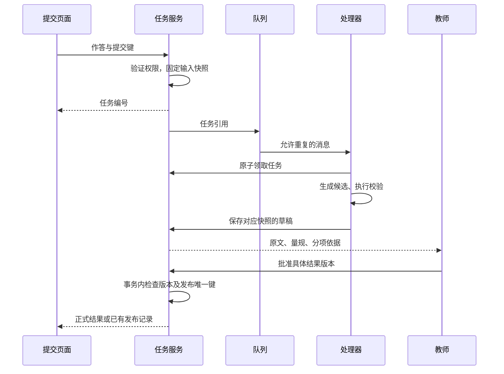

# 第 8 章：把评分演示做成可以接手的服务

同一份作答可能被重复提交，学生也可能补交新版本。若第一次任务还在排队，第二次任务已经完成，稍后返回的旧评分就可能覆盖新结果。这个问题与模型解题能力无关，任务和结果的版本关系需要由应用处理。

下面讨论的是服务扩展设计。现有示例提供检索、校验和发布门槛的纯函数；数据库、队列和审核页面需要按具体应用补充实现。

## 请求里的课程编号不是访问权

演示可以直接传入 `course_id` 来观察课程过滤。在线服务要先从登录身份确定访问范围，再决定请求能读取哪门课、哪份作答。不能因为客户端传了合法编号，就允许读取对应资料。

审核同样如此。`approved: true` 只是一个请求值。后端还要确认审核人具有权限，批准的是哪个结果版本，批准时对应哪份题目、作答和量规。审核页面至少同时显示这些材料和分项依据，否则教师只能对着一个总分做决定。

## 启动任务时固定输入

以学生漏写根 3 的作答为例，任务应绑定当时的作答，而不是处理器执行时才查询“最新作答”。

| 对象 | 任务快照 | 变化后的处理 |
|---|---|---|
| 作答 | `answer-demo@1`，只写根 2 | 补交形成 `answer-demo@2` |
| 题目 | 要求因式分解、全部根和验证 | 修改要求后生成新题目版本 |
| 量规 | C1=2、C2=2、C3=1 | 改分值或认可方法后重新评估 |
| 转写 | 教师或学生已确认的文本版本 | 纠正符号后重建任务 |
| 生成配置 | 模型、提示词和参数版本 | 配置变化保留旧版记录 |

任务完成时比较快照与当前作答版本。旧结果可以保存在历史记录里，但不能作为新作答的当前分数。重跑产生新草稿，也不继承旧草稿的批准。

“固定输入”可以通过不可变记录和内容摘要实现。摘要帮助发现数据改变，访问控制决定谁能读写，教师复核判断分数是否合理；这三项解决的是不同问题。

## 排队以后仍然要处理重复

消息队列让请求先返回任务号，由处理器在后台评分。消息可能重复投递，也可能发生“保存草稿成功、确认消息失败”。[AWS SQS 标准队列文档](https://docs.aws.amazon.com/AWSSimpleQueueService/latest/SQSDeveloperGuide/standard-queues-at-least-once-delivery.html)说明了至少一次投递下的重复问题。采用其他队列时，也应核对自己的投递与确认语义。

同一提交键返回同一任务，明确要求重评时再创建新的尝试。多个处理器竞争任务时，通过条件更新等原子操作领取；领取记录需要有效期或恢复机制，否则进程崩溃后会一直卡住。

任务保存和消息投递也是两步。如果保存后进程退出，消息可能没有发出。可以在同一数据库事务中写任务和待投递事件，由后台补发；也可以扫描未投递任务。无论采用哪种方案，都要演练这条中断路径。

发布需要唯一键和事务，保证同一批准结果不重复写入正式记录。通知教师或学生属于外部副作用，要另外保存待发送、已发送状态，并支持去重。数据库里的评分只写一次，不代表外部通知天然只发一次。

## 异常状态要给出可执行的下一步

图片不完整，返回重新拍摄；材料缺失，进入教师补充；模型超时，保留任务并按重试策略处理；评分字段非法，保存诊断信息。重试适合暂时的服务故障，不适合反复用错误量规生成同一份评分。

日志记录任务号、快照版本、执行阶段、耗时和错误类型。排查需要学生原文时，通过受控入口查看，避免把图片和整份作答散落在通用日志中。一次追踪应当串起识别、检索、生成、校验和复核，而不是只留下最后一次模型请求。

“处理中”还需要超时定义。机器处理时间、排队时间、人工复核时间分别统计，才能判断该增加处理能力，还是调整教师工作安排。模型流式返回第一个字，也不意味着评分任务已经完成。

成本记录至少区分调用、重试、存储和复核。按 token 单价计算的是一部分调用成本；本地部署还有设备利用和维护。没有固定工作量与运行记录时，先收集数据，再讨论每份作业多少钱。

## 交接时演练两个故障

可以用下面两种情况检查实现：两个处理器同时收到同一任务，其中一个保存草稿后退出；学生补交以后，旧任务才返回。逐步核对作答版本、任务状态、草稿版本和允许动作，确认重复消息不多发布一次，旧结果不覆盖新作答。

再让接手人按[交付检查单](../templates/delivery-checklist.md)启动服务、查看失败、重跑任务和停止入口。回滚时要说明程序、配置与材料各回到什么版本，已经发布的评分如何处理。切回旧配置不会自动撤回已发出的结果。

这类交接记录可以参考 [NIST AI RMF](https://www.nist.gov/itl/ai-risk-management-framework)对角色职责和持续管理的安排。具体到本例，真正要留下的是谁负责处理待复核任务，以及一次错误评分如何被发现、修订和通知。

[评测](07-evaluation.md) · [案例维护](09-case-library.md)
