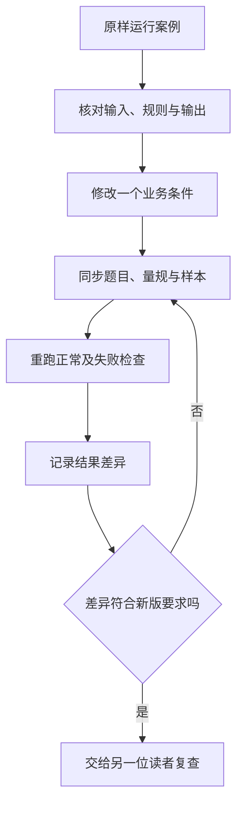

# 第 9 章：给案例留下可以继续修改的材料

作业批改示例得到 3/5 分，读者应该能核对这三分从哪里来，也能把题目改成“不限制解法”，知道接下来要改哪些文件。只有运行截图和一段提示词，无法完成这次修改。

一个可复用的案例需要同时保留题目、输入、规则、实现和判断结果。代码放在哪里并不复杂，难的是这些材料是否仍然描述同一件事。

## 从批改案例核对文件关系

| 材料 | 内容 | 入口 |
|---|---|---|
| 任务规格 | 谁提交、处理范围、结果和失败动作 | [案例规格](../templates/case-spec.md) |
| 题目与作答 | 指定因式分解，学生漏写根 3 | [评分数据](../examples/data/grade-partial.json) |
| 量规 | 分解 2 分、全部根 2 分、验证 1 分 | [量规模板](../templates/grading-rubric.md) |
| 实现 | 接收建议、检查分项与证据、计算总分 | [核心函数](../examples/core.py) |
| 检查 | 非法分数、虚构证据、漏项和未经批准的发布 | [测试](../tests/test_education.py) |
| 运行记录 | 使用版本、原始输出、判定和失败原因 | [评测记录](../templates/evaluation-record.md) |

正常样本说明程序怎样走完流程，失败样本说明为什么会停下。例如把 C2 从 1 分改成 2 分，原文仍然只有 `x=2`。字符串引用检查可能通过，评分却不符合量规。这条样本保留下来，才能提醒维护者程序校验的边界。

## 改一个条件，看哪里跟着变

把“使用因式分解”改为“不限制方法”以后，公式法求出两个根也应按新版要求评价。只改提示词不够：题干、C1 规则、参考评分和测试样本都要核对。新版规则应一致应用于同批作答，不能遇到一个解法才临时改一次标准。

同样的方法可以用于答疑：新增一份讲义时，检查课程和审核范围；用于拍搜：新增归一化规则时，检查它会不会把原本不同的题干变成同一个文本。修改的理由和失败样本一起提交，后面的维护者才知道这条规则为什么存在。

## 总目录与领域目录各管什么

仓库首页按领域导航，教育入口是 `education/`。教育目录内的 `chapters/` 放正文，`examples/` 放代码和数据，`tests/` 放程序检查，`templates/` 放表单，`research/` 放引用说明。

合订稿 `education/BOOK.md` 由单章生成。修改单章后，在仓库根运行 `python3 scripts/build_book.py`；不要分别编辑两份正文。代码的默认路径来自文件位置，运行命令和测试也要随目录调整，不能只移动 Markdown。

Git 记录文件变化，模型和运行环境则写进评测记录。一次接口成功、一次测试通过和一次教师评阅是不同的证据，更新说明要写清楚这次增加了哪一种。

## 新增其他领域时，先重新写规格

教育里的课程隔离、教师量规和补交作答，不能直接改名变成企业权限、设备告警和补发事件。新领域需要重新确认参与者、资料范围、时间关系和允许动作。

新增目录前，先选一个边界清楚的任务，准备可公开或可合成的输入，写出正常结果与失败动作。完成正文和检查后再加入总目录。这样首页里每个入口都有可读内容，也有后续维护的起点。

[服务交付](08-delivery.md) · [教育目录](../README.md) · [总目录](../../README.md)
