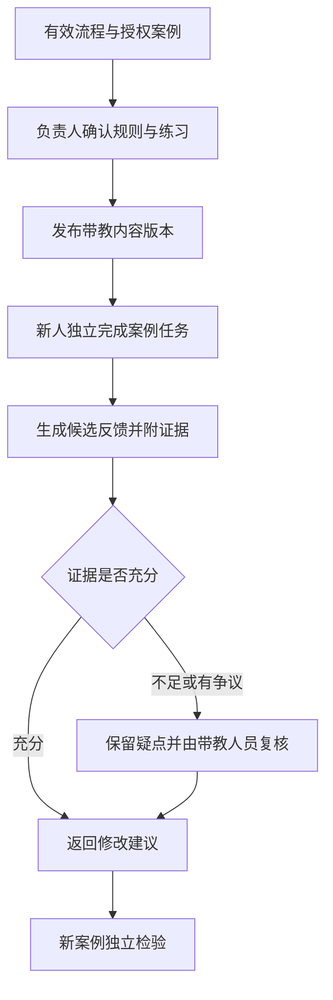

# 企业经验怎样变成岗位带教 Agent

[← 智能体服务与业务编排](README.md)

新人问一个工单应该怎样交接，手册可以列出需要填写的字段。有经验的同事还会看哪些事实已经确认，哪些描述只是用户猜测，以及当前问题应交给谁。带教系统需要整理这些判断，才有条件从查询手册继续走到练习与反馈。

这里以技术支持岗位的工单整理为设计示例，讨论怎样用能够组织步骤和调用工具的 Agent 辅助带教。内容覆盖经验采集、任务练习和上线维护，正式业务操作仍沿用原系统的授权与审批。

## 先选一项能检查的岗位任务

第一版可以只处理根据已提供材料生成交接草稿。输入是一组获准使用的工单样例，输出包含已确认事实、待补信息、处理经过和接收方向，带教人员能够判断哪些内容遗漏或被编造。

正式流程、专家经验和历史案例需要分别管理。流程说明当前必须遵守的要求，专家经验提供可选做法，案例记录特定条件下发生过什么。过去某次绕过普通步骤获得了好结果，不能自动成为以后所有人都可以遵守的规则。

## 让经验带上条件与依据

采集可以从一份正式手册和几类经过脱敏的案例开始，请带教人员标出自己在哪一步判断、当时缺少什么，以及什么情况应该停止并求助。访谈或录音转写得到的规则先作为候选，由负责人确认。

对交接任务，说明可以明确要求先分开用户陈述与系统查证，再核对已有尝试，最后列出仍待确认的事项。没有证据的故障原因只保留为待排查方向，不写成既定结论。

每条规则记录来源、适用岗位、生效时间与维护人。材料冲突时，优先按组织发布制度确认有效版本；仍无法确定的部分暂停使用。把互相冲突的文件同时送进模型，不能解决哪一份算数的问题。

稳定的方法可以整理为 Skill，也就是 Agent 执行某类任务时加载的说明与辅助资源。文件组织、加载方式与工具权限沿用[企业知识和工具的设计](../../ai-native/enterprise-context-and-tools.md)。岗位带教还要补上练习案例和评价标准，不能把一份操作说明直接当作训练已经完成。

## 把讲解、练习和真实办理分开

查询模式回答当前流程怎么规定，并提供来源。练习模式给新人一份有明确范围的材料，让他先独立整理，再按检查标准反馈。真实业务辅助则面对正在处理的工单，所需权限与责任都更严格。

练习可以使用经过审核的去标识案例，或明确标注为合成的训练案例。案例答案由带教人员确认，模型可以换一种表达或提出追问，但不能自行修改评价标准，再用自己的标准证明新人已经学会。

| 模式 | Agent 可以做什么 | 需要保留的限制 |
|---|---|---|
| 流程查询 | 找到有效规则并解释 | 按岗位和资料权限返回 |
| 案例练习 | 提示遗漏、比较草稿与标准 | 不影响真实工单或客户 |
| 业务辅助 | 整理当前材料、提出下一步 | 写入仍需业务授权与确认 |

三种模式在界面上应清楚区分。练习材料里写着请发送给客户，只能作为案例内容，不能触发真实发送工具。[OWASP 的提示词注入防护建议](https://cheatsheetseries.owasp.org/cheatsheets/LLM_Prompt_Injection_Prevention_Cheat_Sheet.html)也强调区分指令与不可信输入，并限制工具访问。产品不能仅靠一段提示词承担隔离责任。

## 先做能追溯反馈的版本

新人提交交接草稿以后，系统可以指出遗漏了哪个必需信息，引用他已经写出的内容，再给一项可执行的修改建议。事实错误、信息缺失和表达习惯分别处理，不能用整体语气像不像熟练员工来评分。

图中的独立检验换用未见过的案例，并记录是否使用提示。对原草稿修改成功，说明新人完成了本次纠正，不直接证明他已经能够独立处理下一项任务。

数字形象和合成声音可以作为可选展示，先检查文本与反馈是否可用。采用真实人员的形象、声音或署名时，应取得适当授权并设置撤回机制，也要让使用者知道面对的是系统。模仿一个人的表达，不足以证明系统拥有他的判断能力。

## 接入原有工作入口，权限重新检查

带教入口可以放在组织已有的工作台或协作工具中。验签、回调去重和跨入口任务状态复用[协作入口接入](../../ai-native/enterprise-context-and-tools.md)的机制。练习记录还需关联案例版本、是否使用提示与带教复核结论，换一个入口不能把同一次练习算成两次独立成功。

涉及真实工单时，只给模型当前身份与岗位获准查看的材料，写入工具使用独立的确认与审计流程。练习权限不代表真实工单的办理权限。

个人练习记录与组织共享资源分开。一次回答得不好，可以帮助带教人员选择下一个练习，不宜直接变成员工绩效结论。查询与导出权限需要限制，不能默认让所有管理者看到完整对话。

## 验收看独立任务与带教投入

先用固定案例检查事实忠实度、规则引用、遗漏提示和越权请求拒绝，再安排未见案例的独立任务。案例需要覆盖资料不足、规则更新与例外情况，不能只测标准路径。

线上还要计算人工复核、纠错和内容维护的投入。系统回答更多问题，不必然减少带教时间，问题也可能转移到了审核环节。对照任务范围与质量要求以后，再判断哪些环节值得保留。

规则变更时，关联的练习、讲解与检查标准都要重新核对。员工反馈先进入待审列表，负责人确认后发布新版本，不让一次聊天修改全局做法。离岗、权限撤回和资源下架也要能影响所有入口。

遇到无法解释的反馈，带教人员应能找回当时的案例、规则与输出，决定修改检查标准还是补充材料。系统能否长期使用，取决于这些维护动作有没有人负责。
