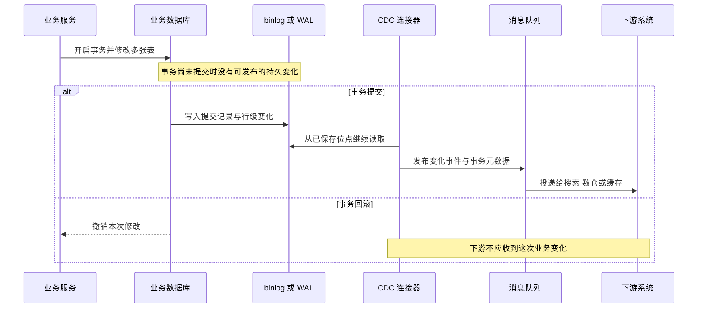

# CDC 怎样捕获数据库变更

[← 数据工程与智能标注](README.md)

CDC 是 Change Data Capture 的缩写，指持续捕获数据库里已经发生的变化。多机房复制是它的一种用途。搜索索引、数据仓库、数据湖和缓存也会用它接收增量数据。

这个名字听起来像一条现成的数据管道，落到生产环境却会碰到快照、日志位点、事务、重复消息和数据库结构变更。写入口不多的系统用一张同步任务表就能解决问题，贸然加一套 CDC，维护工作往往比业务本身还重。

## 连接器读取的是数据库日志

MySQL 会把修改数据库结构和内容的事件写入 binary log。PostgreSQL 的逻辑解码从 WAL 里提取持久化变化，再转成外部系统能够消费的记录。[MySQL 的复制实现文档](https://dev.mysql.com/doc/refman/8.4/en/binlog-replication-configuration-overview.html)和 [PostgreSQL 的逻辑解码文档](https://www.postgresql.org/docs/current/logicaldecoding-explanation.html)分别说明了这两个入口。

CDC 连接器保存自己已经读到的位置。数据库事务提交以后，连接器从这个位置继续读取日志，转换成新增、修改或删除事件，再发送到 MQ。下游服务按事件更新搜索、分析或其他派生数据。

CDC 减少了业务代码主动发送消息的工作，也绕不开下游幂等。连接器重启、MQ 重投和消费者故障都可能让同一变化再次到达。事件需要带主键、源日志位置或业务版本，消费者按版本更新，重复事件直接忽略。

## 数据库事务不等于业务事件

CDC 能看到数据库事务边界。Debezium 的 PostgreSQL 连接器可以产生 `BEGIN`、`END`、事务 ID、事件总数和事务内顺序等元数据。[Debezium 的事务元数据说明](https://debezium.io/documentation/reference/stable/connectors/postgresql.html#postgresql-transaction-metadata)也提醒了一点，连接器部署以前的事务没有这类元数据。

下游收到的主体仍然是行级变化。一次“发布题目”的业务操作可能同时修改题目、选项、答案和审核记录，CDC 会产生多条事件。消费者可以等到事务结束后批量处理，也可以按题目 ID 重新读取业务库。它仍然要靠业务规则判断这些行共同表达了什么。

需要明确业务语义时，可以在本地事务里写一条 Outbox 事件。事件直接表达 `QuestionPublished` 或 `QuestionUpdated`，并带上题目主键和版本。Outbox 发布器可以定时轮询，也可以由 CDC 读取。[Debezium 的 Outbox Event Router](https://debezium.io/documentation/reference/stable/transformations/outbox-event-router.html)负责把 Outbox 记录转换成消息，下游不用再猜测多张业务表的含义。

## 第一次启动需要衔接全量与增量

数据库日志通常只保留一段时间。连接器第一次接入时，不能仅靠当前日志还原全部历史数据。常见做法是先记录日志位置，再读取一份一致性快照，快照结束后从记录的位置继续消费。

全量读取期间，线上仍会修改数据。同一个主键可能先出现在快照里，又出现在实时变化里。消费者若没有版本或日志顺序，只看消息到达时间，旧快照就可能覆盖刚提交的新值。

[Debezium 的增量快照设计](https://debezium.io/documentation/reference/stable/connectors/postgresql.html#postgresql-incremental-snapshots)把数据按主键分块，并用水位和快照窗口处理实时事件与快照记录的碰撞。它还能从中断位置继续。实现这种能力要保存分块进度、日志位点和连接器状态，复杂度已经明显高于扫描一张同步任务表。

## 生产环境的问题集中在恢复过程

CDC 平稳运行时很安静，故障恢复最容易暴露设计缺口。

- 日志位点丢失以后，系统要判断还能续读，还是必须重新做快照。
- 数据库过早清理 binlog 或 WAL，连接器会失去尚未读取的变化。
- MQ 分区不当，同一个业务对象的事件可能乱序。常见做法是用稳定业务主键作为消息键。
- 数据库增加字段、改字段类型或拆表时，事件结构会变化，下游需要兼容旧消息和新消息。
- 大事务会积累大量行级事件，占用连接器内存和 MQ 带宽，也会延迟后续事务。
- 删除事件需要明确保留主键和版本。只发送一条没有上下文的空消息，下游很难安全清理。
- 下游处理变慢时，积压会向日志保留和存储容量传导，监控不能只看连接器是否存活。

这些问题需要故障演练。至少要验证连接器重启、MQ 重投、位点回退、日志缺失、结构变更和重新快照。一次正常同步成功，不能证明恢复过程可用。

## 什么时候值得采用 CDC

| 场景 | 建议 |
| --- | --- |
| 单体应用，所有写操作都经过同一个服务 | 本地事务任务表加 MQ，开发与排障更直接 |
| 已有可靠的事务消息能力 | 使用事务消息，同时保留幂等和对账 |
| 多个旧系统直接写同一个数据库 | CDC 可以覆盖无法逐一改造的写入口 |
| 搜索、数仓、数据湖等多个下游订阅变化 | CDC 适合建设统一变化流 |
| 数据量很大，需要快照和增量连续衔接 | CDC 的位点与增量快照能力更有价值 |
| 只同步少量后台配置 | 定时任务或版本扫描通常已经够用 |

CDC 还可以与 Outbox 组合。业务服务负责写出语义清楚的事件，CDC 负责可靠地搬运这些事件。这套方案适合已有数据平台和连接器运维能力的团队。系统规模尚小时，轮询 Outbox 再发送 MQ 更容易把故障范围控制住。

选择 CDC 以前，先数清写入口、下游数量、允许的同步延迟和团队能维护的组件。数据规模和组织复杂度确实需要它时，日志捕获能减少大量侵入式改造。只有一套题库和一个向量索引时，简单方案通常更耐用。
