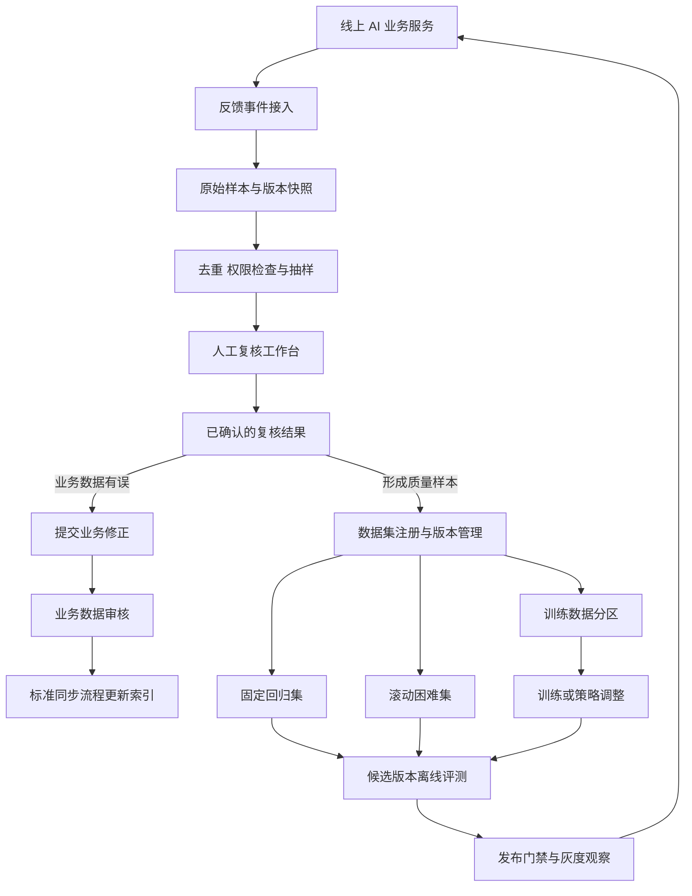

# 数据反馈怎样进入评测与迭代

[← 数据工程与智能标注](README.md)

> 本文以[数字名师中的拍照搜题与答疑](../../education-solutions/digital-teacher/qa.md)作为贯穿案例。文中的学生反馈、教师复核和题库修正来自 AI 教育场景。数据反馈、人工复核、评测集和灰度发布属于通用平台能力，同样适用于搜索、推荐、客服和内容审核等 AI 产品。

拍照搜题页上的“没有搜准”按钮很容易做，后续处理更难。学生可能误点，也可能只是没有看到排在第二位的原题。一次无结果可能来自题库缺题，也可能来自图片切分错误。把这些信号直接当成标签，数据积累得越多，错误也会跟着积累。

数据反馈需要一套独立系统。它从线上业务接收事件，经过筛选和人工复核，再把确认后的业务修正、评测样本和训练数据送到各自的下游。答疑服务和向量索引服务只提供输入与接口，不在一次用户请求里完成全部处理。

## 先保存当时发生了什么

反馈事件要能还原用户当时看到了什么。只记录一句“结果不准”，复核人员无法判断是 OCR、检索、排序还是答案生成出了问题。

| 字段 | 用途 |
| --- | --- |
| `event_id` | 幂等接收与去重 |
| `request_id` | 找回一次完整请求及各处理步骤 |
| `entity_id` | 关联题目、知识片段或会话 |
| `input_snapshot` | 保留当时的图片、识别文本或问题 |
| `candidate_snapshot` | 保留当时返回的候选及顺序 |
| `model_version` | 说明使用了哪个识别、重排或生成模型 |
| `index_version` | 说明查询的是哪一版索引 |
| `user_action` | 记录未命中、候选选择、赞踩或补充输入 |
| `occurred_at` | 处理迟到事件并还原版本关系 |
| `access_scope` | 约束样本查看、导出和使用范围 |

线上日志要保留服务时实际使用的输入和版本。Google 的机器学习工程建议也强调保存服务阶段使用的特征，再与训练流程比较，避免训练与线上处理方式悄悄分开。[Rules of Machine Learning](https://developers.google.com/machine-learning/guides/rules-of-ml/#training-serving-skew)给出的重点是可复现和持续监测，这一点同样适用于检索与 Agent 系统。

在这个 AI 教育案例里，原图、会话和学生信息可能带有个人数据。事件采集前要确定最小字段，敏感内容单独存储并限制访问。业务数据收到删除请求时，反馈样本、导出数据集和缓存副本也要能按来源追踪并处理。

原始事件按追加方式保存，复核结论另行记录版本。复核人员后来改判时，系统保留前一次结论和修改理由，不能覆盖原始事件来制造一份从未出错的历史。

## 业务反馈只是不同强度的信号

下面继续沿用拍照搜题案例，方便比较不同信号的强弱。换到客服、推荐或内容审核场景，信号和复核角色会变化，事件留存、置信判断和人工确认的原则仍然相同。

学生点选某个候选题，通常比一次赞踩更接近原题判断。它仍然可能点错。教师或运营人员看过原图、候选和标准题以后给出的结论，才适合成为高置信标签。

| 信号 | 可以先说明什么 | 仍需确认什么 |
| --- | --- | --- |
| 无结果查询 | 当前流程没有返回候选 | 题库缺题、OCR 失败还是过滤条件过严 |
| “没有搜准” | 第一屏没有满足用户 | 原题是否排在后面，用户是否误点 |
| 用户选中候选 | 某个结果更接近期望 | 是否真是同一道题，还是相似题 |
| 连续追问 | 当前讲解没有解决问题 | 回答错误、提示太少还是学生基础缺口 |
| 人工复核结论 | 可以形成正式题目关系或质量标签 | 复核依据、适用范围和有效版本 |

系统可以先用规则归并明显重复的反馈，也可以按错误类型、科目、模型版本和影响范围抽样。自动规则负责缩小复核范围，不能替复核人员决定标准答案和题目关系。

## 反馈系统与业务系统只通过正式结果交接

这张图里有两条出口。业务修正先经过对应业务系统审核，再走正常的数据与索引同步。质量样本进入数据集系统，用于评测或训练。反馈服务不直接修改线上数据，也不绕过业务审核发布正式结论。

小团队可以把事件接入、复核页和数据集导出做在同一个后台项目里。边界仍要保留。以后拆成独立服务时，业务修正接口、数据集接口和权限记录不需要重新定义。

## 评测集要保留版本与来路

一个样本进入评测集以后，要保留原始请求、期望结果、标注依据、来源时间、适用业务版本和审核记录。只有一份不断覆盖的 Excel，很难回答某个模型当时究竟在哪批数据上通过了验收。

[MLflow 的数据集跟踪文档](https://mlflow.org/docs/latest/dataset/)把数据来源、摘要、结构和训练、验证、评测用途一起记录，用来恢复数据与实验的关系。[TensorFlow ML Metadata](https://www.tensorflow.org/tfx/guide/mlmd)则记录流程执行、输入输出和数据血缘，能够从模型反查使用过的数据集。具体平台可以自行选择，这类元数据不能省。

这里至少保留三类数据。

- 固定回归集收录已经确认且长期有效的问题，用来发现旧能力是否退化。
- 滚动困难集吸收近期线上失败，用来发现新试卷、新表达和新版本带来的问题。
- 训练数据分区服务模型训练、规则调整或阈值选择。

参与训练、提示词调整和阈值选择的样本，不能继续充当同一版本的独立评测数据。否则团队已经看着答案调过系统，评测结果会偏高。新的线上确认样本可以按时间或来源划出未参与开发的一部分，形成下一版评测集。

数据集版本也不只是一串名称。它需要内容摘要、生成规则、父版本、增加与移除的样本、审核状态和允许用途。一个样本被撤销或隐私删除时，系统才能知道哪些训练任务和评测报告受到影响。

## 发布以前让同一批样本跑两遍

候选版本和线上版本使用同一份固定回归集与滚动困难集，分别记录检索排名、回答结果、工具调用和拒答原因。差异样本进入人工检查，不能只比较一个平均分。

离线通过以后再做影子读取或小范围灰度。影子读取让新版本处理真实请求，却不把结果返回给用户。灰度阶段再观察线上反馈、无结果、延迟和异常分布。训练数据、评测数据与线上服务的处理逻辑也要持续比较。[TensorFlow Data Validation](https://www.tensorflow.org/tfx/guide/tfdv)提供的结构校验、训练服务偏差和数据漂移检查，就是这类数据质量门禁的公开实现。

平台可以持续观察下面几组数据。

- 事件接收成功率、重复事件比例和版本字段缺失。
- 待复核数量、等待时间、退回原因和复核结论被再次修改的比例。
- 各业务类型、输入质量、用户分群和版本区间的样本覆盖。
- 固定回归集与滚动困难集上的分层指标变化。
- 灰度版本相对线上版本的反馈、拒答、延迟与错误变化。

这些指标没有一条适合所有业务的通用及格线。团队先保存基线，再根据业务风险、人工成本和用户影响设置发布条件。

## 数据飞轮靠审核结果转动

线上数据会不断增加，能进入下一轮迭代的是经过确认的数据。一次点击只负责触发调查，一次复核给出业务结论，数据集系统保存它的来路和用途。模型或检索策略通过评测与灰度以后才进入生产，新的线上结果再产生下一批候选样本。

这样搭出来的数据飞轮是一套可以审计、暂停和回滚的工程系统。某次反馈判断错了，团队能找到它影响的业务记录、数据集和评测报告，也能撤回对应版本。持续迭代才不会变成持续放大错误。
