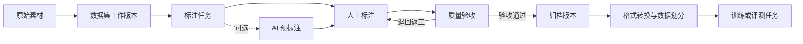
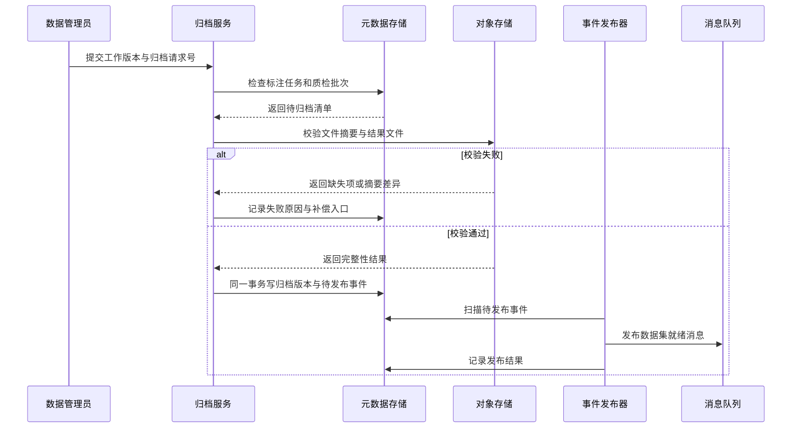

# 一份多模态训练数据怎样完成生产与归档

[← 数据工程与智能标注](README.md)

一批图片已经上传，标注员也点了提交。此时把文件目录交给训练任务，模型大概率能跑起来，团队却回答不了几个关键问题。这批图片对应哪套标签，哪些样本经过质检，AI 预标注来自哪个模型，训练时取到的是返工前还是返工后的结果。

这些问题只要有一个说不清，训练结果就很难复现。数据管理、数据标注、质量验收和数据归档共同组成一条生产链，页面通常把它们放在不同菜单。上一步没有留下稳定产物，下一个环节收到的就只是一批仍在变化的文件。

## 数据标注把人的判断写成训练结果

数据标注员每天做什么，取决于产品希望模型学会什么。图像分类让人选择整张图片的类别，目标检测要求把物体的位置框出来，语义分割继续把区域描到像素或点云。语音项目需要转写、说话人切分和时间位置，搜索与推荐会收集相关性判断，大模型项目还会让人编写示范回答或比较多个候选回答。

[Label Studio 的模板目录](https://labelstud.io/templates)覆盖了图像、音频、文本、视频、三维点云、回答排序和 LLM 评测等任务。不同任务产生的结果结构差别很大，数据标注平台才需要标签体系、标注模板和格式转换这些能力。

| 产品方向 | 人员标什么 | 标注结果解决什么问题 |
| --- | --- | --- |
| 图像识别与自动驾驶 | 类别、二维或三维框、分割区域、关键点和目标轨迹 | 告诉模型物体是什么、在哪里以及怎样移动 |
| OCR 与文档理解 | 文字区域、转写内容、表格结构和字段关系 | 把页面像素还原成可计算的文档结构 |
| 语音产品 | 转写文本、说话人、时间段、声音类别和意图 | 给语音识别、分离与理解提供目标结果 |
| 搜索与推荐 | 查询和内容的相关程度、候选排序与问题类型 | 训练召回、排序并构造离线评测集 |
| 大模型与多模态模型 | 示范回答、偏好选择、安全标签与事实判断 | 支持监督微调、偏好训练和模型评测 |

图像项目经常出现数据标注，是因为原始像素没有直接给出业务需要的类别、边界和对象关系。分类标签只告诉模型图片里有什么，目标框补充物体位置，分割标注进一步描述物体覆盖的区域，视频和点云还要维持目标身份。[AWS Ground Truth 的任务类型](https://docs.aws.amazon.com/sagemaker/latest/dg/sms-task-types.html)包含图片分类、目标框、语义分割、视频跟踪和三维点云标注。[Waymo 的感知数据说明](https://waymo.com/intl/it/open/data/perception/)也列出了二维框、三维框、关键点、点云分割以及二维与三维对象的对应关系。

数据标注岗位的门槛需要分层看。规则清楚的图片分类、目标框、文字转写和候选回答比较，经过培训的外部人员可以承担。质检人员还要理解边界样本和退回规则。医学、法律、教育等专业数据通常需要领域人员参与，标签体系、验收标准和争议仲裁则由熟悉产品目标的人负责。

| 工作层次 | 常见人员 | 主要责任 |
| --- | --- | --- |
| 执行标注 | 经过任务培训的内部或外部人员 | 按说明处理清晰、可重复的样本 |
| 质量检查 | 有经验的标注员或专职质检人员 | 发现漏标、错标和规则使用不一致 |
| 专业判断 | 领域人员 | 处理依赖专业知识或责任较高的样本 |
| 规则与仲裁 | 产品、算法和业务负责人 | 定义标签边界，处理争议并决定验收口径 |

外部人员适合规则稳定、可以拆成小任务的数据。敏感资料、内部业务数据和需要专业资质的任务，应交给受控的私有团队。[AWS 的标注人员文档](https://docs.aws.amazon.com/sagemaker/latest/dg/sms-workforce-management.html)把人员分为公共人员、供应商团队和私有团队；私有团队还可以按任务组成不同工作组。人员来源只是分工条件，最终质量仍要靠任务说明、培训样本、抽检和复核约束。

大模型预训练主要从原始语料中学习，不需要人工给每一个词贴标签。人工数据更多出现在训练后的调整和评测环节。InstructGPT 的[公开论文](https://arxiv.org/abs/2203.02155)记录了两类工作，标注人员先编写符合期望的示范回答，再对多个模型输出进行排序。前一类数据可以用于监督微调，后一类数据可以进入奖励模型或偏好训练。安全测试、事实核验和固定评测集同样需要人给出判断标准。

简单任务可能几分钟就能学会操作。工具很快能熟悉，规则一致性更费功夫。说明以外的样本迟早会出现，标注员需要知道何时暂停、上报和等待仲裁。平台除了统计完成数量，还要记录人员培训版本、结果一致性、返工原因和质检结论。

## 一条数据链先有稳定对象

训练数据从素材进入平台开始，经过标注和验收，最后形成一份可供训练任务引用的归档版本。AI 预标注可以插在人工标注之前，也可以完全关闭。质检没有通过时，数据要回到原来的标注任务继续返工。

文件、样本和数据集要先分开。

| 对象 | 保存什么 | 怎样变化 |
| --- | --- | --- |
| 素材 | 对象存储地址、内容摘要、媒体类型、尺寸或时长 | 原始内容尽量保持不变 |
| 样本 | 一次标注所需的输入及其业务标识 | 可以引用整份素材，也可以引用图片区域、视频片段或多份文件 |
| 数据集 | 一组样本及其用途 | 持续接收新增样本 |
| 工作版本 | 某次生产使用的样本清单、标签体系和处理状态 | 允许标注、退回和修订 |
| 归档版本 | 已验收的样本清单、结果版本和质量结论 | 发布后只读 |

素材适合放在对象存储，数据库保存元数据和关联关系。一个视频可以切成多个样本，同一张图片也可能分别用于目标检测和视觉问答。反过来，一条多模态样本还可能同时引用图片、问题和候选回答。直接把文件目录当作数据集，很快就会失去这些关系。

内容摘要可以判断文件是否发生变化，样本主键负责保持业务身份。数据集版本再用一份清单把样本主键、素材摘要和标签体系版本固定下来。以 Label Studio 为例，它的[数据导入文档](https://labelstud.io/guide/tasks.html)也把任务数据、人工标注和模型预测分开描述，并建议大型项目把媒体放在外部源存储。标注工具负责组织生产，源素材仍由专门的存储系统管理。

## 标注任务记录生产过程

标注任务回答谁来处理哪些样本、使用哪套工具、什么时候提交。标注结果回答样本上画了哪些框、选择了哪个类别，或者哪一个回答更好。两者分开以后，任务可以重新分配，历史结果也不必跟着覆盖。

AI 预标注同样单独保存。模型先给出候选框或候选标签，标注员在它的基础上修改，最后提交一份人工结果。[Label Studio 的预标注文档](https://labelstud.io/guide/predictions)会在预测记录中保留 `model_version`，预测结果保持只读，人工标注从预测复制后继续编辑。这种结构能还原模型给了什么、人改了什么，也方便以后评估预标注到底节省了多少操作。

平台标签与模型标签还要经过一次映射。业务标签可能叫“机动车”，模型输出却是 `car`、`bus` 和 `truck`。映射关系需要保留版本，旧任务继续解释旧结果，新任务再使用更新后的映射。直接修改标签名称，会让历史标注在导出时悄悄改变含义。

DPO 偏好标注也沿用同一套对象关系。DPO 是直接偏好优化，训练数据通常包含问题、较优回答和较差回答。Hugging Face TRL 的[数据格式文档](https://huggingface.co/docs/trl/dataset_formats)把它们表示为 `prompt`、`chosen` 和 `rejected`。在多模态场景中，样本还要绑定当时的图片或音频版本。标注页面上的一次选择，到了训练交付阶段会变成一条有明确结构和来源的偏好样本。

## 质检要保存判定过程

标注员交完任务以后，系统可以全量检查格式、必填项和标签范围。这些检查只能发现结构问题。框有没有漏画、回答是否符合图中内容，还需要质检规则或人工判断。

抽样质检经常只在页面上留下一个通过率。这个数字不足以支撑返工和审计。一个质检批次还要记录检查范围、抽样规则版本、被抽中的样本、质检人员、问题类型、判定结果和复检来源。团队调整抽样比例以后，旧批次仍然能够按当时的规则解释。

退回也要落到样本。整批退回实现简单，标注员却很难知道该改哪里；只退问题样本更省工，但系统必须冻结本轮抽样范围，防止待复检集合在返工期间继续变化。复检通过以后，平台保存新的结果版本和本轮判定，前一版结果仍然留在历史记录里。

AI 可以帮助质检人员找出漏标、标签冲突和低置信样本。它给出的是待检查候选。最后的质量结论仍由明确的验收规则产生，这样模型升级以后，历史归档版本不会跟着重新判定。

## 归档固定一份可交付版本

归档承担业务版本冻结。备份负责系统故障后的恢复，两者解决的问题不同。一份归档版本需要固定素材清单、标注结果、标签体系、质检批次和来源关系，还要说明它允许用于训练、评测还是外部交付。

大数据集的归档不适合放在一次 HTTP 请求里同步完成。服务要逐项核对任务状态、质检结论、对象存储文件和结果清单，其中任何一步都可能超时。更稳妥的做法是创建异步归档任务，让后台流程完成校验和版本发布。

归档请求号可以作为幂等键。同一个工作版本被重复提交时，系统返回原来的任务，不再创建第二份归档。后台任务记录待处理、运行中、成功和失败等状态，同时保存进度、重试次数与最后一次错误。服务重启后可以从数据库找回未完成任务，不能只依赖内存队列。

对象存储里的大文件通常无需再复制一遍。归档清单引用不可变地址和内容摘要，多个版本可以复用同一份素材。标注结果、清单和导出文件则按版本保存。某个文件缺失或摘要不符时，本轮归档失败，原工作版本继续可用，运维人员修复后使用同一请求号重试。

归档版本发布以后保持只读。后来发现漏标，平台从该版本复制出新的工作版本，修订、质检并重新归档。旧训练任务继续引用原版本，新任务可以选择新版本。团队因此能同时保留修订结果和历史可复现性。

## 训练任务引用版本，不接收活动目录

归档完成以后还要经过格式转换。目标检测可能导出 COCO 或 YOLO，语言模型可能需要 JSONL，偏好训练则需要保持问题、优选回答和拒绝回答的对应关系。转换器本身也有版本，同一批标注结果经过不同脚本，字段、坐标精度和过滤规则都可能变化。

训练任务至少记录归档版本、导出任务版本、转换器版本和数据划分规则。训练集、验证集与测试集的样本清单也要固定，不能每次运行时重新随机一遍。[MLflow 的数据集跟踪](https://mlflow.org/docs/latest/dataset/)会记录数据来源、内容摘要、结构与概况，也支持分别登记训练、验证和测试用途。这些元数据让一次训练能够重新找到当时的数据输入。

数据血缘把这些记录继续连到模型。TensorFlow ML Metadata 使用 Artifact、Execution 和 Event 表达流程中的产物、执行步骤及输入输出关系，它的[官方文档](https://www.tensorflow.org/tfx/guide/mlmd)展示了怎样从模型反查上游数据，也能从一份有问题的数据找到受影响的模型。平台无需照搬同一套组件，关系仍然值得保留。

经过格式转换并绑定归档版本后，一批素材才具备交付条件。几个月后某个模型出现异常，团队可以找到它使用的归档版本、那一版的质检结论和标注来源；某批数据需要撤回，也能顺着血缘确定影响范围。数据生产平台的工程价值，就落在这些能够重新回答的问题上。
