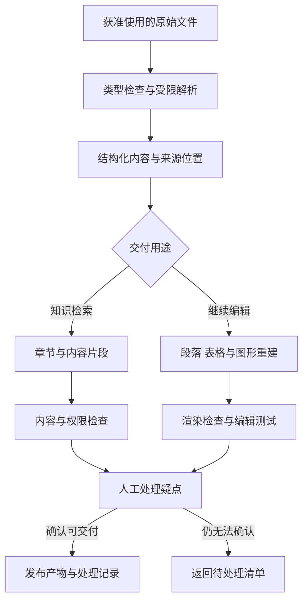

# 复杂文档怎样解析、转换并通过验收

[← 知识工程与内容生产](README.md)

一份图文混排的 PDF 转成 Word，页面看起来接近原稿，文字却可能整页都是图片。另一个结果里的文字可以编辑，表格和公式却错了位置。文档转换需要先确认交付目标，再决定怎样解析和重建。

这里讨论企业资料处理中的通用工程能力。教学资料怎样继续变成题目，另见[题库生产](../../education-solutions/teacher-assistant/question-bank-ingestion.md)。本篇重点放在原始文件到结构化内容与可编辑文档的转换，不预设某个工具能够无损还原所有文件。

## 把内容提取与版式还原分别约定

用于检索的内容，需要阅读顺序、章节关系、表格和可追溯位置。用于继续修改的 Word，需要可编辑的段落与对象。用于归档展示的文件，则可能更重视与原页一致的外观。

这些要求可以同时存在，但应分别验收。一个保持原样的页面图片不适合当作可编辑交付物，一份文字齐全的 Markdown 也没有自动保留分页与浮动排版。

开始转换时，可以让使用者选定用途与重点区域，例如正文可编辑、表格能够修改、公式允许人工复核。无法支持的对象明确列为限制，避免任务完成后才发现双方理解不同。

## 先保存可复查的中间表示

解析可以按页判断文本层与扫描图像，再恢复段落、标题、表格和图片的关系。中间表示是一份独立于最终文件格式的结构化记录，用来保存这些对象、来源位置和处理结果。

[Docling 的文档模型](https://docling-project.github.io/docling/concepts/docling_document/)分别表达文本、表格、图片、层级与可用的位置来源，也区分正文和页眉页脚。这样的结构适合供后续检索或文件生成使用。采用这类解析模型，不代表已经完成 Word 排版重建。

表格要保留行列及合并关系，不能只留下按视觉顺序拼出的文字。公式同时保存识别表达与原图，暂时不能确认的内容保留疑点。多栏正文、图注和跨页表格需要检查阅读顺序，不能把页面坐标顺序直接当成语义顺序。

大模型可以辅助判断结构和修复候选，但应限制在可比较的范围内。原稿有歧义时给出待确认项，不能为追求连贯自行补写业务内容。

## 根据用途生成不同产物

同一份中间表示可以生成知识库片段、审核预览或可编辑文档。不同生成器使用不同映射规则，不必让 Word 文件反过来充当所有下游的数据源。

生成 Word 时，要选择可维护的对象结构。正文映射成段落，表格映射成表格对象，支持的公式尽量保留可编辑结构。确实只能保留为图片的部分，在交付说明中列出，不能宣称所有内容都可以编辑。

工具支持范围也要核对。例如 [python-docx 的图形说明](https://python-docx.readthedocs.io/en/latest/user/shapes.html)介绍了内嵌与浮动图形的区别，其公开接口对图片的支持有边界。选择一个能够写出 DOCX 的库，不足以证明它能重建任意原页布局。

## 既看渲染，也做编辑测试

渲染检查可以把输出文件逐页转成预览，核对内容是否缺失，表格有无溢出，公式和图片是否被遮挡。字体替换与渲染环境要记录，因为它们可能改变换行和分页。像素差异能辅助发现问题，但不能单独判断语义是否正确。

编辑测试检查另外一组要求。尝试修改段落、增加表格行、替换一幅图，再保存与重新打开。若系统只是把碎片文本放到固定位置，原样预览可能很好，编辑后仍会破坏版面。

| 检查对象 | 内容检查 | 交付检查 |
|---|---|---|
| 正文 | 有无漏字、顺序错误与错误合段 | 能否修改并正常换行 |
| 表格 | 单元格、合并关系和关键数值是否正确 | 增删内容后是否仍可用 |
| 公式与图像 | 符号、图例及对应关系是否一致 | 可编辑部分与图片部分是否如实标记 |
| 全文 | 章节、引用和页码关系是否正确 | 目标软件中能否重新打开与导出 |

复杂文档可以先抽取关键页面做试转换，再决定整批处理配置。最终验收需要覆盖已知困难版式，并约定普通内容与关键字段的不同要求。一处金额或规则条件错误，不能因为全文平均指标高就被忽略。

## 文件处理独立隔离，长任务按阶段恢复

文件上传入口校验实际类型与允许范围，限制文件大小、页数和解压后的资源消耗。[OWASP 的文件上传建议](https://cheatsheetseries.owasp.org/cheatsheets/File_Upload_Cheat_Sheet.html)提醒关注解析器漏洞、恶意内容和解压膨胀等风险。扩展名正确或扫描通过，都不能替代受限运行。

解析与渲染进程使用独立工作目录、超时和资源上限，默认不执行宏、不任意访问网络。下载外部图片等行为需单独配置。涉及外部模型时，文件片段是否可以发送也要按资料权限检查，自部署解析器并不意味着后续所有服务都在内部运行。

转换任务记录文件版本、配置和工具版本，按阶段保存完整产物。重试复用已经确认的结果，失败部分另行处理。只有产物完整写入并通过检查，阶段才能标为成功，不能先把临时文件地址发给用户。

临时文件与正式产物分别设定保存期限和访问权限。任务结束后可以清理临时内容，删除或下架资料时，还需处理已经生成的预览、下载文件与检索副本。备份也遵守明确的数据保留政策。

## 用下游任务检查转换价值

解析评测可以按版式统计阅读顺序、表格结构与公式错误，再记录人工修正量。转换成文件以后，还要统计打开失败、无法编辑和重新排版的时间，不能只看成功下载了多少份。

进入知识库的材料需要继续检查能否检索回正确位置，进入题库的材料要核对题目关系。通用解析负责保留内容与结构，下游业务负责解释这些结构的用途。修正后的材料与索引怎样同步，见[向量索引生命周期](vector-index-lifecycle.md)。

当某类版式一直需要大量人工返工，可以限制自动转换范围，返回原页与可确认的内容供人继续处理。比起把全部页面都标成成功，这样更容易判断剩下的工作究竟在哪里。
