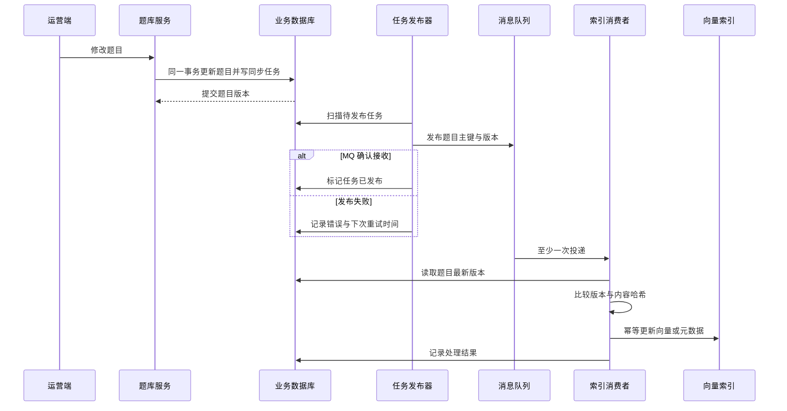
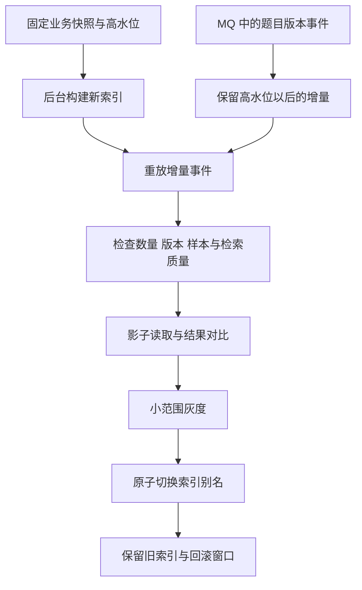

# 向量索引怎样和业务数据保持一致

[← 知识工程与内容生产](README.md)

向量检索接入业务以后，很快就会遇到一个朴素的问题。业务数据库里的题目已经改了，向量库里还是旧内容。题目已经禁用，拍照搜题仍然能把它找出来。换一个向量模型需要重算全库，线上搜索还不能停。

这些问题靠一个定时脚本很难长期解决。系统要先确认哪份数据算数，再设计增量更新、全量重建、删除和回滚。

## 业务数据库保留最终事实

题库可以用向量库检索，向量库不适合成为题库唯一的事实源。题干、选项、答案、解析、原图、试卷位置、审核状态和修改历史仍然放在业务数据库或文档存储里。这些数据能够回答题目当前是否生效，某次修改是谁做的，以及过去的版本是什么。

向量库保存的是一份可重建索引。它帮搜索服务快速找候选题或知识片段，不独立决定业务状态。查询返回候选项以后，普通服务还要根据业务主键确认它没有被禁用，版本也没有过期。

每个向量点至少要能找回下面这些信息。

| 字段 | 用途 |
| --- | --- |
| `entity_id` | 业务对象的稳定主键 |
| `entity_version` | 拒绝迟到的旧更新 |
| `content_hash` | 判断内容是否需要重新计算向量 |
| `embedding_model_version` | 说明向量来自哪个模型和配置 |
| `index_version` | 区分不同批次的索引结构 |
| `status` | 在物理删除前支持禁用过滤 |
| `source_locator` | 返回原题、文档页码或音频时间位置 |

向量点里的题干和元数据可以用来加速查询。完整原图、审计记录和所有历史版本没必要全部复制进去。复制的数据越多，同步越容易出现两份不同的真相。

## 一次修改先留下可补偿任务

单体题库和写入口可控的业务，不必先部署 CDC。题库服务可以在一个本地事务里同时修改题目并插入索引同步任务。事务失败，两项一起回滚。事务成功，即使服务来不及发送 MQ 就宕机，待处理任务仍然留在数据库里。

这种任务表也可以按 Outbox 理解。它保存已经发生的业务事件，发布器负责把事件送进 MQ。[Debezium 的 Outbox 文档](https://debezium.io/documentation/reference/stable/transformations/outbox-event-router.html)处理的是同一个一致性问题，Outbox 的发布器既可以轮询，也可以在复杂系统中使用 CDC。对于规模不大的题库，轮询任务表更容易开发和排障。

同步任务不要只保留一个 `is_synced`。一道题连续修改两次时，旧任务可能在新任务之后完成，再把布尔值改成成功。这个状态无法说明向量库里究竟是哪一个版本，也装不下多个索引或多个向量模型的进度。

| 字段 | 用途 |
| --- | --- |
| `task_id` | 去重并追踪一次同步任务 |
| `entity_id` | 找回题目或知识片段 |
| `entity_version` | 拒绝迟到的旧任务 |
| `event_type` | 区分新增、修改、禁用和删除 |
| `status` | 记录待发布、已发布、处理中、成功或失败 |
| `retry_count` | 控制重试次数 |
| `next_retry_at` | 避免失败任务立即反复抢占资源 |
| `last_error` | 给排障与人工处理留下依据 |

索引消费者先比较 `entity_version`。相同版本重复到达可以直接返回，版本更旧就忽略，版本更新才继续。题干、选项以及被纳入 embedding 的答案或解析发生变化时，`content_hash` 会改变，需要重新生成向量。来源、页码、审核状态和上下架状态只变更元数据时，可以跳过模型调用。

最后使用 upsert，也就是同一主键存在时更新、不存在时新增。删除事件可以用 tombstone 表示。tombstone 是一条带业务主键和版本的删除标记，消费者重放它时也不能删掉更新版本。

| 场景 | 更合适的实现 |
| --- | --- |
| 单体题库，写入口可控 | 本地事务任务表、MQ 与补偿扫描 |
| 已经稳定使用 [RocketMQ 事务消息](https://rocketmq.apache.org/docs/featureBehavior/04transactionmessage/) | 事务消息、事务回查与幂等消费 |
| 多个旧系统共同写库，难以逐一改造 | CDC 捕获变化后进入 MQ |
| 数仓、搜索等多个下游需要同一变化流 | CDC 与统一事件总线 |
| 首次建库或切换向量模型 | 业务快照、增量重放与新旧索引切换 |

[CDC 怎样捕获数据库变更](../data-foundation/cdc-change-capture.md)会单独讨论日志位点、快照、事务边界和结构变更。无论采用哪种入口，MQ 投递、模型推理和向量写入都可能失败。系统仍然需要幂等消费、失败重试和定期对账。

## 全量处理要构建一份新索引

历史数据首次入库、切换向量模型、修正大批量清洗规则时，系统需要重建全量索引。直接在线上集合里一边删一边写，用户会在几个小时或几天内看到一份半新半旧的索引。一旦清洗规则有问题，原来能搜到的题也已经没有了。

更稳妥的做法是固定一个业务快照和高水位。高水位是这份快照已经包含的最新题目版本或事件位置。全量任务用快照在后台构建新集合，线上业务继续写入，高水位以后的 MQ 事件被另行保留。全量构建结束后，再把这些增量事件按版本重放到新集合。

新索引的验收不能只比数量。系统还要比较业务版本、内容哈希、状态分布和抽样内容，再用同一份标注查询集对新旧索引跑检索评测。影子读取会同时查询新旧索引，只把旧结果返回给用户，新结果用于线下比较。差异最大的查询要进入人工检查。

Qdrant 是一个开源向量搜索引擎。这里用它举例，因为它的[集合别名](https://qdrant.tech/documentation/manage-data/collections/#collection-aliases)可以原子地从旧集合切换到新集合。它公开的[向量模型迁移流程](https://qdrant.tech/documentation/tutorials-operations/embedding-model-migration/)也采用新旧集合并行、增量双写和切换后保留回滚能力的做法。系统可以使用其他向量数据库，新旧索引分开构建这条原则没有变。

切换后的观察期也要处理新增改动。系统可以暂时保持新旧索引双写，也可以完整保留切换后的变更日志，在回滚前重放给旧索引。只保留一份静止的旧集合，几小时后它就可能落后于业务数据，不能直接承接线上流量。

全量任务要批量读取、调用向量模型并构建索引，很容易抢走线上查询需要的 CPU、内存、网络和模型配额。后台任务需要限速，记录可恢复的处理进度，并与线上请求使用不同的资源队列。线上延迟或错误率超过运行阈值时，全量任务先降速或暂停。

## 去重以前先定义什么算同一道题

一道“计算机中最小的数据单位是 bit 还是 byte”的题，可能同时出现在教材、模拟卷和历年试卷里。题干和答案一样，不代表这几个业务记录可以合并成一条。拍照搜题还需要返回用户拍下的那张试卷图片、页码和当次考试的解析。

题库可以把数据拆成两层。题目实例保留某道题在某份资料中的出现位置，标准题保留经过审核的通用题干、答案与解析。多个题目实例可以关联到同一个标准题，原来的来源记录仍然存在。

| 判断结果 | 业务处理 |
| --- | --- |
| 同一题目实例的新版本 | 保留主键，提升版本并更新索引 |
| 同题出现在不同试卷 | 保留多个题目实例，关联同一标准题 |
| 数值、选项或条件发生变化 | 保留独立标准题，建立变式关系 |
| 只有考查知识点相同 | 标记同知识点，不复用标准答案 |
| 内容无关 | 不建立题目关系 |

去重流程先生成候选对。系统对题干、选项和答案做有限归一化，去掉明确的 OCR 噪声和排版差异，然后用内容哈希找完全一致的候选。近似题可以结合关键词、字符或词序列的 shingle、文本向量和图片向量。[Stanford 信息检索教材的近重复检测章节](https://nlp.stanford.edu/IR-book/html/htmledition/near-duplicates-and-shingling-1.html)介绍了用 shingle 与 Jaccard 重叠筛选近似文档的方法。

这些方法只能把海量组合缩小成可处理的候选集。选项顺序变了、公式符号识别错了、题干少了一个否定词，向量都可能给出过高的相似分。最终规则需要由业务整理，边界候选由人工复核。复核写入题目关系和标注依据，不直接删除原始题目。

## 逻辑删除与向量物理删除分开

业务数据库可以保留逻辑删除标记，向量库删除一个点以后，恢复通常需要依赖快照或从业务数据重建。两边的删除节奏可以分开。

题目被禁用或逻辑删除时，业务库先提交新状态并产生 tombstone 事件。索引器把向量点改成不可检索，查询层的状态过滤立即生效。经过保留期与对账，再分批做物理清理。需要立即彻底删除的合规请求优先执行，同时要按数据保留政策处理快照与备份。

大批量去重也遵守同样的节奏。系统先在临时结果集中标记建议合并的标准题与建议关联的题目实例，人工抽样与复核通过后，再生成新的关系和索引。旧数据和旧索引继续保留，不用一次全量脚本把回退道路一起清理掉。

[Qdrant 的快照文档](https://qdrant.tech/documentation/snapshots/)展示了集合数据与索引配置如何保存和恢复。快照属于灾难恢复手段，业务数据仍然要能独立重建向量。只有快照而没有原文、模型版本和清洗配置，后续更换模型时仍然无法完整重建。

## 反馈由独立系统复核

拍照搜题页的“没有搜准”、学生手动选中的真实原题和无结果查询都会产生反馈事件。这些信号只说明当前结果值得检查。学生可能误点，模型也可能在证据不足时给出看似合理的候选，反馈不能直接改写业务数据库或线上向量。

独立的数据反馈系统负责去重、抽样、人工复核和数据集管理。复核人员确认标准原题、题目关系与修正理由以后，正式修正先写回业务数据库，再由本篇介绍的同步流程更新索引。这样每次线上变化都能追到一条业务修正记录。

困难样本怎样进入固定回归集、滚动困难集或训练数据分区，详见[数据反馈怎样进入评测与迭代](../data-foundation/data-feedback-evaluation.md)。向量同步系统只接收审核后的业务版本，不承担标注平台与评测平台的职责。

## 运行中持续对账

一次迁移通过，不代表两份数据以后一直一致。运行监控至少要看事件积压量、同步水位延迟、重试与死信数量、版本冲突、tombstone 积压、业务记录与向量点数量差异。搜索侧继续看无结果比例、原题误命中、不可用数据被返回的次数和查询延迟。

对账任务发现差异时，根据业务主键读取最新版本，再生成一次可重放的修复事件。不要在对账脚本里现场推测哪边更正确。业务数据库已经给出了答案，向量索引跟着它重建即可。

向量库让搜索跟上了语义，也多了一份需要维护的派生状态。把业务主键、任务版本、删除事件和全量水位连在一起，系统才能在更换模型、重做全量数据和修正去重规则时，继续服务线上用户。
