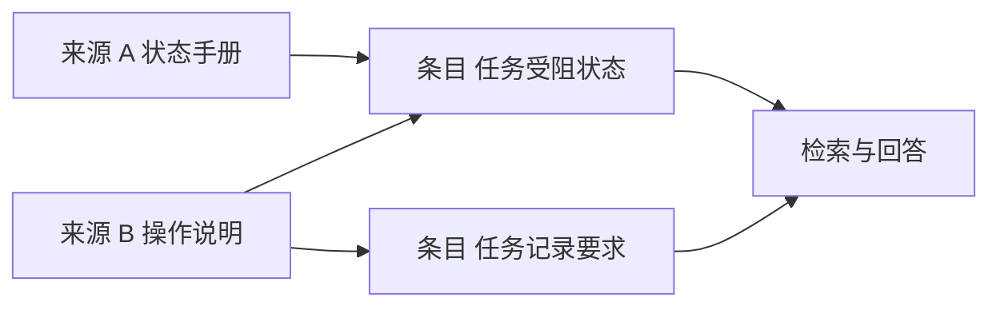

# Wiki 式知识编译与增量维护

[← 知识工程与内容生产](README.md) · [AI Agent 学习路线](../../agent-learning-path/README.md)

同一个问题的答案可能散落在几份资料里。状态手册定义 `blocked` 的含义，操作说明写着如何记录阻塞原因，补充通知又调整了适用范围。Agent 每次直接检索原文，可以找到材料，却不一定容易看清这些文件之间的关系。

一种做法是把获准使用的资料整理成可维护的知识条目。每个条目围绕一个明确主题组织内容，保存它来自哪些资料、适用于什么范围，以及什么时候需要重新核对。这里把这种组织方式称为 Wiki 式知识编译，不限定必须使用某个 Wiki 软件。

本文使用虚构的任务状态规则说明设计。资料、版本和条目都是教学示例，不代表某个实际企业的制度。

## 从源材料整理一条知识

假设系统收到两份已获授权的材料。

| 材料 | 内容 | 标识 |
|---|---|---|
| 任务状态手册 | 定义 `blocked` 表示当前无法继续推进 | 来源 A，版本 v2 |
| 操作说明 | 任务受阻时记录原因 | 来源 B，版本 v1 |

知识编译服务可以生成一条“任务受阻状态”的候选条目，将两个事实放在一起，并分别标注来源。

```md
# 任务受阻状态

## 状态含义

blocked 表示任务被外部条件阻碍，当前无法继续推进。
依据：来源 A，v2，章节 3.2。

## 处理要求

任务进入 blocked 状态时，应记录阻碍原因。
依据：来源 B，v1，章节 2.1。
```

这里的条目是演示内容。系统还需要保存条目编号、状态、适用范围、维护人、生成或修订时间，以及每条事实对应的源文件版本和位置。条目可以由模型生成草稿，正式发布前按业务风险安排检查；模型写得通顺不能证明事实正确。

来源记录有一个实际用途。当读者问“为什么要记录原因”，可以回到来源 B 的具体位置。W3C 的 [PROV 模型概览](https://www.w3.org/TR/prov-overview/)讨论了记录数据、生成活动和参与者之间的来源关系。应用可以借鉴来源关系的思想，不必为了一个小系统直接实现完整模型。

## 条目和源文档要能双向查找

每个条目需要知道自己引用了哪些资料；反过来，资料发生变化时，也要能找到依赖它的条目。这种对应关系可以存在数据库或文档元信息中。



例如来源 B 的记录要求发生变化，系统沿着依赖关系就能找到两个受影响条目。依赖可以细化到章节或字段，也可以先按文件粒度管理。粒度越细，定位越准确，但维护成本也会增加。

编译条目和[原文 RAG 检索](../../agent-learning-path/rag-evidence-and-answers.md)可以同时存在。条目便于理解跨文件的知识关系；用户需要核对依据时，仍应能回到允许访问的源材料。条目不是新的权威来源，发生矛盾时要检查其依据和适用范围。

## 更新只处理受影响的内容

假设来源 B 的版本从 v1 更新到 v2，新的操作说明改变了记录要求。一条可行的增量维护流程如下。

1. 发现来源 B 的新版本，保存来源标识、版本和变化范围；无法可靠定位变化时，先按整份来源确定影响范围。
2. 查找依赖来源 B 的条目，将它们标记为待核对。
3. 在已授权的范围内读取新旧材料，生成变更说明和修订候选。
4. 检查每个结论是否仍有依据；需要业务判断时交由维护人审核。
5. 审核通过后发布新条目版本，并更新其依赖和检索索引。

重复收到同一版本的更新通知时，应能识别并避免重复发布。处理过程中如果来源 B 再次更新，发布前需要检查候选依据是否仍是当前版本；否则基于旧材料生成的草稿可能覆盖刚更新的事实。可以使用版本比较等方式发现这种竞争，重新生成或审核。

条目已经发布、索引尚未更新时，检索可能仍命中旧版本。读取时需要校验权威条目状态；索引更新、重试和对账可以复用[向量索引同步设计](vector-index-lifecycle.md)，不需要在知识编译服务中重新实现一套索引生命周期。

## 冲突、失效和权限变化怎么处理

两份来源看起来矛盾时，先检查适用对象、生效时间和版本。它们可能分别适用于不同范围，也可能确实存在尚未解决的冲突。无法判定时把冲突留在待审核状态，不能让模型自行把两个不同要求合成一个新规则。

来源撤回或下架时，先更新权威状态，让读取入口拒绝返回受影响的结论，并标记条目待核对。索引和缓存异步更新期间，读取路径仍要检查当前状态与权限；查不到权威状态时按受限处理。已经生成的条目、检索索引、缓存与引用链接都要清理或刷新。确需删除的内容按保存策略处理历史版本和备份；“下线”与“彻底删除”需要分别设计。

多来源条目的权限尤其容易出错。来源 A 对所有项目成员开放，来源 B 只允许部分维护人访问时，不能把 A 和 B 的内容合并后默认开放给所有成员。应用应对条目中各项内容分别校验来源授权，或为整篇条目采用能满足全部来源限制的访问范围。权限变化需要触发失效处理，不能只依赖索引里的旧权限标签。

维护人员也可能直接修改条目。修订应保留修改人、版本与依据，并明确哪些内容仍由源资料支撑。若人工增加一条没有来源的经验，应标注其身份和审核状态，不能伪装成来自原文的正式规则。

## 不必让每次提问都重新编译

知识编译发生在资料进入和更新时，读者提问时则检索已经审核发布的条目或原文。这样能把维护工作和在线问答分开，也方便复用同一条目。遇到小规模、变化频繁的资料，直接查询原始数据可能更省事；编译只在整理后的关系确实能帮助使用和维护时才值得做。

编译系统与数据反馈系统也可以对接。用户指出某条知识过期后，反馈进入待核对队列；维护人员确认问题，再更新来源、条目或评测集。反馈本身不自动成为事实。

## 怎样验收一条知识

| 情况 | 应检查的行为 |
|---|---|
| 新来源进入 | 条目能定位来源版本和具体位置 |
| 一份来源更新 | 所有依赖它的条目进入待核对 |
| 更新通知重复或乱序 | 不重复发布，旧版本不能覆盖新依据 |
| 两份来源冲突 | 保留冲突与适用范围，按规则审核 |
| 源资料权限收紧 | 不再向无权用户返回受限结论或缓存 |
| 模型引用不存在的章节 | 拒绝作为有效依据，交给审核处理 |
| 原文下架 | 检查条目、索引、缓存和引用是否仍可访问 |
| 发布前来源再次变化 | 检出版本变化，重新核对候选 |

这些是设计与验收建议，没有在真实企业知识库中执行。日常评测可以持续加入资料过期、冲突和权限变更的样本，检查条目能否追溯到正确依据，也检查用户是否仍能找到被限制访问的内容。
